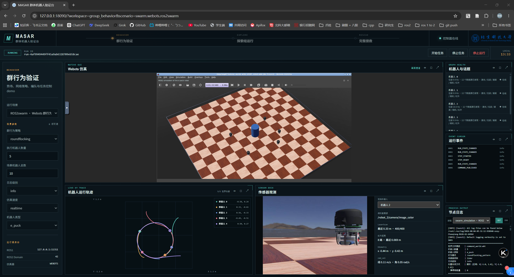
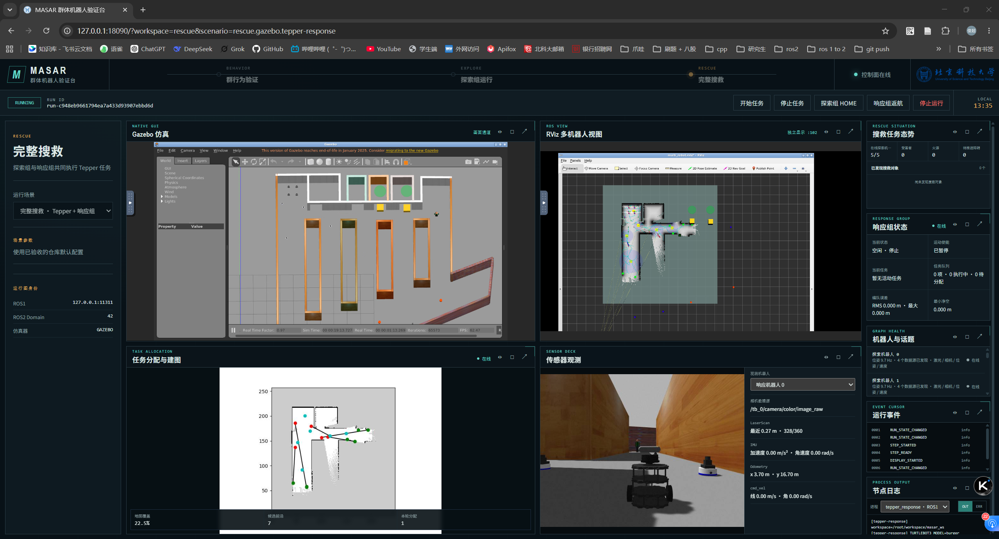
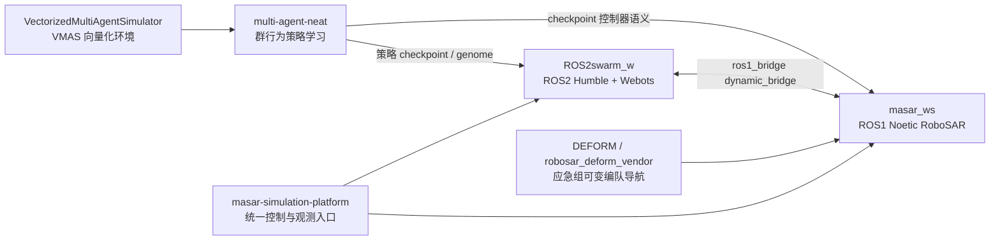

# 多智能体群行为与搜救仿真工作区

本 README 是整个 workspace 的导航页，覆盖训练环境、群行为仿真、搜救系统、统一平台
和参考工程。各子项目仍保留自己的依赖、脚本和独立运行方式；需要统一操作与观测时，
再由 `masar-simulation-platform` 组合 `ROS2swarm_w` 与 `masar_ws`。

本工作区把“群行为策略学习”和“机器人仿真验证”放在同一个工程视角下组织：

- `multi-agent-neat` 负责在 VMAS 向量化多智能体环境中训练和评估群行为策略，重点是 Pure-NEAT 与 EA-RL warmup 等学习算法。
- `VectorizedMultiAgentSimulator` 是 `multi-agent-neat` 训练和评估使用的 VMAS 向量化环境代码，主要作为上游开源环境依赖，不是当前工作的主要开发对象。
- `ROS2swarm_w` 负责把群行为策略落到 ROS2 Humble + Webots 的 3D 物理仿真中验证，包括势场/规则策略和从 VMAS/NEAT 训练得到的策略。
- `masar_ws` 负责未知环境下的多智能体搜救系统，保留 RoboSAR 的搜索、SLAM、任务生成、任务分配、导航、控制和 GUI 主链路，并扩展 Gazebo/Webots 验证、ROS1-ROS2 桥接和应急响应组能力。
- `masar-simulation-platform` 是上述 ROS1/ROS2 仿真的统一 Web 控制与观测入口，按“群行为验证、探索组运行、完整搜救”三个模块组织场景。
- `DEFORM` 是可变编队导航的参考/上游工作区；`masar_ws` 内当前使用的是 `src/robosar_deform_vendor` 里的 ROS1 vendor 拷贝。

## 目录说明


| 目录                                                                         | 定位                         | 主要内容                                                                                      |
| -------------------------------------------------------------------------- | -------------------------- | ----------------------------------------------------------------------------------------- |
| [multi-agent-neat](https://github.com/ustbmicl-ros2epucksRL/multi-agent-neat/blob/main/README.md) | 独立 Git 仓库，作为本工作区的学习算法子模块索引 | VMAS 任务上的 Pure-NEAT、EA-RL、warm-start EA-RL、BenchMARL/heuristic baseline、结果分析与视频导出         |
| [VectorizedMultiAgentSimulator](VectorizedMultiAgentSimulator/README.md) | VMAS 开源环境                  | PyTorch 向量化 2D 多智能体仿真器，为 `multi-agent-neat` 提供 `flocking`、`transport` 等训练/评估环境            |
| [ROS2swarm_w](ROS2swarm_w/README.md)                                     | ROS2 + Webots 群行为验证        | Webots 场景、`robot_N` 节点、e-puck/Burger 支持、ROS2swarm 行为策略、NEAT/VMAS 策略加载、RoboSAR Webots 桥接适配 |
| [masar_ws](masar_ws/README.md)                                           | ROS1 RoboSAR 搜救系统          | 多机器人 SLAM、任务生成、任务分配、导航控制、GUI、Gazebo 搜救闭环、Webots 桥接闭环、应急响应组与 DEFORM 集成                     |
| [masar-simulation-platform](masar-simulation-platform/README.md) | 统一仿真验证与可视化平台 | React 工作台、运行编排 API、Gazebo/Webots/RViz noVNC、ROS Web sidecar 和运行归档 |
| [DEFORM](DEFORM/)                                                        | 可变编队导航参考项目                 | ROS1 Noetic 下的多机器人可变编队规划与局部避障参考实现                                                         |

## 统一平台快速开始

`masar-simulation-platform` 已完成 ROS1/ROS2 业务容器、Web 数据面、仿真显示、运行
编排和前端入口的 Compose 收口。三个项目保持同级目录即可，宿主机绝对路径不固定：

```text
<workspace>/
├── masar-simulation-platform/
├── masar_ws/
└── ROS2swarm_w/
```

目标设备具备 Docker Compose v2、NVIDIA 驱动与 Container Toolkit、X11、`/dev/dri`
和可读 `.Xauthority` 后，执行一个命令：

```bash
cd <workspace>/masar-simulation-platform
make docker-start
```

首次执行会复用或拉取公开的 ROS1/ROS2 v2 运行环境镜像，并在缺少 overlay 时自动
运行 `catkin_make` 和 `colcon build`。启动完成后访问 `http://127.0.0.1:18090`。
远程服务器只需配置一条 SSH 转发，浏览器地址保持不变：

```sshconfig
LocalForward 18090 127.0.0.1:18090
```

平台提供六个受限场景，归入群行为与控制验证、探索组独立运行、完整搜救三个模块。
一次 Run 包含该场景的全部业务、仿真、RViz 和录制进程；页面停止会关闭整个 Run，
但保留 8 个常驻 Compose 服务供下一次运行。关闭整个平台使用 `make docker-stop`。

完整命令、首次构建、远程访问与排障见
[平台使用与运维手册](masar-simulation-platform/docs/OPERATIONS.md)。

这是统一平台的启动入口，不是整个 workspace 的唯一运行方式。训练项目和两个 ROS
业务项目都可以按各自 README 独立运行；平台不会替代它们原有的脚本或 Qt GUI。

## 平台界面预览

统一平台使用同一个浏览器入口覆盖不同验证模块。群行为验证界面集中展示 Webots
仿真、世界坐标轨迹、按机器人切换的传感器观测、ROS 图健康状态和运行日志：



完整搜救界面同时展示 Gazebo、RViz、任务分配与建图、探索态势、响应组状态、机器人
传感器和节点日志，便于从搜索组发现任务到响应组执行任务进行整体观测：




## 总体关系




学习链路先在 VMAS 中用大规模并行环境快速获得群行为策略，再把策略带到 Webots/Gazebo 中做物理仿真验证。ROS1 的 RoboSAR 主链路负责未知环境搜索救援任务，ROS2 侧主要承担 Webots 机器人仿真和桥接适配。

## 运行环境

| 子系统 | 当前推荐环境 | 说明 |
|---|---|---|
| `masar-simulation-platform` | Docker Compose v2 + NVIDIA/X11 | 单一入口管理 8 个常驻服务；宿主机不要求安装 ROS、Node.js 或平台 Python 依赖 |
| `ROS2swarm_w` | `talent18/masar_ros2_bridge-w:v2` | 镜像提供 ROS2 Humble、Webots 和桥接依赖；可独立运行，平台 Compose 以固定 digest 复用该镜像 |
| `masar_ws` | `talent18/masar_ros1_srv-g:v2` | 镜像提供 ROS1 Noetic、Gazebo 和系统依赖；可独立运行，平台 Compose 以固定 digest 复用该镜像 |
| `multi-agent-neat` | 项目自身 Python/PyTorch 环境 | 训练流程尚未接入统一平台，按其独立 README 创建环境 |
| `VectorizedMultiAgentSimulator` | Python + PyTorch | `multi-agent-neat` 使用的 VMAS 环境源码依赖 |

两个 ROS 镜像只提供运行环境和系统依赖，当前工作区以读写挂载进入容器，因此修改
`masar_ws` 或 `ROS2swarm_w` 源码不需要重新制作业务镜像。首次平台启动会自动生成
缺失的 `masar_ws/devel` 与 `ROS2swarm_w/install`，后续直接复用宿主目录中的结果。

## 双容器 Webots 桥接

Webots 搜救闭环采用 ROS1/ROS2 双容器架构：


| 侧      | 工作区           | 主要职责                                                                                                                         |
| ------ | ------------- | ---------------------------------------------------------------------------------------------------------------------------- |
| ROS2 侧 | `ROS2swarm_w` | 启动 Webots、生成 `robot_N` 机器人节点、发布 scan/odom/TF、运行 `robosar_bridge_adapter`、启动 `ros1_bridge dynamic_bridge --bridge-all-topics` |
| ROS1 侧 | `masar_ws`    | 启动 RoboSAR 原有任务流，包括 SLAM、任务生成、任务分配、导航、控制、多机器人 GUI                                                                            |


统一平台会按场景 manifest 自动保证“ROS2 Webots 先就绪、ROS1 RoboSAR 后启动”，
并在停止时逆序关闭。只有调试原项目独立入口时才需要手工进入两个 Compose runtime：

```bash
# 确认平台没有活动 Run 后，分别打开两个终端
docker exec -it masar_ros2_bridge-w bash
cd /root/workspace/ROS2swarm_w
./start_robosar_webots.sh

docker exec -it masar_ros1_srv-g bash
cd /root/workspace/masar_ws
./launch_robosar_w.sh
```

桥接设计要点见 [ROS2swarm_w/docs/robosar_webots_bridge_plan.md](ROS2swarm_w/docs/robosar_webots_bridge_plan.md)。当前 `masar_ros2_bridge-w` 容器已经包含 ROS1/ROS2 桥接能力，运行时由 `start_robosar_webots.sh` 启动 `ros1_bridge dynamic_bridge --bridge-all-topics`。关键约束是：两侧统一使用 Webots `/clock`，ROS1 侧保留 RoboSAR 话题和节点组织，ROS2 侧保留 Webots/ROS2swarm 的 `robot_N` 命名，命名映射与 TF 适配集中在 `robosar_bridge_adapter.py` 中。

核心话题映射：


| 方向  | ROS2 Webots 侧                                 | ROS1 RoboSAR 侧                                      |
| --- | --------------------------------------------- | --------------------------------------------------- |
| 激光  | `/robot_N/scan`                               | `/robosar_agent_bringup_node/agent_N/feedback/scan` |
| 里程计 | `/robot_N/odom`                               | `/robosar_agent_bringup_node/agent_N/odom`          |
| 控制  | `/robosar_agent_bringup_node/agent_N/cmd_vel` | `/robot_N/cmd_vel`                                  |


## 主要工作流

### 1. VMAS 策略学习与评估

`multi-agent-neat` 在 `vmas/flocking` 和 `vmas/transport` 等任务上比较：

- Pure-NEAT recurrent / feed-forward。
- EA-RL cold start。
- Pure-NEAT warm-start 后的 EA-RL，当前 dashboard 选择口径为 `rec + layerwise + 50 gen`。
- heuristic 与 BenchMARL baseline。

常用入口（训练环境按 `multi-agent-neat` 自身 README 创建）：

```bash
cd multi-agent-neat
conda activate NEAT-ROBO

# 单次实验、链路验证或 debug
python train.py ...

# 统一 benchmark 和结果分析说明
less benchmark/README.md

# 重新生成 transport dashboard
python benchmark/analysis/ea_rl_warmup_dashboard.py \
  --task vmas/transport \
  --warmup-generations 10 30 50 70 \
  --budget-frames 362400000
```

更多训练、baseline、视频导出说明见 [multi-agent-neat/benchmark/README.md](https://github.com/ustbmicl-ros2epucksRL/multi-agent-neat/blob/main/benchmark/README.md)。

### 2. Webots 群行为验证

`ROS2swarm_w` 在 ROS2 Humble + Webots 中实现/验证多种群行为策略：

- 规则或势场类策略：aggregation、attraction、dispersion、drive、magnetometer、minimalist flocking、navigation、random walk、rat search、round flocking、transport 等。
- 学习策略：`navigation_pattern_neat`、`roundflocking_pattern_neat`、`transport_pattern_neat` 等，从 VMAS/NEAT 训练产物加载策略。
- RoboSAR 桥接：`launch_webots` 包负责 Webots 场景、机器人节点、地图上下文、`robosar_bridge_adapter` 和 ROS1/ROS2 bridge 运行。

策略演示视频已放在 [ROS2swarm_w/videos/movement_patterns/basic](ROS2swarm_w/videos/movement_patterns/basic/)：

- [navigation_pattern_neat.mp4](ROS2swarm_w/videos/movement_patterns/basic/e_puck/navigation_pattern_neat.mp4)
- [roundflocking_pattern_neat.mp4](ROS2swarm_w/videos/movement_patterns/basic/e_puck/roundflocking_pattern_neat.mp4)
- [transport_pattern_neat.mp4](ROS2swarm_w/videos/movement_patterns/basic/e_puck/transport_pattern_neat.mp4)
- [minimalist_flocking_pattern.mp4](ROS2swarm_w/videos/movement_patterns/basic/e_puck/minimalist_flocking_pattern.mp4)

### 3. RoboSAR 搜救系统与应急响应

`masar_ws` 保留 RoboSAR 原有未知环境搜救主链路。以下脚本可在 ROS1 容器内独立
运行；统一平台调用的是同一组入口脚本：

```text
SLAM / 地图
-> frontier 与 coverage 任务生成
-> 任务分配
-> 导航规划
-> 多机器人控制
-> GUI 监控与任务启动
```

Gazebo 搜救闭环入口：

```bash
cd masar_ws
./launch_robosar_g.sh
```

Webots 桥接搜救闭环入口：

```bash
cd masar_ws
./launch_robosar_w.sh
```

应急响应组/DEFORM demo 入口：

```bash
cd masar_ws
./run_response_deform_demo.sh
```

应急组当前目标是让搜索组发现 victim/fire/box 等应急对象后，生成应急任务；4 台 TurtleBot 响应组接单后通过 DEFORM 风格可变编队导航到 staging pose，再切换到任务控制器。详细设计见 [masar_ws/docs/ROBOSAR_DEFORM_INTEGRATION_DESIGN.md](masar_ws/docs/ROBOSAR_DEFORM_INTEGRATION_DESIGN.md)。

未知环境下搜救策略已有部分演示视频放在 [masar_ws/videos](masar_ws/videos/)：

- [launch_robosar_g.mp4](masar_ws/videos/launch_robosar_g.mp4)：ROS1 + Gazebo/Tepper 搜救主系统启动与运行演示。
- [launch_robosar_w.mp4](masar_ws/videos/launch_robosar_w.mp4)：ROS1 + Webots 桥接搜救闭环启动与运行演示。

## 当前结果与展示

### VMAS 算法结果

`multi-agent-neat` 是独立 Git 子模块，GitHub 上的结果链接会跳转到子模块仓库查看。当前 [`multi-agent-neat/results/analysis`](https://github.com/ustbmicl-ros2epucksRL/multi-agent-neat/tree/main/results/analysis) 已包含 flocking 与 transport 的结果图、CSV、dashboard 和视频索引。


| 任务               | 最佳/当前选中策略                                | 结果摘要                                                                                | 入口                                                                                                                                                                                                                                              |
| ---------------- | ---------------------------------------- | ----------------------------------------------------------------------------------- | ----------------------------------------------------------------------------------------------------------------------------------------------------------------------------------------------------------------------------------------------- |
| `vmas/flocking`  | EA-RL warmup, `rec + layerwise + 50 gen` | 6 seeds，Final IQM `-24.486`；相对 heuristic 提升 `38.896%`，相对 Pure NEAT rec 提升 `10.991%` | [算法对比](https://github.com/ustbmicl-ros2epucksRL/multi-agent-neat/blob/main/results/analysis/flocking/algorithm_training_comparison.md), [训练曲线](https://github.com/ustbmicl-ros2epucksRL/multi-agent-neat/blob/main/results/analysis/flocking/algorithm_training_comparison.png), [视频索引](https://github.com/ustbmicl-ros2epucksRL/multi-agent-neat/blob/main/results/analysis/flocking/video_index.md)    |
| `vmas/transport` | EA-RL warmup, `rec + layerwise + 50 gen` | 6 seeds，Final IQM `79.642`；相对 heuristic 提升 `3.521%`，相对 Pure NEAT rec 提升 `44.221%`   | [算法对比](https://github.com/ustbmicl-ros2epucksRL/multi-agent-neat/blob/main/results/analysis/transport/algorithm_training_comparison.md), [训练曲线](https://github.com/ustbmicl-ros2epucksRL/multi-agent-neat/blob/main/results/analysis/transport/algorithm_training_comparison.png), [视频索引](https://github.com/ustbmicl-ros2epucksRL/multi-agent-neat/blob/main/results/analysis/transport/video_index.md) |


可视化结果还包括：

- [flocking warmup 配置热力图](https://github.com/ustbmicl-ros2epucksRL/multi-agent-neat/blob/main/results/analysis/flocking/warmup_selection_heatmap.png)
- [flocking 最优策略轨迹](https://github.com/ustbmicl-ros2epucksRL/multi-agent-neat/blob/main/results/analysis/flocking/best_policy_trajectory.png)
- [flocking 最优策略时间线](https://github.com/ustbmicl-ros2epucksRL/multi-agent-neat/blob/main/results/analysis/flocking/best_policy_timeline.png)
- [transport warmup 配置热力图](https://github.com/ustbmicl-ros2epucksRL/multi-agent-neat/blob/main/results/analysis/transport/warmup_selection_heatmap.png)
- [transport 最优策略轨迹](https://github.com/ustbmicl-ros2epucksRL/multi-agent-neat/blob/main/results/analysis/transport/best_policy_trajectory.png)
- [transport 最优策略时间线](https://github.com/ustbmicl-ros2epucksRL/multi-agent-neat/blob/main/results/analysis/transport/best_policy_timeline.png)

### Webots 行为视频

`ROS2swarm_w/videos` 中已有 Webots 物理仿真录屏，覆盖规则策略与学习策略：

```text
movement_patterns/basic/e_puck/aggregation_pattern.mp4
movement_patterns/basic/e_puck/dispersion_pattern.mp4
movement_patterns/basic/e_puck/navigation_pattern.mp4
movement_patterns/basic/e_puck/navigation_pattern_neat.mp4
movement_patterns/basic/e_puck/roundflocking_pattern.mp4
movement_patterns/basic/e_puck/roundflocking_pattern_neat.mp4
movement_patterns/basic/e_puck/transport_pattern.mp4
movement_patterns/basic/e_puck/transport_pattern_neat.mp4
movement_patterns/combined/e_puck/discussed_dispersion_pattern.mp4
voting_patterns/e_puck/majority_rule_pattern.mp4
```

完整列表见 [ROS2swarm_w/videos](ROS2swarm_w/videos/)。

### RoboSAR 与应急响应资料

`masar_ws/docs` 中保留系统设计、报告和集成说明：

- [ROBOSAR_DEFORM_INTEGRATION_DESIGN.md](masar_ws/docs/ROBOSAR_DEFORM_INTEGRATION_DESIGN.md)
- [TeamF_FinalReport.pdf](masar_ws/docs/TeamF_FinalReport.pdf)
- [TeamF_PDR.pdf](masar_ws/docs/TeamF_PDR.pdf)
- [robosar-基于图的多机器人快速搜索的覆盖与探索联合规划.pdf](masar_ws/docs/robosar-基于图的多机器人快速搜索的覆盖与探索联合规划.pdf)

## 开发与验证提示

直接调试 ROS 脚本前，先确认平台当前没有活动 Run。ROS2/Webots 侧可做 dry-run
检查命令和环境变量：

```bash
cd ROS2swarm_w
./start_robosar_webots.sh --dry-run
```

ROS1/RoboSAR 侧也提供 dry-run：

```bash
cd masar_ws
./launch_robosar_g.sh --dry-run
./launch_robosar_w.sh --dry-run
./run_response_deform_demo.sh --dry-run
```

如果运行 Webots 桥接闭环，建议固定顺序：先 ROS2 Webots + bridge，再 ROS1 RoboSAR。这样 ROS1 节点在 `/use_sim_time=true` 且 `/clock` 已桥接的前提下启动，可以减少 TF 时间外推和 scan 队列积压问题。
