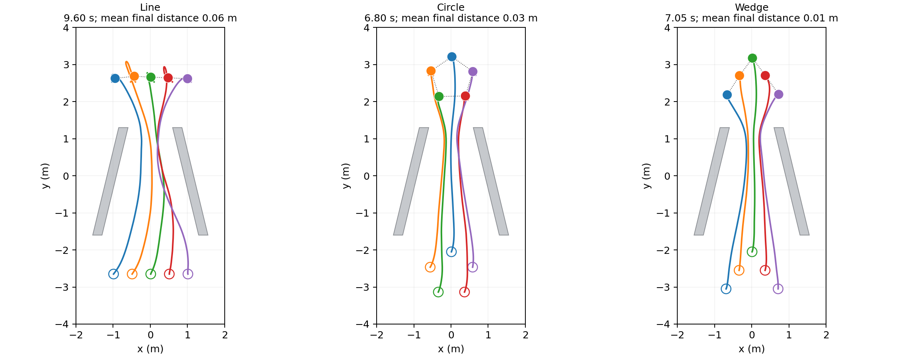

# 局部自主编队：原渐缩通道

本项目只维护一套方案：**局部观测 GRU actor + 独立任务 critic + 单流 PPO + 训练期局部制动辅助损失**。五台机器人共享本队形的策略，各自维护记忆。横排 `line`、圆形 `circle`、楔形 `wedge` 分别对应一份已经训练好的模型。

任务保持原双斜墙渐缩场景。策略输入为本机最终目标相对向量、速度、半径、2 m 激光和单跳邻居量测；途中队形调整由策略产生。开口宽度、全局阶段、航点和全地图不进入策略。

固定模型只在 1.20 m 开口训练；在 1.10–1.60 m 的六档开口复用同一组权重，三种队形合计 **1728/1728 成功**。这是原任务中已测开口的结果；三维仿真、实物及任意未知环境尚未验证。详见[算法方案与 AFOR 对比](docs/ALGORITHM.md)、[结果与收敛判断](docs/RESULTS.md)和[部署接口](deployment/README.md)。



## 目录

```text
afor/                  原始 AFOR 文献与发布代码，完整保留
src/afor_local/        唯一的训练、环境、策略、观测与评测实现
models/                三份固定 actor.pt 及模型身份清单
deployment/            可整目录复制的 TorchScript 模型、契约和本机控制器
tools/                 训练、宽度评测、导出验证与绘图入口
tests/                 当前方案的测试及原场景固定样本
docs/                  当前算法和实验结果说明
results/               保留的训练日志、原始评测、轨迹和图
runs/                  新训练和评测输出（运行时生成）
```

`models/<formation>/actor.pt` 和部署包中对应队形的 `actor.ts` 是同一策略的两种格式；`afor/` 是独立参考材料。项目内没有第二套活动训练实现，也不需要从 `results/` 加载冻结源码。

## 使用

从项目根目录执行，Python ≥3.11。已有环境可使用 `/home/zjc/anaconda3/envs/PPO-ROBO/bin/python`。

```bash
python -m pip install -e '.[dev]'
export OMP_NUM_THREADS=1 MKL_NUM_THREADS=1 OPENBLAS_NUM_THREADS=1
python -m pytest -q
```

**评测现有策略，无需重新训练：**

```bash
python tools/evaluate_narrowing_widths.py --output runs/widths
```

默认三种队形、六档开口、每档三个测试种子各 32 回合。同一队形始终加载 `models/<formation>/actor.pt`，不根据开口换模型。输出目录须为空。单模型评测与轨迹输出：

```bash
python -m afor_local.evaluate models/line/actor.pt --formation line \
  --passage-width 1.2 --episodes 32 --trajectory --output runs/line/report.json
python tools/plot_local_trace.py runs/line/report_narrowing_line_30001.pt \
  --output runs/line/trajectory.png --labels line
```

**如需重新训练：**每种队形运行一次；默认使用最终推荐配方、seed=2、500 次更新、每 50 次验证，不用测试集挑检查点。

```bash
python tools/train_policy.py --formation line --output runs/line_train
python tools/train_policy.py --formation circle --output runs/circle_train
python tools/train_policy.py --formation wedge --output runs/wedge_train
```

训练保存 `actor.pt`、`latest.pt`、配置、指标、验证历史及最终测试。精确续训要求源码、配置、设备一致，例如 `--resume runs/line_train/latest.pt --updates 600`。本次清理前的旧训练检查点与原源码已在外部归档；它们不能直接作为新包的精确续训检查点。已有最终 actor 可以直接推理，无需重训。

**部署：**复制整个 `deployment/`；控制器只依赖 NumPy、PyTorch。复核现有导出，或生成新的独立包：

```bash
python tools/validate_local_deployment.py --output runs/deployment_validation.json
python tools/export_local_deployment.py --output runs/deployment_bundle
```

训练与评测的新输出放在 `runs/`，不会覆盖保留的模型或历史证据。迁移清单和外部归档位置记录于 [results/provenance.json](results/provenance.json)，清理验证记录见 [results/cleanup_verification.json](results/cleanup_verification.json)。

## 消融实验

消融结果保存于 [results/ablations/](results/ablations/README.md)，包含完整方案、去制动损失、去邻居输入、共享价值编码器和去目标距离代价五组。每组在 1.20 m 开口训练，使用同一最终权重测试 1.1、1.2、1.3、1.4 m。实验入口为 `tools/run_ablation_study.py`，图表与汇总由 `tools/summarize_ablations.py` 生成。

已完成 45 次训练、17,280 个评测回合及完整性核验。局部制动损失的成功率差异最大；邻居输入、独立价值编码器和目标距离代价也显著影响横排表现。总结果和可视化见上述总结。
