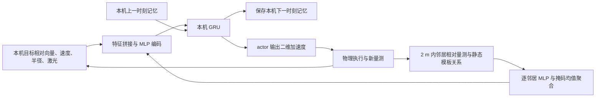
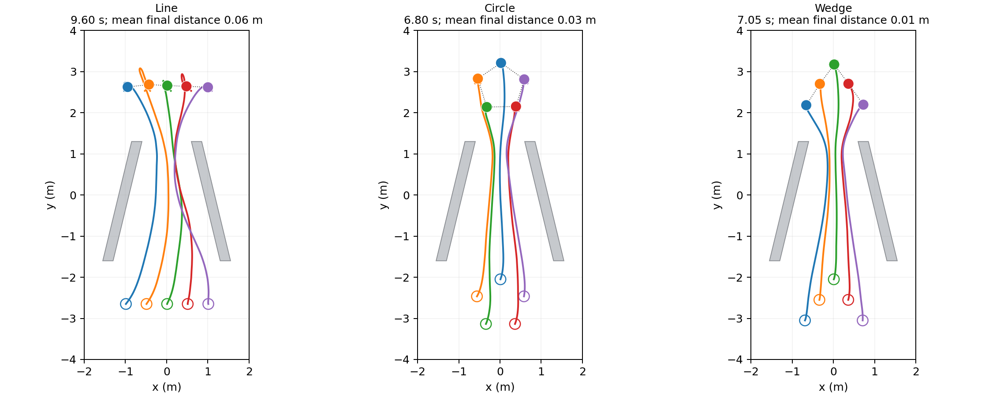

# 当前算法方案：基于局部观测的自主编队适应

本文对应当前唯一实现 `src/afor_local/` 和三份已交付策略，核对日期为 2026-10-20。运行方法见[项目 README](../README.md)，完整实验记录见 [RESULTS.md](RESULTS.md)。

当前方案可以概括为：**局部邻居特征聚合 + 带本机记忆的 GRU actor + 参数共享 PPO + 训练期局部制动辅助损失**。执行时，每台机器人根据自己的局部观测独立计算加速度；训练时，另一个独立的任务 critic 帮助估计回报。三种队形分别训练，队内共享权重。

## 1. 任务：通过渐缩通道，并恢复指定队形

五台机器人从给定队形出发，向各自的最终目标槽位运动。通道由两侧逐渐靠近的斜墙构成，机器人需要在通行过程中自主调整间距和相对位置，通过后恢复横排、圆形或楔形，并在终点停稳。

这里的“自主调整”包括何时减速、如何收缩或错开、何时恢复队形；环境不提供压缩比例、途中槽位、阶段切换或入口／出口航点。最终目标和原始队形是启动时已知的任务要求。

| 任务设置 | 当前定义 |
|---|---|
| 机器人 | 5 个半径 0.13 m 的全向平面圆盘，固定角色 0～4 |
| 场景 | 原双斜墙渐缩通道，场地 x∈[-2,2]、y∈[-4,4] m |
| 通道 | 斜墙从 y=-1.6 延伸至 y=1.3 m；入口内宽 2.6 m，墙厚按 x 方向为 0.25 m |
| 开口 | 在上端开口 1.20 m 训练；固定策略测试 1.10～1.60 m 六档开口 |
| 三种队形 | 横排 `line`、圆形 `circle`、楔形 `wedge`，分别使用一份 actor |
| 起终点 | 模板整体平移；起点中心 y∈[-2.8,-2.6]、终点中心 y∈[2.5,2.7] m，中心 x∈[-0.05,0.05] m |

**同一队形在不同开口使用同一份权重，不按开口重新训练。当前也不是一份网络任意切换三种队形。**

## 2. 要解决的核心问题

**局部信息下如何协调。** 单台机器人只能看到有限距离内的墙体和邻居，不能依赖全队完整状态来决定自己的运动；但其避障动作又会影响其他机器人及整体队形。

**通行与队形保持如何兼顾。** 始终强制维持原始几何形状会妨碍窄处通行；完全取消队形约束又可能使机器人只顾各自到达目标。因此，途中队形作为软偏好，最终队形作为成功验收条件。

**如何在碰撞前学会制动。** 只有碰撞后的负奖励，给 actor 的安全学习信号较间接。需要利用已有局部量测提供距离与接近速度相关的训练信号，同时保持执行接口简单。

**训练成功如何转化为可部署策略。** 如果训练依赖环境计算途中目标，或者执行依赖额外的避障控制器，就难以判断 actor 自己学到了什么。当前方案明确任务输入、传感输入、学习网络和评测职责，并通过对照实验判断保留机制的作用。

## 3. 整体流程

执行流程为：**获取本机量测与单跳邻居信息 → 聚合邻居关系 → 融合本机观测 → 更新本机 GRU 记忆 → actor 输出平面加速度 → 机器人运动并产生下一次观测。**



训练流程为：**带随机探索的 actor 采样 → 环境计算任务奖励 → 独立任务 critic 估计价值 → GAE 计算优势 → PPO 与局部制动损失共同更新 actor，价值回归更新 critic。** 最终只导出 actor。

例如，机器人接近渐缩段时，激光中的墙面距离逐渐减小，邻居量测反映队友的位置和运动。actor 根据这些输入及自身记忆调整加速度，形成减速、错开或收缩等行为；通过后仍以最终槽位和模板关系为依据恢复队形。网络没有单独输出“当前进入压缩阶段”或“压缩至某个比例”，这些中途调整体现在连续动作中。

物理环境提供传感器模拟、运动更新、奖励和成功／失败判定。全局物理状态可以用于计算奖励和验收，但不会因此成为 actor 或 critic 的观测。

## 4. 每台机器人看到什么、输出什么

### 4.1 局部观测

| 输入 | 维度 | 具体含义 |
|---|---:|---|
| 本机 `ego` | 5 | 最终目标相对 xy 向量除以 `max(目标距离,1)`、本机 xy 速度、半径 |
| 激光 `scan` | 32 | 全周 32 束、量程 2 m；机器人中心至首个表面的距离除以量程，包含其他机器人的遮挡 |
| 邻居 `neighbours` | 每个邻居 8 | 相对 xy 位置／2 m、相对 xy 速度、静态模板相对 xy 位移、编队边标志、邻居半径 |
| 邻居 `mask` | 每个候选邻居 1 | 只允许本机 2 m 内实际接收到的邻居，排除本机；无效填充值被屏蔽 |
| 本机记忆 | 64 | 本机上一次推理留下的 GRU 隐状态，新回合清零 |

“模板关系”指原始队形中两种角色应有的固定相对位移和连接关系，用于告诉网络要恢复什么队形。它不随通道宽度变化，也不是环境实时下发的变形指令。关系由邻居角色查询静态模板得到，无需接收邻居目标或隐状态。

邻居范围严格为中心距离小于 2 m；当前仿真按距离建立通信范围，**没有进一步要求视线无遮挡**。激光则模拟首个表面遮挡。部署时只能填写真实测得或收到的邻居数据，不能补入通信范围外的全队状态。

所有向量和射线使用同一个固定任务坐标系：+y 沿任务前进方向，+x 朝右，射线从 +x 逆时针排列。最终目标相对量可以由定位和目标相减得到；绝对位置本身不送入网络。这里仍需要目标、固定角色和方向标定，不能理解为机器人无需任何任务先验。

网络不接收全地图、开口宽度、全局阶段、途中航点、邻居目标和邻居记忆。对新环境的接口要求是提供上述任务输入与局部量测，而不是复现训练环境的阶段机。

### 4.2 动作与物理执行

actor 输出二维加速度，每轴范围为 ±1 m/s²。步长为 0.05 s，即 20 Hz；环境按以下方式更新：

```text
v_next = clip(v + 0.05 × a, -1, 1)
p_next = p + 0.05 × v_next
```

加速度与速度均按任务坐标轴分别限幅；速度向量模长不一定小于 1 m/s。训练时从高斯分布采样隐变量，再通过 tanh 得到动作；确定性执行时使用 `tanh(高斯均值)`。

部署控制器也可把同一加速度转换为上述积分得到的速度目标，交给平台底层跟踪器。该转换没有加入新的导航策略。**GRU 在训练和执行时都使用；局部制动损失仅在训练时使用。**

## 5. 网络如何实现局部编队协调

### 5.1 单跳邻居聚合：表达周围机器人关系

每个收到的邻居先经过共享 MLP：`8→32→32`。对有效邻居特征取掩码均值，并另外保留邻居数量 `min(数量,10)/10`。无邻居时聚合结果为零。

因此，改变邻居输入顺序不会改变聚合结果；同一套网络能够处理当前可见邻居数量的变化。但任务、模板和已有实验仍固定为五台机器人，不能据此宣称已验证任意团队规模。

这一步让网络知道邻居相对于自己的位置、运动趋势和应有队形关系。从图的角度，它可以看成一次单跳邻居消息聚合；当前代码直接使用相对关系 MLP 和集合聚合，没有保留 AFOR 的“节点编码差分 GNN 分支 → 下层控制网络”结构。

### 5.2 本机 GRU：保留局部观测历史

将本机 5 维、激光 32 维、邻居聚合 32 维和邻居计数 1 维拼成 70 维特征，经过 `70→64→64` MLP，再进入 64 维 GRU。最后由线性头输出二维高斯均值，另有可学习的标准差参数。actor 共 35,140 个参数。

GRU 的设计目的是让局部策略利用过去的观测，缓解瞬时观测不足。每台机器人只更新自己的记忆，不交换 GRU 状态。现有无历史对照也能完成固定任务，因此目前不能将“记忆必不可少”或“记忆显著提高成功率”写为实验结论。

### 5.3 参数共享与分布式执行

同一队形的五台机器人使用相同 actor 参数，但输入、动作和 GRU 状态各自独立。协调来自邻居信息、任务模板及共同训练形成的行为；每一步运动由各自的 actor 直接决定。

当前方案可以称为**参数共享训练、分散／分布式执行的多智能体策略**。这里的分布式允许单跳邻居通信，不意味着机器人完全不通信。仿真为提高效率批量计算五台机器人的动作，独立部署接口可以逐台调用同一个 actor。

训练仍由统一程序采样和优化。任务 critic 使用独立的局部观测编码器、GRU 和标量价值头，与 actor 不共享编码器；它不读取额外全局状态。actor 与 critic 的总训练参数为 70,213，部署时移除 critic。因此，应准确称为参数共享的循环 PPO，而不是带全局状态 critic 的 MAPPO。

## 6. 如何训练：任务奖励与局部制动辅助

### 6.1 奖励：最终目标引导，途中允许变形

每个机器人的奖励为：

```text
r_i = 4 × (上一步最终目标距离 - 当前最终目标距离)
      - dt × [0.05 + 0.15 × min(编队边相对位移误差, 2)]
      - dt × min(最终目标距离, 1)
      - dt × 0.3 × exp(-最终目标距离 / 0.4) × 本机速度平方
      + 5 × 团队成功 - 10 × 团队碰撞
```

目标进展项鼓励向自己的最终槽位运动。编队误差是相连角色的实际相对位移与静态模板位移之差，对本机编队边求平均；它作为全程相同的软惩罚，允许网络为避障暂时变形。

每步目标距离代价提供持续的终点吸引；即使已进入 0.3 m 的目标距离阈值，仍鼓励更接近各自槽位，从而有利于最终队形精度。已有横排对照的差异表现为最终形状验收是否通过，而非目标距离阈值是否通过。靠近目标时的速度代价帮助停稳。这里没有 AFOR 完整的 Spring–Damper 奖励：当前没有单独的全程邻居相对速度惩罚，也没有全程运动平滑性的实验保证。

相对于环境通过阶段机切换奖励方向，这个设计让目标引导始终指向最终目标。收益是减少对场景路径脚本的依赖；代价是探索更依赖策略、局部感知及奖励设计，而且最终目标进展并不提供绕复杂障碍的全局规划能力。

### 6.2 局部制动损失：提供碰撞前的学习信号

只在 PPO 更新 actor 时，根据训练样本中的局部观测，计算一个可微的安全辅助项。它考虑“剩余距离是否足以抵消当前接近速度”：

```text
h = 距离 - 排斥半径 - 安全余量 - 接近速度² / (2 × 制动加速度)
```

当前余量为 0.03 m，制动加速度取 1 m/s²。静态表面使用激光端点和本机速度；动态邻居使用相对位置、相对速度及两台机器人的半径和。辨认为邻居表面的激光回波会从静态项中剔除，避免把同一运动机器人重复当成固定墙体。

用 actor 当前均值动作计算一次候选速度与相对位置，得到 `h_next`，惩罚：

```text
residual = relu(((1 - dt) × h - h_next) / dt)
local_braking_loss = 最大静态射线残差 + 最大可见邻居残差
```

该项通过梯度鼓励 actor 提前减小危险接近趋势。它不需要安全 critic，也不额外生成第二条交互轨迹。它基于有限射线、当前邻居速度和一步近似，**属于训练辅助损失，不构成控制屏障函数的硬安全证明**。

执行时不再计算这个损失，也没有 QP、动作投影或几何安全过滤。实测零碰撞说明固定策略在已测任务中有效，不能推出面对未见障碍、噪声或延迟时必然安全。

### 6.3 PPO：同时学习局部协作和个体运动

训练使用单条随机采样流、GAE 和按序列截断反向传播的 PPO。这里的“单流”指只有一套带随机探索的交互采样，不是只有一个并行环境。邻居编码、本机编码、GRU 和动作头通过同一 actor 损失联合更新。

```text
总损失 = PPO actor loss + 0.5 × task value MSE
         - 0.001 × entropy + 1.0 × local braking loss
```

| 训练参数 | 默认值 |
|---|---:|
| 并行环境数／每轮采样步数 | 16／128 |
| GRU 训练序列长度／每批序列数 | 16／64 |
| 每轮优化 epoch | 4 |
| Adam 学习率 | 3e-4 |
| 折扣 γ／GAE λ | 0.99／0.95 |
| PPO clip | 0.2 |
| actor／critic 梯度裁剪 | 分别为 0.5 |
| 交付策略训练预算 | 每队形 seed=2，500 次更新 |

时间上限的价值估计使用重置前状态；GAE 与 GRU 记忆均不跨回合传播。每 50 次更新验证一次，但最终交付固定第 500 次更新的 actor，不用测试集挑选模型。

### 6.4 物理失败与任务验收

训练和评测都检查每一步运动的连续扫掠几何。任何机器人互撞、碰墙或越界，立即终止整个团队回合；保留最后有效位置用于日志，失败回合不能回退后继续行动。这个判定是物理失败规则，不是替 actor 修改动作的控制器。

最长回合为 750 步。成功要求五台机器人都满足距各自目标小于 0.3 m、速度模长小于 0.15 m/s、最终队形合格，并连续保持 10 步。横排要求相邻边长误差小于 0.1 m、y 跨度小于 0.15 m；圆形／楔形要求编队边长误差及去中心模板最大位置误差均小于 0.1 m。

评测另用独立 NumPy float64 实现复核连续碰撞，并确认五台机器人实际穿过上端开口。沿墙外绕到目标不会被计为通道任务成功。穿越检查不参与动作决策。

## 7. 与 AFOR 的区别，以及修改原因

### 7.1 先区分原论文、发布代码和项目旧扩展

AFOR 原论文采用“上层 GNN 协调、下层策略输出速度”，通过 PPO 联合训练，并将 Spring–Damper 的队形距离与相对速度代价加入奖励。它的 GNN 具有半径邻接的局部信息结构，但论文第 IV-A 节明确写 **centralized execution**，实物实验由主控电脑集中控制，结论将 **decentralized execution** 列为后续工作。因此，原 AFOR 的实验执行方式是集中式，不能把“采用局部图邻接”直接等同于已经完成分布式部署。

发布代码的 `model.py` 使用 `goal-pos`、`pos`、`pos+vel` 编码节点，按通信半径建立图并聚合邻居编码差分。模型接口批量接收全队位置、速度和最终目标；其局部图计算在适配消息交换后可以分散实现，不能据此认定 GNN 本身必须集中执行。论文状态定义还讨论了最近障碍距离，保留的发布模型实际没有显式激光输入；下表区分论文表述和发布实现。

发布环境的阶段、航点及部分队形尺度奖励主要用于训练塑形，actor 读取的 `goal` 是最终目标，并不是阶段航点。因此，这次修改减少的是训练奖励对环境路径脚本的依赖，不应描述为“删除了 AFOR actor 原有的航点输入”。

本项目早先叠加的安全 critic、确定性第二采样流、约束优化和严格安全执行栈属于**项目旧扩展**，不是 AFOR 原论文或发布代码原本具备的全部模块。当前方案保留 PPO 与局部协作思想，重新实现观测、网络、奖励和部署接口。

### 7.2 对比表

| 比较项 | AFOR 论文／保留的发布实现 | 当前方案 | 修改原因与对应问题 |
|---|---|---|---|
| 整体组织 | GNN 团队嵌入接个体控制网络，PPO 联合优化 | 单跳关系聚合接本机 GRU actor，PPO 联合优化 | 将信息依赖和本机控制写成明确的独立接口，便于逐台部署 |
| 执行方式 | 原论文实验为集中执行；发布接口按全队批量输入输出 | 每台机器人可独立加载同一 actor，只需本机与单跳邻居输入 | 降低对主控推理进程及全队完整状态接口的依赖；实机分布式闭环尚未验证 |
| actor 输入 | 发布模型含绝对位置，邻居消息来自含目标的节点编码；未显式输入激光 | 本机最终目标相对量、速度、半径、32 束激光及邻居相对量／模板关系 | 用可由局部传感与通信提供的信息表达障碍和队友，避免依赖邻居目标与绝对位置特征 |
| 邻居协调 | 节点 MLP 编码后，对邻居编码差分做图消息聚合 | 对原始相对关系做 MLP，掩码均值聚合加邻居计数 | 简化消息接口并处理邻居排列和数量变化；尚无同预算证据证明比 AFOR GNN 更优 |
| 时间信息 | 发布策略为前馈网络，无有效循环状态 | 每台机器人维护 64 维 GRU | 为部分可观测性保留历史；目前未证明固定任务必须使用记忆 |
| 任务引导 | 发布环境按位置／阶段切换奖励航点，并有队形专用塑形 | 始终根据最终目标和固定模板计算奖励，无途中阶段机 | 减少为新开口或相同任务迁移编写路径奖励脚本的需求 |
| 队形与平滑 | Spring–Damper 距离／相对速度奖励，以及编队专用约束 | 软相对位移误差、近目标速度代价和最终形状验收 | 允许途中变形并检查最终恢复；不声称已达到 AFOR 的全程减振或 CFI 表现 |
| 安全学习 | 主要由碰撞／障碍奖励等塑形；保留代码中碰撞可阻止位置更新后继续 | 首次扫掠碰撞即失败，加一项局部制动辅助损失 | 排除“碰撞被模拟器挡住但仍完成任务”的假象，并提供提前制动梯度 |
| 动作 | 二维速度目标，环境按加速度限幅跟踪 | 二维加速度；部署可转换为速度目标 | 将学习动作与已知的制动能力直接对应；尚无单独动作形式消融 |
| critic | 发布模型本就有独立 `gnn_value` 分支 | 独立、仅局部输入的循环任务 critic，部署移除 | 相对当前网络的共享编码器对照改善横排完成；独立 critic 本身不是对 AFOR 的新发明 |
| 队形与模型 | 发布代码按队形分开环境和奖励逻辑 | 一个物理环境配三种静态模板、三份 actor | 统一物理和评测定义，减少重复实现；尚未实现三队形统一策略 |
| 验证与部署 | 论文有 Gazebo、Unity3D／ROS 和实物实验，并考察不同团队规模 | 当前完成二维渐缩任务多开口、独立几何及 TorchScript 导出回归 | 提供可复制的本机接口；现阶段的物理验证范围少于 AFOR 原文 |

AFOR 材料完整保留在 [afor/](../afor/)：原[论文](../afor/public/static/pdf/AFOR.pdf)第 III-B、IV-A、IV-C 和 V 节，以及发布的[模型](../afor/code/model.py)和[横排环境](../afor/code/env_line.py)，是上述比较的依据。

### 7.3 旧扩展删去哪些机制，为什么

| 旧扩展机制 | 当前处理 | 原因与证据边界 |
|---|---|---|
| 安全 critic 及对应约束更新 | 移除，保留普通任务 critic | 当前配方用局部几何直接提供安全学习信号；已能完成已测任务，但没有证明旧安全 critic 在所有条件下无益 |
| 额外确定性严格安全采样流 | 移除，只保留 PPO 随机交互流 | 避免同时维护两种轨迹和更新逻辑；确定性评测仍保留，它与第二条训练流不同 |
| Fisher／CG／回溯等额外约束优化 | 移除，使用 PPO 加权辅助损失 | 减少优化器耦合和调参负担；暂无等预算逐模块移除对照支持“性能一定更高” |
| 执行期 QP、投影及安全过滤栈 | 当前交付不依赖 | 让闭环结果直接反映 actor 行为，便于迁移与归因；安全性仍受训练任务和理想传感假设限制 |
| 全局阶段、途中航点及地图推导的变形目标 | 当前训练与执行均不使用 | 由局部观测、最终目标和软队形偏好学习中途调整，减少环境替策略决策的部分 |

这些模块的移除说明当前任务存在更简洁、已通过验证的实现路径，**不等于逐一证明所有旧模块“无用”**。旧方案与当前方案同时改变多项设计，不能把最终成功全部归因于某一个删除动作。

## 8. 实验：哪些效果已经验证

### 8.1 固定策略跨开口测试

每种队形的交付模型仅在 1.20 m 开口训练，固定使用 seed=2、第 500 次更新的最终权重，评测期间不再训练。六档开口分别用三个环境种子，各 32 回合；成功率按整个五机器人团队统计。

| 上端开口 | 横排 line | 圆形 circle | 楔形 wedge |
|---|---:|---:|---:|
| 1.10 m | 96/96 | 96/96 | 96/96 |
| 1.20 m | 96/96 | 96/96 | 96/96 |
| 1.30 m | 96/96 | 96/96 | 96/96 |
| 1.40 m | 96/96 | 96/96 | 96/96 |
| 1.50 m | 96/96 | 96/96 | 96/96 |
| 1.60 m | 96/96 | 96/96 | 96/96 |
| 合计 | 576/576 | 576/576 | 576/576 |

总计 **1728/1728 成功**，碰撞、超时和绕墙完成均为零。测试时只改变上端开口及斜墙斜率，起终点分布、机器人尺寸、模板和动力学保持一致。结论是原渐缩任务中这六档开口的适应有效，不是任意未知环境泛化。



图片展示代表性完成过程；成功率依据逐回合记录及独立几何检查，而不是只依据成功轨迹图。原始[宽度协议](../results/widths/protocol.json)、[结果汇总](../results/widths/summary.json)及[代码清理后的复验](../results/cleanup_verification.json)均已保留。

### 8.2 训练是否收敛

清理后的唯一实现已对三种队形重新从零运行 500 次更新，所得 actor 的 SHA256 与交付权重一致。在 1.20 m 开口的最终测试中，每种队形均为 384/384 成功。横排和圆形的定期验证均通过；楔形在第 400 次更新降为 9/16，包含 7 次互撞，第 450 和 500 次恢复为 16/16。

因此，可以说最终策略在当前任务上达到有效的经验收敛；不能声称所有训练过程单调稳定，或存在任意随机种子的收敛保证。训练中的随机探索碰撞率与最终确定性执行的碰撞率也需分开解读。

### 8.3 哪些保留模块有增益依据

消融实验完成 45 次训练，覆盖五组方案、三种队形和三个训练种子，每次 500 次更新。所有模型只在 1.20 m 开口训练，再以同一最终权重测试 1.1、1.2、1.3、1.4 m，共 17,280 个团队回合。以下 ± 为训练种子间样本标准差；详见[消融总览](../results/ablations/README.md)。

| 机制 | 观察到的结果 | 可以支持的结论 |
|---|---|---|
| 局部制动辅助损失 | 四档三队形成功数由完整方案的 3448/3456 降至 1833/3456；1.20 m 横排／楔形由 100% 降至 33.3 ± 57.7% | 成功率影响最大，支持保留；差异来自训练期辅助制动损失，不是执行时安全过滤 |
| 独立任务 critic | 共享价值编码器后，1.20 m 横排为 66.7 ± 57.7%；四档三队形为 3072/3456 | 支持保留独立分支；共享组训练参数更少，不能单独归因于梯度冲突 |
| 目标距离代价 | 取消后，1.20 m 横排为 69.8 ± 52.3%；四档三队形为 3126/3456 | 对横排最终抵达有帮助；该对照在三队形中并非都产生差异 |
| 单跳邻居输入 | 屏蔽部署用 actor 的邻居特征后，1.20 m 横排为 73.6 ± 37.1%；四档三队形为 3216/3456 | 邻居量测对横排策略有帮助；训练 critic 与制动教师仍读取原始局部量测 |

完整方案九个运行中有 **7/9** 在最后三次定期验证达到满成功。该数值描述当前任务和训练种子的经验稳定性，不代表理论收敛保证；本轮没有据此替换默认训练方案或交付权重。

### 8.4 工程完整性与迁移接口

清理验证记录了可编辑安装、39 项自动测试通过、三种队形完整训练复现和宽度评测复验。独立导出包在三种队形、1.10／1.20／1.60 m 开口上另做 144 回合闭环回归，全部成功，逐步动作与记忆和原 actor 一致；这些导出回归不累加到主宽度测试的 1728 回合中。

迁移时复制 `deployment/`，由目标系统提供本机目标相对量、速度、激光和邻居量测，按固定任务坐标与 20 Hz 调用；不需要复刻训练器或阶段机。它提供的是平面 xy 加速度／速度接口。若接入三维仿真或无人机，高度、姿态和底层跟踪由目标平台维护。详见[部署说明](../deployment/README.md)。

## 9. 当前解决了什么，仍未解决什么

当前在**原渐缩场景与已测开口范围**内，验证了机器人可以依靠局部传感、邻居通信、固定任务模板和最终目标完成途中编队适应；不需要环境计算全局阶段、途中航点或压缩队形。相同权重跨开口复用，并可从训练系统中独立导出，减少了任务脚本和部署环境之间的耦合。

在学习机制上，消融支持保留局部制动损失、独立任务 critic、邻居量测与目标距离代价。结论限于原渐缩任务；尚未通过同预算对照验证旧扩展中的其它安全模块是否有增益。

尚未完成与 AFOR 的同场景、同预算、公平基线比较，也没有按 AFOR 的 CFI 指标验证全程队形质量或振荡减少。因此，这是一套围绕局部自主性、机制简化和接口迁移进行的改造，不能直接写成“成功率、效率或平滑性全面优于 AFOR”。

当前还没有证明任意拓扑环境通行、任意机器人数量／半径、未测连续开口范围、传感噪声与通信延迟鲁棒性、三维空间编队或实物安全。分布式推理接口已经具备，真实分布式多机系统及三维仿真闭环仍待接入验证。

## 10. 代码对应关系

| 模块 | 实现位置 | 职责 |
|---|---|---|
| 任务模板 | [formations.py](../src/afor_local/formations.py) | 固定角色坐标与编队边，不依赖地图 |
| 传感契约 | [observation.py](../src/afor_local/observation.py) | 局部观测打包、量程限制及训练用激光模拟 |
| 网络 | [policy.py](../src/afor_local/policy.py) | 邻居聚合、GRU actor、独立任务 critic |
| 物理与奖励 | [environment.py](../src/afor_local/environment.py) | 原渐缩场景、运动更新、奖励和终止 |
| 制动辅助 | [barrier.py](../src/afor_local/barrier.py) | 仅训练期使用的局部可微损失 |
| PPO | [train.py](../src/afor_local/train.py) | 采样、GAE、循环序列更新和检查点 |
| 独立评测 | [evaluate.py](../src/afor_local/evaluate.py) | 通道穿越验收与独立扫掠几何复核 |
| 训练入口 | [train_policy.py](../tools/train_policy.py) | 周期验证、固定最终 actor 和最终测试 |
| 多开口评测 | [evaluate_narrowing_widths.py](../tools/evaluate_narrowing_widths.py) | 复用每队形固定策略进行六档开口测试 |
| 本机部署 | [local_controller.py](../deployment/local_controller.py) | 坐标／传感适配、独立 TorchScript 推理和本机记忆管理 |
