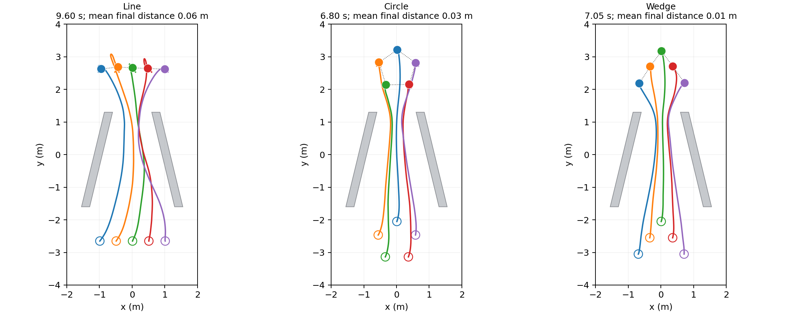
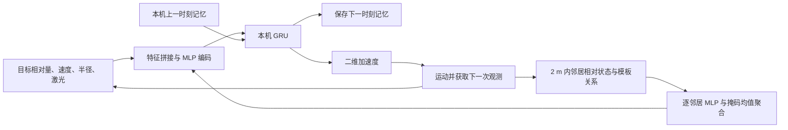
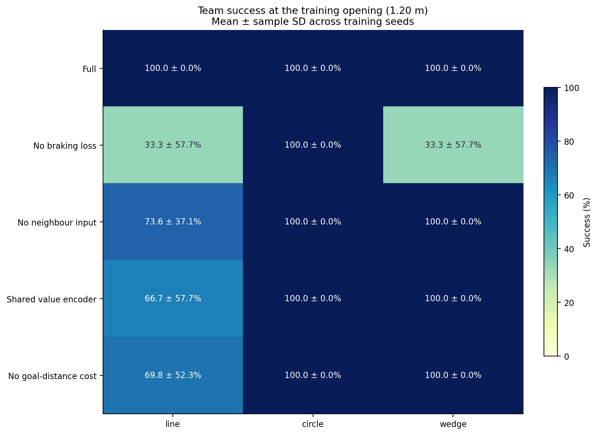

# afor-validation 阶段性研究汇报：基于局部观测的自主编队适应

整理日期：2026-10-28。本文面向组会汇报，按“任务目标 → 问题拆解 → 方法设计 → 实验证据 → 阶段判断 → 后续工作”组织。实验结果取自现有记录，主要更新于 2026-10-20；2026-10-21 的研究方案属于后续设想。本次代码核验中，44 项自动测试及 45 次训练的完整性检查均通过，没有重新开展整轮训练与评测。

**本次汇报的核心判断：已经实现一套能在原渐缩通道内完成编队变形、通行与恢复的局部循环 PPO 策略，并用消融验证了主要设计的作用；当前需要进一步解决的是跨训练种子的稳定性，以及更复杂信息条件下的协同问题。**

正文可按第 1～7 节依次讲述；每节末尾附有衔接句，附录用于参数查询和现场答疑。

## 1. 任务目标：让整个编队通过窄处，并恢复指定形状

研究对象是五机器人编队通过渐缩通道的过程。机器人从给定队形出发，穿过两侧逐渐靠近的斜墙，再到达各自的最终目标槽位，恢复原队形并停稳。

任务同时要求三个结果：

1. **通行：**五台机器人都真正穿过通道开口，途中不发生碰撞。
2. **适应：**通道内允许暂时收缩、错开或改变相对位置。
3. **恢复：**通过后重新形成指定形状，抵达目标并停稳。

| 设置 | 当前范围 |
|---|---|
| 机器人 | 5 个半径 0.13 m 的全向平面圆盘，固定角色 0～4 |
| 队形 | 横排 line、圆形 circle、楔形 wedge |
| 场景 | 双斜墙渐缩通道，起终点在小范围内随机平移 |
| 训练开口 | 1.20 m |
| 主宽度测试 | 1.10、1.20、1.30、1.40、1.50、1.60 m |
| 模型组织 | 每种队形一份策略；同队五台机器人共享权重，各自维护记忆 |



上图展示代表性轨迹，不能代替整体成功率统计。它用于说明任务中的形变与恢复；完整结果在第 4 节给出。

**讲述衔接：**“这个任务既要求局部避障，也要求队友之间保持协作。接下来需要明确：每台机器人能够获得什么信息，以及如何利用这些信息决定自己的动作。”

## 2. 问题拆解：把任务难点对应到方法设计

当前方案采用**局部邻居关系聚合 + 本机 GRU actor + 独立局部任务 critic + 单流循环 PPO + 训练期局部制动辅助损失**。

其中，actor 是输出动作的策略网络，critic 是估计任务回报的价值网络；GRU 用于保留观测历史，PPO 是优化策略的强化学习算法。

| 任务难点 | 采用的设计 | 希望解决的问题 |
|---|---|---|
| 局部机器人需要相互协调 | 聚合单跳邻居的相对状态和静态队形关系 | 感知队友位置、运动趋势及应有相对关系 |
| 单帧局部观测不完整 | 每台机器人维护自己的 GRU 记忆 | 利用观测历史辅助动作决策 |
| 通行时要变形，终点要恢复 | 途中软队形惩罚，终点严格验收 | 允许必要变形，同时保留恢复要求 |
| 碰撞惩罚发生得较晚 | 增加基于局部距离与接近速度的制动损失 | 提供碰撞前的可微学习信号 |
| 动作决策与价值估计的表征需求可能不同 | 使用独立任务 critic | 让价值估计单独学习表征，收益通过共享编码器对照检验 |
| 训练结果需要独立部署 | 导出仅含 actor 的单机控制接口 | 让每台机器人根据自身输入独立推理 |

这里的“希望解决”是设计动机，是否产生增益要由第 5 节的消融判断。特别是，当前正式消融没有单独验证去掉 GRU 的效果。

与原始 AFOR 材料的关系也需要说明：`afor/` 保留论文和发布代码，当前活动实现位于 `src/afor_local/`。这次工作的重点是将局部感知、关系聚合、连续控制和部署接口重新组织成明确的本机决策流程。尚未完成与原 AFOR 的同场景、同预算比较，因此当前结果不能作为性能优越性的证据。详细区别见 [ALGORITHM.md](ALGORITHM.md)。

**讲述衔接：**“这些设计确定了方案的组成。下面沿着一次控制周期，说明输入怎样经过网络变成动作，再说明训练如何塑造这些动作。”

## 3. 方法实现：从局部观测到连续动作，再到训练更新

### 3.1 执行时，每台机器人只处理自己的局部输入



| 输入 | 维度 | 含义 |
|---|---:|---|
| 自身信息 | 5 | 归一化最终目标相对向量、当前速度、机器人半径 |
| 激光 | 32 | 全周 32 束、量程 2 m，包含其他机器人的遮挡 |
| 邻居信息 | 每邻居 8 | 相对位置、相对速度、静态模板相对位移、编队边标志、邻居半径 |
| 邻居有效标记 | 每邻居 1 | 屏蔽本机、范围外邻居和无效填充 |
| 本机记忆 | 64 | 自己的 GRU 隐状态，新回合清零 |

模板关系由固定角色和原始队形确定，不随通道宽度实时改变。当前通信邻居按中心距离小于 2 m 建立，没有进一步模拟视线遮挡或丢包；激光则有首个表面遮挡。

网络不接收开口宽度、全地图、全局阶段、途中航点或邻居目标。执行仍需要已知的最终目标、固定角色和统一任务坐标系；局部观测并不意味着没有任务先验。

### 3.2 邻居聚合表达关系，GRU 输出本机动作

每个有效邻居经过共享的 `8→32→32` MLP，然后做掩码均值聚合，并额外保留归一化邻居数量。这样可以处理邻居输入顺序和当前可见数量的变化，但现有实验仍固定为五机器人任务。

将自身 5 维、激光 32 维、邻居聚合 32 维和邻居计数 1 维拼成 70 维，再经过 `70→64→64` MLP、64 维 GRU 和动作头。actor 共 **35,140 个参数**。

动作是任务坐标系下的二维加速度。控制频率为 20 Hz，每轴加速度限制为 ±1 m/s²；速度按轴限制为 ±1 m/s。确定性评测使用高斯均值经过 tanh 后的动作，训练则保留随机探索。

同一队形的五台机器人共享网络参数，但不共享 GRU 隐状态。仿真中可以批量推理，部署接口支持逐台调用。

### 3.3 奖励使“向目标前进”和“允许途中变形”同时成立

| 奖励组成 | 作用 |
|---|---|
| 最终目标距离的进展奖励 | 鼓励向自己的最终槽位运动 |
| 全程软队形误差惩罚 | 保留队形偏好，同时允许为通行暂时变形 |
| 持续目标距离代价 | 鼓励继续靠近最终槽位，减少停在验收条件之外的情况 |
| 近目标速度代价 | 帮助终点停稳 |
| 团队成功奖励与碰撞惩罚 | 将个人运动与团队结果关联 |

目标引导始终指向最终目标，环境不计算途中压缩槽位或切换奖励航点。因此，收缩、错开和恢复的时机体现在策略的连续动作中。

### 3.4 制动损失补充提前避碰的学习信号

制动项先近似计算当前的距离余量：

```text
h = 距离 - 排斥半径 - 0.03 m 安全余量
    - 接近速度² / (2 × 制动加速度)
```

当前制动加速度取 1 m/s²。随后用 actor 的均值动作预测一步后的余量，惩罚余量恶化过快的情况。静态障碍使用激光端点，动态邻居使用相对位置、相对速度及双方半径；辨认为邻居的激光回波从静态项中剔除。

这一机制只在训练更新时计算，部署时由 actor 直接输出动作。它依赖有限射线、邻居当前速度和一步近似，不提供硬安全保证；执行端没有额外 QP、动作投影或安全过滤。

### 3.5 循环 PPO 联合训练策略，独立 critic 估计任务回报

训练流程是：随机策略采样 → 环境计算奖励 → 独立任务 critic 估值 → GAE（广义优势估计）计算优势 → 循环 PPO 更新。

```text
总损失 = PPO actor loss + 0.5 × task value MSE
         - 0.001 × entropy + 1.0 × local braking loss
```

critic 使用自己的局部编码器和 GRU，不读取额外全局状态，部署时移除。因此当前方法称为**参数共享的循环 PPO**，不应描述成使用全局状态 critic 的 MAPPO。“单流”表示只维护一套随机交互采样逻辑，实际使用 16 个并行环境。

**讲述衔接：**“方法已经落实为一套完整的训练与执行流程。下面先看固定模型能否完成任务，再通过消融回答各项设计是否有作用。”

## 4. 主实验：固定模型能否适应不同开口

### 4.1 测试方式：训练一次，在六档开口复用权重

每种队形使用训练 seed=2、第 500 次更新的最终 actor，只在 1.20 m 开口训练。评测时，每个队形在所有开口复用同一份权重，不按开口重训，也不通过测试结果重新挑检查点。

每个“队形 × 开口”使用三个环境种子，每种子 32 回合，共 96 回合。训练种子影响最终得到哪份策略，环境种子决定评测回合的随机起终点，两者承担不同的重复实验作用。

| 上端开口 | 横排 line | 圆形 circle | 楔形 wedge |
|---|---:|---:|---:|
| 1.10 m | 96/96 | 96/96 | 96/96 |
| 1.20 m | 96/96 | 96/96 | 96/96 |
| 1.30 m | 96/96 | 96/96 | 96/96 |
| 1.40 m | 96/96 | 96/96 | 96/96 |
| 1.50 m | 96/96 | 96/96 | 96/96 |
| 1.60 m | 96/96 | 96/96 | 96/96 |
| 合计 | 576/576 | 576/576 | 576/576 |

**结果：1728/1728 个团队回合成功，碰撞、超时和绕墙完成均为零。**这支持固定策略对原渐缩通道中六档已测开口的适应能力。测试主要改变开口及斜墙斜率，其他任务条件保持一致，因此泛化结论限于这个通道族的已测设置。

### 4.2 成功验收：通行、到达、恢复和停稳必须同时满足

成功要求五台机器人均实际穿过开口，到各自目标的距离小于 0.3 m、速度模长小于 0.15 m/s，最终形状合格，并连续保持 10 步，即 0.5 s。

横排要求相邻边长误差小于 0.1 m、纵向跨度小于 0.15 m；圆形和楔形要求编队边长误差及去中心模板最大位置误差均小于 0.1 m。最长回合为 750 步，即 37.5 s。

训练和评测均检查每一步运动的连续扫掠碰撞，首次碰撞立即终止团队回合；失败动作不会被挡回后继续尝试。评测另用独立 NumPy float64 几何实现复核，并排除绕墙抵达目标的情况。

### 4.3 工程验证：策略已能脱离训练系统推理

三份 actor 已导出为 TorchScript，独立包只需 NumPy、PyTorch 和本机量测接口。历史导出闭环回归在三种队形、1.10／1.20／1.60 m 开口上共 **144/144 成功**，并逐步核对导出模型与原 actor 的动作及记忆。

这 144 回合用于验证导出和接口一致性，不累加到上述 1728 回合中，也不代表已经完成三维仿真或实物验证。详细记录见 [RESULTS.md](RESULTS.md) 和[部署说明](../deployment/README.md)。

**讲述衔接：**“固定模型在已测开口上完成了任务。接下来用多训练种子的控制实验，检查结果是否依赖某一个种子，以及哪些机制对成功率产生了影响。”

## 5. 消融实验：哪些设计有实际增益

### 5.1 实验设置与总体结果

正式消融包含五组方案、三种队形和训练种子 2／3／4，共 **45 次训练**。每次统一训练 500 次更新，训练开口均为 1.20 m；最终权重测试 1.10、1.20、1.30、1.40 m 四档开口，每档三个环境种子、每种子 32 回合。

合计 **17,280 个团队回合**。下表总成功数汇总四档开口和三种队形；最后一列只对应 1.20 m 横排，± 为三个训练种子间的样本标准差，不是置信区间。

| 方案 | 总成功数／回合数 | 总成功率 | 碰撞／超时 | 1.20 m 横排成功率 |
|---|---:|---:|---:|---:|
| 完整方案 | **3448/3456** | **99.77%** | 8／0 | 100.0 ± 0.0% |
| 去制动损失 | 1833/3456 | 53.04% | 1613／10 | 33.3 ± 57.7% |
| actor 去显式邻居输入 | 3216/3456 | 93.06% | 240／0 | 73.6 ± 37.1% |
| 共享价值编码器 | 3072/3456 | 88.89% | 257／127 | 66.7 ± 57.7% |
| 去持续目标距离代价 | 3126/3456 | 90.45% | 39／291 | 69.8 ± 52.3% |



### 5.2 按“观察 → 解释 → 结论范围”讲述四项机制

**第一，局部制动损失带来的差异最大。**去掉后总成功率从 99.77% 降至 53.04%，碰撞从 8 次增加到 1613 次；横排和楔形在训练开口的平均成功率均降至 33.3%。这支持制动辅助信号提高当前训练预算下的学习可靠性；部分无制动运行仍能成功，因此不能说普通 PPO 一定学不会。

**第二，邻居输入对横排协同有帮助。**去掉后出现 240 次互撞，均来自横排；圆形、楔形在本轮四档测试中仍全部成功。这里仅屏蔽部署 actor 的邻居输入，激光、训练 critic 和制动教师仍保留原有量测，不能解释为“训练与执行完全不使用队友信息”。

**第三，当前配方更适合保留独立任务 critic。**去掉共享价值编码器后，总成功率为 88.89%，同时出现碰撞和超时。但共享组的训练参数从 70,213 减少至 35,205，因此结果同时受到训练容量变化的影响，不能单独归因于 actor 与 critic 的梯度冲突。

**第四，持续目标距离代价帮助完成终点验收。**去掉后产生 291 次超时，说明仅靠目标进展和其他奖励，部分策略仍不能在时限内满足最终要求。当前正式消融的超时涉及目标距离及队形条件，不能统一解释为只差形状恢复。

这些对照支持在当前任务和训练预算下保留上述机制。训练种子只有三个，应报告均值与离散程度，不能把大量评测回合当作大量独立训练重复，也不将这些差异表述为已经通过统计显著性检验。

数据来源：[消融协议](../results/ablations/protocol.json)、[汇总表](../results/ablations/summary.csv)、[逐回合记录](../results/ablations/episodes.csv)。

**讲述衔接：**“消融支持当前方案的主要取舍，但完整方案也存在失败。下面把这些失败和训练波动单独拿出来，判断目前真正解决到哪一步。”

## 6. 阶段判断：基础任务有效，协同稳定性仍有改进空间

### 6.1 三组结果回答不同问题

| 数字 | 对应范围 | 回答的问题 |
|---|---|---|
| 1728/1728 | 三份交付 seed=2 模型，六档开口 | 这组固定模型能否跨开口复用？ |
| 3448/3456 | 完整配方，三个训练种子、三种队形、四档开口 | 同一配方在不同训练种子下是否稳定？ |
| 144/144 | 导出包在原二维环境中的闭环回归 | 模型导出及接口是否保持原策略行为？ |

因此，交付模型的全成功与多训练种子中的少量失败并不矛盾，三组数据也不能混合成一个泛化成功率。

### 6.2 失败集中于横排互撞，不能仅用开口宽度解释

完整方案的 **8 次失败全部发生在横排、训练 seed=4、1.40 m 开口，均为机器人间碰撞**。这说明表现并非简单随开口变窄而下降，训练种子与机器人交互过程也会影响结果。

从代码看，当前制动项在预测本机下一步动作影响时，近似保持邻居速度不变，没有显式推演双方同时改变动作后的联合运动。这是一个需要研究的局部近似，但尚不能据此认定它就是上述失败的原因。

### 6.3 最终策略有效，不意味着训练过程始终稳定

完整方案九个训练运行中，**7/9 在最后三次定期验证均满成功**。楔形 seed=2 在第 400 次更新时降为 9/16，出现 7 次互撞，第 450、500 次更新恢复为 16/16。

因此，目前能支持的是当前任务上的经验有效性和有限重复下的稳定性。确定性评测的低碰撞率不能替代随机探索训练中的碰撞统计，也没有理论收敛保证。

### 6.4 已有成果与尚待验证的范围

已有成果包括：局部输入下的自主通行与队形恢复、固定权重跨已测开口复用、主要机制消融、独立碰撞复核，以及可复制的单机器人部署包。

尚待验证的范围包括：任意地图与通道拓扑、不同机器人数量或尺寸、传感噪声与通信延迟／丢包、三维动力学及实物闭环。本轮正式消融也没有证明 GRU 必不可少；当前方案与原 AFOR 的公平性能比较仍未完成。

**讲述衔接：**“现有证据已经提供了一个可复现的局部编队基线。后续工作可以围绕协同信息变差时的退化展开，先确认问题，再检验新增模块能否带来独立收益。”

## 7. 后续工作：从正常通信下的编队适应，推进到受限通信下的协调

已有研究文档提出的方向是：**面向突发通信失效的局部自主编队适应**。这部分目前是研究设计，尚无新模块的训练结果。

推进顺序应与前面的证据衔接：当前正常条件下的基础能力已经有效，但跨种子仍有互撞，通信受损时的表现也尚未验证。因此先用控制实验刻画退化，再决定是否需要新的协调机制。

| 阶段 | 拟开展工作 | 回答的问题 |
|---|---|---|
| 1. 建立受限通信测试 | 在现有基线上引入独立丢包、突发断联和可控几何变化 | 是否存在可重复、可恢复的协同退化？ |
| 2. 检验局部协调模块 | 以现有 GRU 为动作提议器，结合邻居意图、消息时效和相对运动，生成有界动作修正 | 相比普通随机化、缓存和等容量网络，协调结构是否有额外收益？ |
| 3. 按需加入场景课程 | 搜索失效链路、发生时机和持续时间，组织训练场景 | 相比等预算域随机化及难例回放，课程是否提高效率或泛化？ |

实施时，丢包应真实影响当前邻居状态输入，不能只删除新增意图而保留实时邻居真值。新方法还需要与在同类故障分布中训练过的基线比较，不能仅与未见过故障的旧模型比较。

进化课程属于可选训练机制：只有超过等预算随机化和难例回放，才有理由将其作为独立贡献。完整设想与实验设计见 [RESEARCH_PROPOSAL_ROBUST_COORDINATION.md](RESEARCH_PROPOSAL_ROBUST_COORDINATION.md)。

建议口头收尾：

> 目前，我们已经完成了一个局部观测下的自主编队适应方案：机器人可以在原渐缩通道中自行调整相对位置，通过后恢复队形，策略也已经能够独立导出。固定交付模型的六档开口测试全部成功，多训练种子消融支持保留制动辅助、邻居信息、独立 critic 和目标距离代价。现阶段仍有横排互撞与训练波动，所以下一步先刻画通信受损时的协同退化，再验证时效感知协调模块是否有独立增益。

## 附录 A：训练参数与精确奖励

| 参数 | 当前值 |
|---|---:|
| 每种队形训练更新次数 | 500 |
| 并行环境数／每轮采样步数 | 16／128 |
| GRU 序列长度／每批序列数 | 16／64 |
| 每轮优化 epoch | 4 |
| Adam 学习率 | 3e-4 |
| 折扣 γ／GAE λ | 0.99／0.95 |
| PPO clip／熵系数 | 0.2／0.001 |
| 制动辅助损失权重 | 1.0 |
| actor／critic 梯度裁剪 | 分别为 0.5 |
| 定期验证 | 每 50 次更新，16 回合 |

每个机器人的任务奖励为：

```text
r_i = 4 × (上一步最终目标距离 - 当前最终目标距离)
      - dt × [0.05 + 0.15 × min(编队边相对位移误差, 2)]
      - dt × min(最终目标距离, 1)
      - dt × 0.3 × exp(-最终目标距离 / 0.4) × 本机速度平方
      + 5 × 团队成功 - 10 × 团队碰撞
```

代码入口：[policy.py](../src/afor_local/policy.py)、[observation.py](../src/afor_local/observation.py)、[environment.py](../src/afor_local/environment.py)、[barrier.py](../src/afor_local/barrier.py)、[train.py](../src/afor_local/train.py)。

## 附录 B：过程指标补充

以下由完整消融组的逐回合 CSV 汇总，合并三个训练种子与四档开口，**仅统计成功回合，并按回合取平均**。与只统计 1.20 m、再按训练种子汇总的表格口径不同。

| 队形 | 成功回合数 | 平均完成时间 | 过程平均队形误差 |
|---|---:|---:|---:|
| 横排 | 1144 | 8.91 s | 0.299 m |
| 圆形 | 1152 | 6.81 s | 0.149 m |
| 楔形 | 1152 | 6.93 s | 0.147 m |

这里的过程队形误差是运动中实际编队边相对位移与静态模板关系的偏差，不是最终形状验收误差。已测横排策略耗时更长、途中形变更大，提示横排协调可能更困难；这不代表已经证明横排任务必然需要更多协调，也不能将不同队形之间的差异解释为某个算法模块的因果效果。

交付 seed=2 模型六档开口测试中的最小机器人表面净距为：横排 0.06462 m、圆形 0.03040 m、楔形 0.07665 m。这些是已测轨迹的观测值，不是未来运行的净距下界。

补充图：[跨开口成功率热图](../results/ablations/figures/width_heatmaps.png)、[训练曲线](../results/ablations/figures/learning_curves.png)、[失败构成](../results/ablations/figures/failure_breakdown.png)。

## 附录 C：组会答疑口径

| 可能的问题 | 建议回答 |
|---|---|
| 是否一份模型能切换三种队形？ | 当前每种队形一份模型；同队共享权重，各自维护记忆。 |
| 是否完全不需要全局信息？ | actor 和 critic 只读取局部观测，但需要最终目标、固定角色和统一坐标系；奖励及验收可由环境使用全局状态计算。 |
| 是否完全不通信？ | 当前使用 2 m 内的单跳邻居量测／通信，尚未测试真实通信故障。 |
| 是否已经实现实机分布式控制？ | 已有逐机器人推理接口和独立导出包，真实分布式多机闭环尚未验证。 |
| 制动损失是否保证安全？ | 它是训练期辅助项，依赖局部量测和近似预测；部署时没有在线安全过滤，也没有硬安全保证。 |
| 是否证明 GRU 必不可少？ | 本轮正式消融不包含去 GRU 对照，当前证据不足以作此结论。 |
| 是否优于原 AFOR？ | 尚未进行同场景、同预算的公平对照；当前证据支持局部接口重构和任务有效性。 |
| 是否已经完成鲁棒协调与进化课程？ | 目前只有研究设计，尚未实现和训练，不能作为已有成果汇报。 |

## 附录 D：证据与文件索引

| 材料 | 用途 |
|---|---|
| [算法说明](ALGORITHM.md) | 网络、奖励、物理规则及与 AFOR 的区别 |
| [结果说明](RESULTS.md) | 主实验、收敛与验证范围 |
| [模型清单](../models/manifest.json) | 三份交付模型的身份、训练种子和权重哈希 |
| [宽度协议](../results/widths/protocol.json)与[宽度汇总](../results/widths/summary.json) | 六档开口结果；汇总同时保留历史 seed=3 复验，正文主结果仅取交付 seed=2 |
| [消融总览](../results/ablations/README.md)与[汇总表](../results/ablations/summary.csv) | 五组控制实验及分队形结果 |
| [消融逐回合数据](../results/ablations/episodes.csv)与[训练稳定性统计](../results/ablations/convergence.csv) | 失败定位、过程指标及跨种子波动 |
| [消融完整性核验](../results/ablations/final_verification.json) | 45 次训练、源码快照和模型一致性记录 |
| [部署说明](../deployment/README.md)与[导出验证](../results/deployment_validation.json) | 独立推理接口及 144 回合回归 |
| [后续研究方案](RESEARCH_PROPOSAL_ROBUST_COORDINATION.md) | 尚待验证的鲁棒协调和场景课程设计 |
