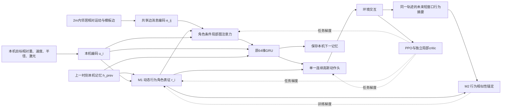

# 第二版研究方案：行为角色条件的局部图记忆编队策略

日期：2026-10-29。对应项目：`afor-validation`。本文重新检索原始论文、核对作者实现后形成；保留[第一版方案](RESEARCH_PROPOSAL_LOCAL_RESPONSIBILITY.md)，不修改现有算法源码或模型。

**本版推荐：以局部图注意力GNN＋GRU＋PPO为骨架，融合“低维动态行为角色条件化”和“短时行为相似性锚定”两处机制。所有可学习模块从第一批交互开始联合训练，沿用当前局部观测、连续动作、独立局部critic与制动辅助。**

这里的“角色”是随情境变化的连续行为表征，表示机器人当前的推进、减速、侧向调整和恢复倾向；不是重新分配最终槽位，也不预先规定三个离散角色。新方法尚未实现或训练，下面给出可实施的网络、损失、文献来源和验证方案。

## 1. 对这次反馈的直接回答

### 1.1 已有思想可以用，而且应当具体地用

这次的取舍原则是：**从多篇可靠论文中选取已经验证过的核心思想，针对当前编队任务改造信息接口、网络位置和训练目标，再用实验证明组合后的作用。**

“角色已有研究”“GNN＋GRU已有研究”“意图共享已有研究”都不是排除理由。需要说明的是：借用了什么，适配改变了什么，为什么适合当前问题，以及实验怎样区分融合收益和普通实现差异。硕士论文可以做这类有明确问题和证据的增量研究，无需每个组件都原创。

与第一版相比，本版不再以责任分摊辅助为主线，而是将研究中心放到**行为表征如何组织局部交互和时序决策**。旧责任辅助不与新角色机制一起堆入。

### 1.2 局部GNN＋GRU是否比当前掩码均值更合适

**作为这项研究的网络骨架，我更推荐显式的局部关系GNN＋GRU。** 理由是它把空间关系和时间记忆分开表达，便于把“当前行为模式如何影响邻居关注”写成可检验的结构。

当前逐邻居MLP＋掩码均值本身是合理的集合编码，也可以视为一层简单边消息聚合。它的“简单”不等于论文工作不合格；工作量和贡献要看问题诊断、方法适配和实验。但本任务希望研究不同步时的选择性协作，普通均值不会在聚合时显式根据本机情境给不同邻居不同权重，升级关系模块有合理动机。

推荐的升级不是单纯换成 `torch_geometric`，也不是把多层MLP改名为GNN。实际变化是：**把已知局部邻接、相对运动和编队边写入消息传递，再让低维行为表征调节消息权重和动作映射。** 性能是否更好需要和强GAT＋GRU基线比较，不能从模块名称推出。

原AFOR的GNN处理当时的邻居关系，当前GRU处理本机历史；二者可以串联。只要消息来源合法，GNN不要求集中获取全队状态。本版第一实现只使用现有8维邻居量测，不新增隐状态、角色或意图广播。

## 2. 研究问题与核心insight

### 2.1 用已经发现的失败作为入口

前一轮实际运行的冻结诊断表明：对现有固定训练seed=2的横排模型，保持1.20 m通道和最终目标不变，只加入每台独立的初始纵向偏差，便出现机器人互撞。

| 条件，每格96个团队回合 | line | circle | wedge |
|---|---:|---:|---:|
| 原场景 | 96/96 | 96/96 | 96/96 |
| 全队共同纵向平移±15 cm | 96/96 | 未测 | 未测 |
| 个体独立纵向偏移±5 cm | 67/96 | 未测 | 未测 |
| 个体独立纵向偏移±15 cm | 66/96 | 96/96 | 79/96 |

初态均经独立碰撞检查确认可行，成功标准、扫掠碰撞和实际过口检查未改变。所有表内失败均为机器人互撞。它反映个体相对不同步的脆弱性，不是已经发现死锁，也不是已经证明缺少角色是致因。[诊断与原始记录](research_notes/frozen_diagnostics_20261029.md)

这些是上一轮诊断，本轮没有重新运行这1248回合，也没有训练新方法。三个环境种子不是三个训练种子。

### 2.2 从任务现象到可研究的表示问题

五机器人共享策略、固定最终槽位，不同输入当然可以产生不同动作。问题不是共享网络“无法分工”，而是：

> 在不同步穿行中，能否把短时协作状态组织为可复用的行为表征，使机器人更容易选择当前相关邻居、产生合适的减速或错开动作，并在通过后重新恢复？

**核心insight：队形身份和过程中的行为模式应当区分；同一个固定槽位的机器人，在不同阶段和不同扰动下，可以采用不同的临时协作模式。相近行为模式也不必绑定同一个机器人编号。**

进一步说，同一个邻居可能在持续前进时是需要跟随的队友，在侧向压缩时是需要协调的对象，在恢复过程中又是几何参考。我们不预设这三种标签，而是研究：由历史和当前量测产生、被短期行为约束的低维表征，能否帮助网络学习这种关系选择。

这是一种**表示与策略的归纳偏置**。它没有增加机器人能看到的信息，也不保证网络必然发现有用角色；它的价值应表现为比同预算普通GAT更稳定的学习和更可靠的协同。

## 3. 本轮文献：明确借什么、怎样融合

本轮补充了角色表征、局部图循环策略、意图通信、弹性图和残差控制的原始论文与作者代码。下表是直接支持选型的重点文献；更多细节见三个[第二轮研究笔记](#16-材料与复现索引)。

### 3.1 主方案的主要来源

| 原始研究 | 采用其核心思想 | 对本项目的具体适配 |
|---|---|---|
| **AFOR — Coordinated Multi-Robot Navigation with Formation Adaptation**, Deng et al., ICRA 2025 | 图关系协调与连续控制联合学习，形变与恢复共同评价 | 保留编队任务、局部关系与PPO主线，用显式行为条件组织通行过程。[原文项目](https://hcrlab.gitlab.io/project/afor/)、[正式记录](https://doi.org/10.1109/ICRA55743.2025.11128457) |
| **InforMARL — Scalable Multi-Agent Reinforcement Learning through Intelligent Information Aggregation**, Nayak et al., ICML 2023 | 用图边和attention聚合局部信息，再接循环策略 | 用现有相对量测和模板边构造局部边消息，接原64维GRU；保持连续动作和局部critic。[正式论文与全文](https://proceedings.mlr.press/v202/nayak23a.html)、[代码](https://github.com/nsidn98/InforMARL) |
| **Graph Attention Networks**, Veličković et al., ICLR 2018 | 对不同邻居学习不同消息权重 | 采用单层、边特征条件化的局部注意力，作为成熟骨架。[作者论文](https://arxiv.org/abs/1710.10903)、[机构记录](https://www.repository.cam.ac.uk/items/9afe00c9-2eb7-469c-8ee2-60a00554a8d2/full) |
| **ROMA: Multi-Agent Reinforcement Learning with Emergent Roles**, Wang et al., ICML 2020 | 低维角色条件化个体策略，角色应有行为可辨识性 | 用确定性连续表征调节本机图关系和动作，替代随机角色和完整价值分解。[正式论文](https://proceedings.mlr.press/v119/wang20f.html) |
| **ACORM — Attention-Guided Contrastive Role Representations for Multi-agent Reinforcement Learning**, Hu et al., ICLR 2024 | 相似行为组织角色表征，其MAPPO变体已有局部角色条件actor，并以attention增强全局价值信息 | 借用角色条件actor，进一步用于接收端边关系打分；采用低成本编队行为相似性约束，沿用局部critic。[原文](https://arxiv.org/abs/2312.04819)、[正式PDF](https://openreview.net/pdf?id=LWmuPfEYhH)、[作者代码](https://github.com/NJU-RL/ACORM) |
| **COPA — Coach-Player Multi-agent Reinforcement Learning for Dynamic Team Composition**, Liu et al., ICML 2021 | 低维策略向量应可由短期未来行为辨识 | 去掉全局coach，由本机当前量测和记忆生成表征；未来本机行为只用于训练标签。[正式论文与全文](https://proceedings.mlr.press/v139/liu21m.html) |
| **LDSA: Learning Dynamic Subtask Assignment in Cooperative Multi-Agent Reinforcement Learning**, Yang et al., NeurIPS 2022 | 共享主干、动态职责条件策略，利用历史保持策略连续 | 首版采用连续条件化，借GRU和短窗口行为组织时序，不另建高层子任务选择器。[正式论文](https://papers.neurips.cc/paper_files/paper/2022/hash/0b4145b562cc22fb7fa50a2cd17c191d-Abstract-Conference.html)、[作者论文](https://arxiv.org/abs/2205.02561) |
| **Decentralized Control of Quadrotor Swarms with End-to-end Deep Reinforcement Learning**, Batra et al., CoRL 2021 / PMLR 2022 | 相对邻居编码、Deep Sets与attention的直接对照 | 把均值与普通attention都作为基线，用同接口架构对照衡量新增行为条件的收益。[正式论文](https://proceedings.mlr.press/v164/batra22a.html) |

该组合的来源可以直观写成：

```text
AFOR：编队形变/恢复任务与PPO
              ＋
InforMARL/GAT：局部关系图＋循环策略骨架
              ＋
ROMA/ACORM：低维行为角色条件化与相似行为共享表征
              ＋
COPA：短期未来行为可辨识性
              ↓
本课题：行为锚定的角色条件局部图记忆策略
```

这是一条具体可用的融合路线。新增贡献是针对当前任务的组合与适配，不把GAT、GRU或对比学习分别算作自己的发明。

### 3.2 对截图中角色编队论文的重新理解

**Norén et al., Role-Adaptive Collaborative Formation Planning for Team of Quadruped Robots in Cluttered Environments, Mechatronics 2026**，可以作为正面借鉴来源。[期刊正文](https://doi.org/10.1016/j.mechatronics.2026.103599)、[公开作者版本](https://arxiv.org/html/2602.18260v1)

它把动态角色、前向参考和虚拟弹簧阻尼融成一个规划框架。可借鉴的研究逻辑是：**任务中的身份或配合关系需要随当前运动情境调整；这种调整应实际影响连续运动，而不只停留在高层标签。**

本文借用这一逻辑，但保持固定最终槽位，把动态性放在本机临时行为表征和局部交互上。该论文角色主要是机器人与编队位置的在线分配；本文角色是连续行为表征，两者定义不同。其ETA选择与滞回也可以构成另一套轻量方案，详见第12节，而不是因为原作有全局规划就完全弃用。

### 3.3 原作训练步骤与本项目的适配

本次核对发现，ACORM公开MAPPO代码默认有150轮表征预训练分支。应如实引用，而不是把作者完整脚本说成无预训练。[核对的固定commit及预训练分支](https://github.com/NJU-RL/ACORM/blob/67aa762e3ccc1d7333f77765d9780b2f30aca296/ACORM_MAPPO/run.py#L57)

这不影响借鉴其核心思想。**本版明确去掉该分支，不复制ID预测、EMA编码器和在线K-means；用同一批PPO轨迹构造行为相似性目标，从第一轮同时优化任务和表征。** 这是为了符合当前要求而做的训练适配。

RODE的动作效应分组也可借来理解软策略专门化；Option-Critic和DAC说明模式与连续控制存在共同学习的成熟路线。首版选择确定性表征，使当前PPO概率接口保持简单。[RODE](https://arxiv.org/abs/2010.01523)、[Option-Critic](https://arxiv.org/abs/1609.05140)、[DAC](https://arxiv.org/abs/1904.12691)

## 4. 完整网络：两处机制，其余沿用

暂定方法名：**行为角色条件图记忆策略（Behavior-Anchored Role-Conditioned Graph Recurrent Policy，简称BRG策略）**。这是工作名称，不是名称查新结论。

### 4.1 模块职责

| 部分 | 职责 | 是否作为新增机制 |
|---|---|---|
| 本机与关系编码器 | 编码目标、速度、激光和邻居8维量测 | 骨架 |
| 局部图注意力GNN | 根据关系权重聚合实际邻居 | 成熟骨架，其增益单独与均值比较 |
| GRU | 保留本机观测历史，64维记忆 | 保留现有组件 |
| **M1：行为角色条件化** | 从本机当前量测和旧记忆产生8维表征，调节邻居权重与动作 | 新的任务适配机制一 |
| **M2：行为相似性锚定** | 用同一批短时行为约束表征，使相似行为获得相近表示 | 新的任务适配机制二 |
| PPO、独立局部critic、原制动辅助 | 联合优化与训练稳定 | 保留，不改成责任分摊版本 |

### 4.2 框架图



图中的未来行为支路只在采样之后计算训练损失；部署不需要未来量、角色标签、聚类器或新通信字段。

## 5. M1：把本机行为模式放入局部图决策

### 5.1 输入与图的定义

当前本机输入为5维ego和32束激光，记为 \(o_i^t\)。当前邻居8维关系记为 \(x_{ij}^t\)，仍包含相对位置、相对速度、名义模板位移、编队边标志和半径。

构图 \(\mathcal G_t=(\mathcal V,\mathcal E_t)\)，其中 \((j,i)\in\mathcal E_t\) 当且仅当机器人i实际收到或测得有效邻居j，且符合2 m范围。名义编队边是其中的关系属性，不意味着可以读取范围外的成员。

本版采用**单层、基于边特征的消息传递**：接收方用自身情境和观测到的相对关系计算消息，无需交换邻居神经网络嵌入。它是局部GNN的一种实现形式；与原AFOR的“节点编码差分后聚合”不同。

### 5.2 一个无计算环的前向过程

先将回合重置机器人记忆清零，再计算：

\[
u_i^t=f_o(o_i^t)\in\mathbb R^{32},\qquad
r_i^t=\operatorname{normalize}\left(f_r([u_i^t,h_i^{t-1}])\right)\in\mathbb R^8,
\]

\[
e_{ij}^t=f_e(x_{ij}^t)\in\mathbb R^{32},\qquad
\ell_{ij}^t=f_\alpha([u_i^t,r_i^t,e_{ij}^t]),
\]

\[
\alpha_{ij}^t=\operatorname{maskedSoftmax}_{j}(\ell_{ij}^t),\qquad
g_i^t=\sum_{j\in\mathcal N_i^t}\alpha_{ij}^t e_{ij}^t,
\]

\[
h_i^t=\operatorname{GRU}\left(f_g([u_i^t,g_i^t,n_i^t]),h_i^{t-1}\right),
\qquad
\mu_i^t=f_a([h_i^t,r_i^t]),
\]

\[
\xi_i^t\sim\mathcal N(\mu_i^t,\Sigma),\qquad a_i^t=\tanh(\xi_i^t).
\]

关键顺序是 **旧记忆→当前表征→当前图聚合→新记忆→动作**。角色不能先依赖当前新GRU状态、再反过来决定产生该状态的图聚合，否则会形成同一步循环依赖。

\(r_i\)是确定性的网络中间表示，不是另抽样的角色动作，因此高斯动作之外没有第二个角色log-prob，也没有Gumbel采样或选项终止器。当前邻居突然变化时，图分支仍直接读取新关系；表征利用旧记忆并不意味着动作忽略当前邻居。

### 5.3 建议的首版尺寸

| 子层 | 首版配置 |
|---|---|
| 本机编码 | `37→32→32` |
| 共享边消息 | `8→32→32` |
| 行为角色头 | `[u32,h_prev64]→32→8`，带数值稳定的L2归一化 |
| 关系打分 | `[u32,r8,e32]→32→1`，单头masked attention |
| GRU前融合 | `[u32,g32,count1]→64→64` |
| 时间记忆 | 原64维GRU |
| 动作头 | `[h64,r8]→2`，保留可学习标准差与tanh变换 |
| critic | 原独立局部均值编码＋GRU，不复制actor新分支 |

按这一尺寸，actor仍是几万参数量级；主要改动是编码和条件化方式，不是增加大型Transformer。无邻居时聚合为零并保留计数，避免对全mask行直接softmax产生NaN。

### 5.4 “角色”的具体含义与边界

同一个机器人可以在不同时间获得不同表征；不同机器人表现相似行为时可以获得相近表征。它不要求全队恰好一人负责推进、一人负责让行，也不要求角色均匀分布。

该表征首先是**本机行为模式条件**，没有广播给其他机器人。局部协调通过机器人实际运动及既有邻居观测形成；不能声称它让机器人读到了邻居的私有计划，或完成了全队离散角色分配。

若实验只证明表征有利于控制，却无法识别稳定的职责模式，论文名称可使用“行为条件局部图记忆”，方法依然成立。只有在跨身份、跨情境和干预实验支持时，再讨论临时功能分工。

## 6. M2：用短时行为锚定表征，避免任意latent

### 6.1 为什么需要行为锚定

只把一个8维向量接进attention和动作头，可能只是多加了一条MLP分支。借鉴ACORM的相似行为角色表征和COPA的未来行为可辨识性，给它一个可检验的训练目标：**相似短时行为的表征相近，不同短时行为的表征允许分开。**

这里采用连续行为相似性，不复现原作完整聚类或互信息估计器。也不强行把不同机器人推到不同角色，避免制造没有任务意义的分工。

### 6.2 与编队任务对应的四维行为摘要

取 \(H=8\)步，当前 \(\Delta t=0.05\,\mathrm s\)，窗口长 \(T=H\Delta t=0.4\,\mathrm s\)。从同一条on-policy轨迹构造：

\[
b_i^t=\left[
\frac{p_{i,y}^{t+H}-p_{i,y}^{t}}{T v_{\rm ref}},\quad
\frac{1}{H v_{\rm ref}}\sum_{k=1}^{H}|v_{i,x}^{t+k}|,\quad
\frac{v_{i,y}^{t+H}-v_{i,y}^{t}}{T a_{\rm ref}},\quad
\frac{E_i^t-E_i^{t+H}}{T v_{\rm ref}}
\right].
\]

使用固定物理尺度 \(v_{\rm ref}=1\,\mathrm{m/s}\)、\(a_{\rm ref}=1\,\mathrm{m/s^2}\)，各分量按预先规则裁剪，例如到[-2,2]。

| 分量 | 与任务的联系 |
|---|---|
| 纵向进展 | 持续推进还是暂缓前进 |
| 横向运动量 | 是否进行明显的侧向压缩或调整 |
| 纵向速度变化 | 正在加速、维持还是减速 |
| 局部模板误差变化 | 是放松原形状、还是向原形状恢复 |

**第四维是针对当前编队任务的适配。** 仅有 \(|v_x|\)无法区分向内压缩和向外恢复，因此加入局部形状变化，而不只复制一般导航的速度标签。

\(E_i^\tau\)只用本机可测关系：先取当前与窗口末尾都能关联到的名义编队邻居集合 \(\mathcal C_i^t\)，然后在两个端点上用**同一集合**计算：

\[
E_i^\tau=\frac1{|\mathcal C_i^t|}
\sum_{j\in\mathcal C_i^t}
\|r_{ij}^{\tau}-d_{ij}^{\mathrm{template}}\|,
\qquad \tau\in\{t,t+H\}.
\]

这样不会把“邻居消失后误差自动变小”误当作恢复。若集合为空，首版跳过该窗口的M2损失；PPO和原制动损失仍照常使用这一样本。记录被跳过的比例和分布，避免只在容易窗口上说明表征效果。实现时，打包观测中的相对位置已除以2 m，计算E前要恢复为米；模板位移字段本来就是米，不应再乘一次感知范围。

前三维来自本机速度/里程，第四维来自已记录的本机局部量测。仿真可以用自身位置差计算本机位移，但不把未来位置、全队形状或地图送进actor。+y/+x采用当前固定任务坐标；若以后旋转任务，应统一转换标签和策略坐标。

### 6.3 相似性目标与损失

从有效窗口中抽取 \(M=128\)或256个样本。用行为距离生成目标：

\[
P_{ab}=\operatorname{stopgrad}\left[
\frac{\exp(-D_b(b_a,b_b)/\tau_b)}
{\sum_{c\in\mathcal A_a}\exp(-D_b(b_a,b_c)/\tau_b)}
\right],\quad b\in\mathcal A_a.
\]

\(D_b\)可取四维无量纲平方距离，首版固定各维相同权重，不另加可学习距离网络。对角色表征构造：

\[
Q_{ab}=\frac{\exp(\cos(r_a,r_b)/\tau_r)}
{\sum_{c\in\mathcal A_a}\exp(\cos(r_a,r_c)/\tau_r)},
\qquad
L_{\rm role}=\frac1M\sum_a D_{\rm KL}(P_a\Vert Q_a).
\]

候选集合 \(\mathcal A_a\)在P、Q中必须完全一致，排除自身和同一机器人相邻重叠的窗口。优先跨机器人、跨并行环境配对，避免仅利用短期连续性或张量位置取巧；不足以形成候选集合的行不计算这一损失。

未来窗口不得越过成功、碰撞、超时、reset或rollout尾部。首版直接屏蔽不完整窗口，不用重置后状态补齐。可以保存当前128步rollout内部的有效标签，不另生成第二条轨迹。

### 6.4 目标能帮助什么，不能替代什么

当行为相似分布P有区别时，这一目标鼓励角色相似分布Q也有区别；当全队行为相同时，允许表征相近，不强制制造多样性。

但它不保证避免所有塌缩，也不保证actor实际依赖r。未来行为还包含探索噪声和环境影响，因此r应理解为行为模式表征，而不是确定的未来计划或因果职责。记录P/Q熵、表征有效秩和任务表现；用后面的消融判断该目标是否有用。

本损失是本课题设计的行为相似性适配，不直接等同于ROMA、ACORM或COPA的原始互信息界，不继承它们的理论推导。

## 7. 一次联合训练，保持现有PPO概率接口

总目标：

\[
L=L_{\rm PPO}+0.5L_V-\eta H(\pi)
+\lambda_b L_{\rm original\ braking}
+\lambda_r L_{\rm role}.
\]

首版保留原 \(\eta=0.001\)、\(\lambda_b=1\)，\(\lambda_r\)可从0.03起步，仅用验证集在少量候选如0.01/0.03/0.1中选择。H先固定8，不同时大范围搜索温度、角色维度和网络宽度。

```text
随机初始化整个actor和原独立critic
从第一回合起采用统一的原场景/扰动场景混合分布
每个控制步：
    获取本机与合法邻居观测
    先按回合边界清零旧GRU记忆
    计算当前行为表征、局部图消息、GRU和高斯动作
    执行并保存原PPO数据，以及本机局部行为标签所需数据
每轮更新：
    从同一rollout构造合法的H步行为窗口
    按现有单机时间序列重算角色、图与GRU
    计算原PPO、价值、熵和制动辅助
    从这一批角色表征计算行为相似性损失
    一次反向传播，联合更新所有可学习模块
训练结束：
    导出actor；行为标签计算和critic不进入部署
```

没有先训练角色、再冻结角色、再训练控制的过程；没有专家轨迹、预训练actor或长期replay。M2从第一批有完整窗口的数据开始与PPO一起优化，窗口的天然有效性筛选不是另一个训练阶段。

**梯度与数据处理的关键点：**

- 动作log-prob沿用现有tanh-Gaussian；r是确定性中间层，无需角色概率项。
- 任务梯度能通过动作头和图关系权重传回角色分支，行为损失也直接更新该分支。
- PPO更新要重算当前参数的r，不能拿rollout中保存的旧r并detach后声称角色被联合训练；未来行为标签则固定并stop-gradient。
- 本版没有跨机器人可学习消息，原按单机序列切分和截断BPTT可保留。跨样本相似性是训练正则，不是执行时的信息交换。
- 核心所有对照固定同一种独立局部critic、奖励、制动辅助和采样预算，只切换actor中的两处机制。

## 8. 理论与逻辑闭环

### 8.1 信息闭环

执行策略是：

\[
a_i^t\sim\pi_\theta(a_i^t\mid o_i^{0:t},x_{ij}^{0:t},j\in\mathcal N_i^{0:t}).
\]

r只从本机当前输入和旧记忆产生，GNN只聚合合法邻居。因此不增加全局信息依赖。未来行为只在采样后构造训练标签，类似一般预测辅助任务，不是在线预知未来。

### 8.2 关系与时间闭环

角色表征调节本机如何组合邻居关系，组合结果进入GRU，形成新的记忆和动作；下一步的角色再由新观测和这份记忆产生。这是明确的离散时间递推，没有同时互相依赖的隐式求解。

逐邻居共享编码与集合softmax/求和保持邻居排列不变性。它不能保证任意团队规模泛化；当前仍是五机器人、预置模板任务。

### 8.3 学习闭环

任务奖励约束是否完成编队任务，行为锚定约束低维表征的组织方式。M1给表征一个实际影响决策的位置，M2给它与任务行为相连的学习信号；二者可以分别关闭，便于判断组合是否有效。

这一逻辑不要求角色本身成为新的奖励目标，也不会让机器人通过把某个“角色权重”置零免除原队形惩罚。原任务奖励和验收不由r修改。

### 8.4 需要实验证明的部分

行为锚定只提供合理的学习偏置，不是稳定性、无碰撞或角色涌现定理。它也可能只是重编码速度，或学习出actor不使用的漂亮表征。后续必须证明：完整方法优于同预算GAT；行为条件有作用；行为锚定有额外收益；收益不只是更多参数或数据增强。

能严格陈述的信息局部性、时间递推和排列性质，与需要经验验证的性能贡献应分开。这比为整个深度RL系统拼接一个不适用的安全证明更可靠。

## 9. 主实验：先建立强骨架，再归因两机制

### 9.1 所有方法都见过相同扰动

训练可从第一轮起混合：50%原初态，50%个体独立纵向扰动，\(a\sim U[0,0.10]\,\mathrm m\)。测试 \(a=0,0.05,0.10,0.15,0.20\,\mathrm m\)，同时保留原1.10–1.60 m开口。

所有方法使用相同场景集、合法初态拒绝采样规则、模型选择规则和训练transition数。不能只让新网络见过扰动，再与旧固定模型直接比较。

主场景仍然是现有渐缩穿行与最终恢复。第二个可选压力场景是在通行中对随机一台施加短时跟踪偏差，所有对照采用相同定义和扰动分布；它用于检验临时模式调整，不给actor扰动身份或全局阶段标志。先不扩展任意复杂地图或异构机器人。

### 9.2 四组核心消融

| 编号 | 决策中使用r条件化 | 行为锚定M2 | 作用 |
|---|---|---|---|
| G | 否，普通局部GAT＋GRU | 无 | 成熟图循环骨架的强基线 |
| R | 是 | 无 | 增加条件分支、时间旁路和参数本身是否足够 |
| A | 否；辅助表征从共享主干产生，但不送图权重或动作 | 有 | 一般表征正则是否已经解释全部收益 |
| RA | 是 | 有 | 完整框架，以及两机制是否互补 |

A组的辅助梯度应进入共享本机编码/记忆；如果辅助头完全独立、既不影响主干也不影响动作，就不是有效的辅助学习对照。G组可用同等预算的MLP补齐参数，R组则直接控制“多加低维分支”的解释。

**G是共同骨架，M1是角色条件的关系/动作映射，M2是行为锚定。** 不能只拿完整RA与旧均值模型比较后，把全部收益都算给角色。

### 9.3 附加对照与任务标签检查

1. **原均值＋GRU，使用同样扰动训练。** 回答数据增强和图升级分别有多大作用。
2. **固定槽位表征替代动态r。** 使用已知任务slot的可学习embedding，不改最终目标；与同参数动态分支比较，判断是否只是永久身份专门化。
3. **RA去GRU，使用近似参数预算的前馈网络。** 若论文强调历史与角色的联系，需要直接检验；不能把现有GRU当作已经证明必要。
4. **RA三维行为标签 vs 完整四维标签。** 仅移除局部恢复摘要，其余网络、训练和标签尺度相同；直接检验第四维编队适配是否带来额外收益。没有这个对照，只能说明M2整体作用，不能单独声称恢复锚定必要。

建议核心四组×三队形×三个训练种子，共36次训练；四个附加对照先在最敏感的line各做三个种子，共12次，总计48次。关键G/RA在line再各补两个种子可形成5种子主比较，总计52次。该预算是建议，不要求先完成所有组才判断方向。

仍可采用每次500更新、16并行环境、128步的原预算，即每次1,024,000团队transition。记录实际训练时间、参数量和推理耗时，不把“网络图更复杂”作为工作量证据。

### 9.4 任务指标与机制指标

| 问题 | 任务指标 | 机制证据 |
|---|---|---|
| 不同步穿行是否更可靠 | 成功率、机器人互撞/墙撞/超时分别统计 | 冲突事件的最小净距与动作序列 |
| 是否真正完成编队任务 | 最终模板误差、停稳、过口后恢复时间 | 压缩与恢复期间的局部误差变化 |
| 是否只是变得很慢 | 失败计入上限的任务耗时、成功条件耗时 | 速度、累计加速度、动作变化量 |
| 表征是否携带行为信息 | 不能代替任务指标 | 表征与四维行为的对应、线性探针、P/Q差异、有效秩 |
| 是否只是固定身份 | 跨扰动同slot表现、任务成功 | 同slot随情境变化、跨slot相似行为获得相近表征 |
| r是否进入实际决策 | G/R/A/RA的任务差异 | 受控r干预下的动作和关注关系变化 |

按训练种子报告均值、标准差和关键差值置信区间；各模型用相同测试初态。圆形若增益小，可以作为任务冗余或原基线更稳健的证据，不要求所有队形都产生同样大的改进。

## 10. 怎样让“角色”成为可检验贡献

### 10.1 三层证据

**第一层：行为可辨识。** 在未参与训练和调参的轨迹上，表征应与推进、减速、侧向调整、形变/恢复等量相关。可以用冻结表征的简单线性探针预测行为摘要，与直接用当前速度、普通GRU隐状态作对照。探针只是分析工具，不是另一个策略预训练阶段。

**第二层：超越身份。** 相同固定slot在不同扰动、不同通行时刻应出现表征变化；不同slot的相似行为应有接近的表征。需要足够的情境变化，不能只画按编号着色后分成五团的图。

**第三层：影响控制。** R/A/RA之间的差异，以及合理的表征干预，应说明角色通路参与关系选择或动作。若只有嵌入可视化漂亮、任务没改善，就不算协作机制贡献。

### 10.2 干预与竞争解释

- 将r固定为训练分布中的常见参考值，观察同初态下关系关注和任务变化。
- 在观测、速度及局部约束相近的样本之间交换r，减少任意跨状态交换造成的分布外破坏。
- 小规模打乱行为相似性标签，检查收益是否依赖正确的行为关联；与正常M2使用相同标签维度和损失规模。
- 记录是否一直使用同一表征、是否随阶段剧烈抖动、是否由slot完全解释。先诊断，不再额外加均衡角色损失来强行制造分工。

这些干预与消融相互补充。任意把r换成异常向量导致失败，并不能独立证明角色具有预期语义。

## 11. 与原AFOR及当前程序的关系

| 项目 | 原 `afor/` | 当前 `src/afor_local/` | 本版主方案 |
|---|---|---|---|
| 空间关系 | 节点编码差分GNN | 相对关系MLP＋均值 | 相对边消息＋角色条件attention |
| 时间 | 发布模型无有效循环更新 | 本机64维GRU | 保留64维GRU，旧记忆参与行为表征 |
| 临时协作表征 | 没有本版这一路径 | 隐式包含在融合特征/记忆中 | 显式8维行为条件，配行为锚定 |
| 训练 | PPO与编队塑形 | 循环PPO＋局部制动辅助 | 同一循环PPO＋原制动辅助＋行为相似性目标 |
| 输入 | 发布接口批量位置、速度、目标 | 本机与2 m相对邻居8维 | 输入接口保持当前版本 |
| 研究重点 | 形变与减振 | 局部可部署基线与制动学习 | 不同步下的行为组织及局部交互 |

因此，本版采用的是原AFOR图协调思想与当前局部实现的融合，不必把原来的位置输入、速度动作、奖励和所有训练代码一并恢复。若将原AFOR列为实验参考，需统一物理、传感和验收条件；未经统一的原结果只作为文献背景。

主方案仍需要可靠相对定位、身份关联、任务方向和真实邻居来源。使用机载跟踪或近邻广播可实现本机推理；采用中心动捕则应如实说明外部感知依赖。[真实分散GNN先例](https://arxiv.org/abs/2111.01777)

## 12. 两条可以真正采用的备选，不与主方案叠加

主方案之外，下面两条也成立。选它们时应各自替换主线，而不是全加进同一网络。

### 12.1 备选A：可学习弹性关系＋局部GNN/GRU

**适合偏好控制解释、希望变量直接影响编队几何的路线。**

融合来源：AFOR的spring–damper思想、Pham等RA-L 2024的刚性/弹性边、Buchli等IJRR 2011的学习可变增益、Johannink等ICRA 2019的残差控制。它们提供成熟组件，可以针对本任务组合。[弹性边原文](https://doi.org/10.1109/LRA.2024.3471460)、[可变阻抗原文](https://doi.org/10.1177/0278364911402527)、[残差RL原文](https://doi.org/10.1109/ICRA.2019.8794127)

在GNN/GRU后为每条可见模板边输出 \(g_{ij}\in[0,1]\)，形成小幅关系反馈：

\[
F_i=\frac1{\max(1,|\mathcal N_i^{\rm form}|)}
\sum_j g_{ij}\,[k_p(r_{ij}-d_{ij})+k_d v_{ij}],
\qquad
\mu_i=\mu_{i,\rm learned}+\rho\,\tanh(F_i/F_{\rm ref}).
\]

F先按物理尺度无量纲化再与高斯latent均值叠加，\(\rho\)限制它的影响。仍只采样一个高斯动作分布，PPO通过均值训练门与原控制网络。第二机制最多加同一邻居连续可见时的弱门变化损失，借鉴角色编队论文的切换保持思想，无需新的高层阶段机。

其insight是：**任务要求最终恢复，但途中不同编队关系可以采用不同耦合强度。** 需要固定门、普通attention、纯残差和时间损失消融，检查门是否全为零、关系项是否被学习分支完全抵消。门不乘任务奖励，避免靠关门免罚。

这种适配不直接继承原QP安全证明；有向、随时变化的门也不等同于经典无向弹簧系统。若更重视可解释控制变量，可将此路线作为首选。完整公式与实施细节见[弹性融合笔记](research_notes/v2_formation_fusion.md)。

### 12.2 备选B：短时运动意图共享＋局部GNN/GRU

**适合希望直接研究邻居私有信息和预测协作的路线。**

融合来源：TarMAC的定向信息融合、Kim等ICLR 2021的Intention Sharing、ToM2C的意图协作，以及局部图循环策略。[TarMAC](https://proceedings.mlr.press/v97/das19a.html)、[Intention Sharing原文](https://openreview.net/pdf?id=qpsl2dR9twy)、[ToM2C原文](https://arxiv.org/abs/2111.09189)

每机先从本机输入和旧记忆预测0.2/0.4 s自身位移，单跳广播少量预测量；接收方结合当前相对位置/速度构造预测关系，再接GNN和GRU。用同一rollout的未来自身位移监督预测头，所有模块同轮训练，不复制完整世界模型或多层子目标体系。

它的insight更直接：**当前相对速度相同，不代表邻居接下来会持续推进、减速或侧移；广播短时反应摘要可以缓解这种信息缺口。** 对照应含恒速外推、无语义等带宽消息、预测仅作辅助但不广播。

代价是通信契约和PPO重放需要改变。若接收者任务梯度要训练发送者，更新时应按同队同时间重算消息与动作，保留跨发送端计算图；单纯把旧消息detach当观测，不等于完整可微通信。相比主方案，它更直接研究信息共享，但改动量更大。[实现与概率闭环笔记](research_notes/v2_graph_recurrent_training.md)

### 12.3 为什么本版优先行为角色图，而不是把备选全加上

| 路线 | 直接研究什么 | 当前接口改动 | 主要实验难点 |
|---|---|---|---|
| 本机行为角色条件图 | 行为表征能否改善局部关系决策 | 小：不新增邻居字段，PPO序列保留 | 证明表征被使用，排除容量与一般辅助学习 |
| 弹性关系控制 | 哪些关系应放松、何时恢复 | 小到中：新增动作均值分支 | 排除门塌缩、分支抵消，解释变增益效应 |
| 预测意图通信 | 共享短时反应能否改善协调 | 中：新消息、时序与团队重放 | 通信学习信用、预测误差和延迟 |

三条都有先例、都可以成为硕士研究。优先主方案是考虑了用户对角色层次、完整网络、较小训练改动和清楚消融的共同要求，不是因为另外两条已有论文就不能采用。

## 13. 进化思想的可采用位置

ERL、CERL、MERL的思路也可以与PPO重新融合。例如保持actor架构不变，训练期间对小型策略种群或少量超参数进行选择，最终只部署一个策略。[ERL](https://arxiv.org/abs/1805.07917)、[CERL](https://proceedings.mlr.press/v97/khadka19a.html)、[MERL](https://proceedings.mlr.press/v119/majumdar20a.html)

这可以形成另一项研究，但它更适合“训练探索或长期团队信用是主要瓶颈”的证据。当前最直接证据是不同步下的执行互撞，因此本版把开发预算放在局部决策结构上。

如果以后采用种群，不要求先预训练再进化；可以并行进行，但每份PPO轨迹必须对应自己的行为策略和旧log-prob，种群评估也计入总采样预算。它不与本版两个机制一同加入，避免无法归因。

## 14. 实现范围、验证顺序与实际工作量

### 14.1 最小修改范围

| 位置 | 修改 |
|---|---|
| `policy.py` | actor拆出本机/边编码、角色头、条件图打分和新动作头；保留GRU；critic继续原均值配置 |
| `train.py` | 保存本机局部行为标签元数据，H步有效mask，重算当前r，采样行为配对并联合损失 |
| `environment.py` | 统一初始扰动训练；奖励、扫掠碰撞与成功条件不变 |
| `evaluate.py`和工具 | 固定场景集、失败分类、r/attention/行为与恢复指标 |
| 导出与部署 | 新actor权重schema、配置和检查；输入字段与本机64维记忆接口可保持 |

未来窗口的本机位移可记录里程或自身位置差，局部E从已打包邻居量测还原。配对时保留机器人、环境、episode和步号t，落实重叠窗口排除；这些仅作为训练元数据，不加入actor输入。

现有 `PolicyConfig`限制关闭邻居/记忆，需要正式增加可消融配置；现有actor和critic共用 `LocalFeatures`类，必须分开配置，避免改actor时顺便改critic。新的网络不能当作旧checkpoint的精确续训，所有对照各自从零训练。

### 14.2 研究步骤

1. 先实现可切换的均值/普通局部GAT，复现同扰动训练基线；角色与行为损失保持关闭也应可独立运行。
2. 加M1与M2，进行line的小规模筛查；每个模型都从零联合训练，不跨阶段冻结/预训练。
3. 完成四组核心消融，再扩展到三队形与独立训练种子。
4. 对有任务增益的方法做角色使用、身份分离和表示有效性分析，最后补导出/部署验证。

这些是实验开发顺序，不是单个网络分阶段学习。实现估计涉及3–5个核心文件和实验工具，主要工作在数据有效性、可消融配置和公平实验，而不是很多独立子系统。

### 14.3 必要验证

- 邻居重排与padding不影响合法结果；空邻居不会NaN，范围外信息不会进入actor。
- 回合reset在角色计算前清零记忆；单步与按序列重放一致。
- H步标签不跨终止/reset；局部恢复标签使用相同邻居集合；不完整窗口不会接上另一回合。
- 推理和部署只需当前合法观测与记忆，未来标签代码不被导出。
- 角色、GNN和动作头都能收到预期梯度；critic配置及原制动辅助在核心组一致。
- 导出前后动作与记忆回归一致，原任务验收保持不变。

## 15. 可表述的贡献与决策标准

### 15.1 论文贡献草案

以下应在实验完成后改成真实结论：

1. **问题与框架：** 研究局部观测编队在个体不同步下的协同退化，构建图关系与本机历史结合的连续控制框架，以动态行为表征组织邻居选择和动作映射。
2. **任务相关学习机制：** 利用同一on-policy轨迹中的进展、侧移、加减速与局部形状恢复构建行为相似性锚定，使低维协作表征与编队过程相联系，并与PPO从零联合训练。
3. **实验证据：** 通过同扰动强基线、两机制消融、身份/记忆对照和表征干预，区分图骨架、一般辅助学习及行为条件策略的贡献。

第三项是完整研究证据，不必硬称第三个算法模块。核心算法仍只有M1/M2。

**ACORM的MAPPO变体也已将角色用于局部actor，本课题明确借用这一做法，不把“角色进入actor或动作”单独列作新颖性。** 本版的适配重点是：将行为条件用于接收端边关系打分；以编队形变/恢复相关的连续摘要构造相似性目标；去掉预训练、聚类等完整组件；保留当前局部critic与连续PPO接口。贡献来自这些成熟思想在当前问题上的紧凑融合和实证解释，其有效性须由实验支持，不宣称全球首次。

### 15.2 怎样判断该继续哪一条路线

| 观察结果 | 应如何解释 |
|---|---|
| 普通GAT＋同扰动训练已很好，RA无额外收益 | 图骨架或数据覆盖已足够，不把角色必要性写成结论；可转向有直接控制语义的弹性边备选 |
| RA优于G，但与R相同 | 增益可能来自条件分支/容量，行为锚定没有额外价值 |
| A与RA相同 | 更像一般表示辅助；角色进入策略的贡献没有被证明 |
| RA跨种子稳定优于G/R/A，干预也表明r影响关系选择 | 可以围绕行为条件局部协作形成主要论点 |
| 表征聚类明显但任务没有改善 | 只能算表示现象，不能当成协作算法贡献 |
| 弹性备选表现更稳定、更易解释 | 可以选它作为最终论文主线；不必为了最初的角色设想增加复杂度 |

合适的硕士研究不要求网络越复杂越好，也不要求每个模块全新。**本版希望得到的是一套有成熟来源、能解释任务现象、可独立消融、能从零联合训练的完整网络方案。**

## 16. 材料与复现索引

- [当前实现与信息审计](research_notes/code_audit_20261029.md)。
- [既有冻结策略问题诊断与脚本](research_notes/frozen_diagnostics_20261029.md)。
- [本轮角色/策略融合原文笔记](research_notes/v2_roles_and_policy_fusion.md)：ROMA、RODE、LDSA、ACORM、COPA、Option-Critic、DAC及代码核对。
- [本轮编队/弹性融合笔记](research_notes/v2_formation_fusion.md)：截图论文、InforMARL、弹性边、可变增益与残差控制。
- [本轮图循环与意图通信笔记](research_notes/v2_graph_recurrent_training.md)：GNN/GRU先例、消息时序、PPO信用与低接口路线评议。
- [程序获取的V2参考文献](research_notes/v2_verified_references.bib)、[来源清单](research_notes/v2_reference_manifest.json)：保留上一轮已核实引用并补充本轮原始文献；arXiv条目与正式venue按上文区分。

本文没有改动现有训练源码或模型，没有新增算法性能结果；给出的是本轮检索后的首选研究方案和两条可实施备选。
