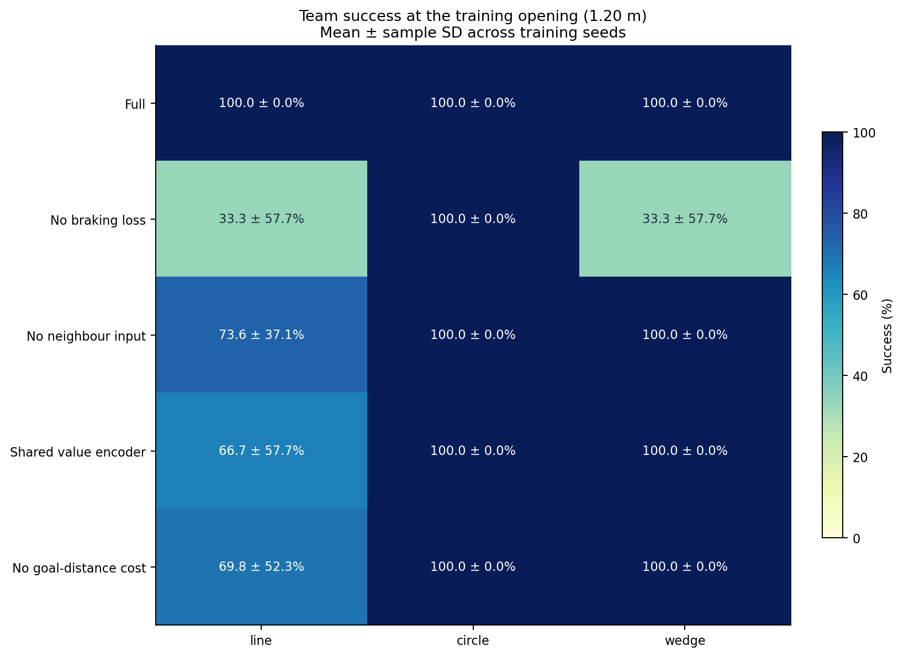
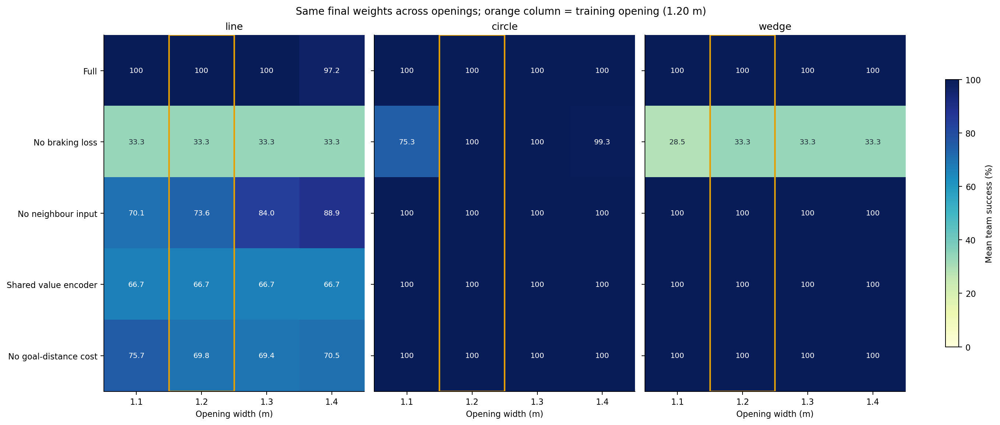
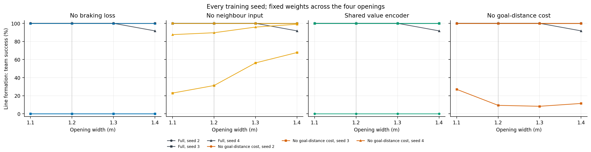
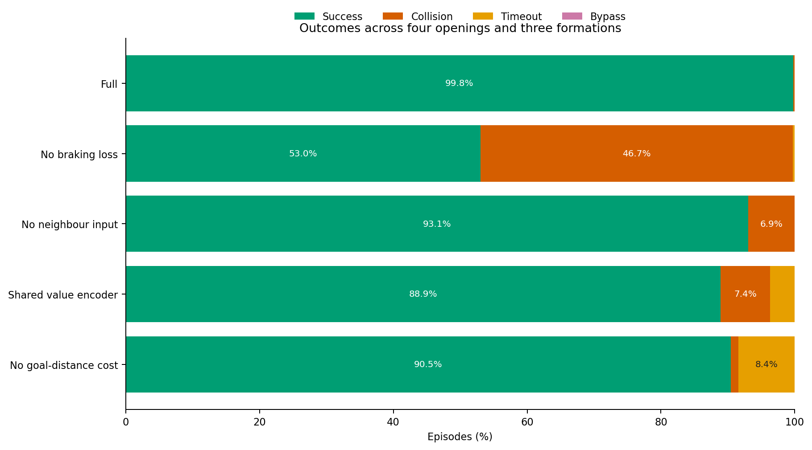
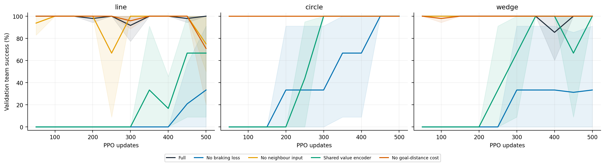
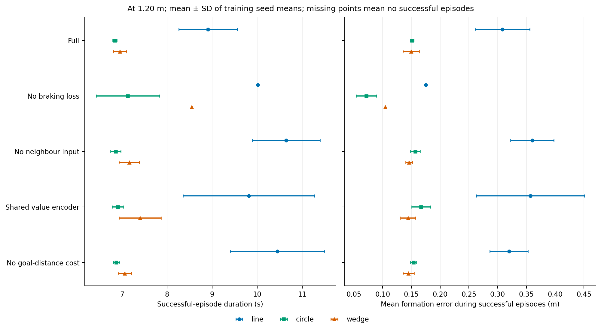

# 当前算法消融实验结果

完成 **45/45** 个训练任务，评测 **17,280** 个团队回合。五组方案覆盖三种队形、训练种子 2/3/4，每次 500 次更新；统一在 1.20 m 开口训练，并以同一最终权重评测 1.1、1.2、1.3、1.4 m 四档开口。每档使用 3 个环境种子、每种子 32 回合。表中 ± 为训练种子间样本标准差。

| 方案 | 横排 1.20 m | 圆形 1.20 m | 楔形 1.20 m | 四档总成功数 | 碰撞 | 超时 |
|---|---:|---:|---:|---:|---:|---:|
| [完整方案](full/README.md) | 100.0 ± 0.0% | 100.0 ± 0.0% | 100.0 ± 0.0% | 3448/3456 | 8 | 0 |
| [去制动损失](no_braking/README.md) | 33.3 ± 57.7% | 100.0 ± 0.0% | 33.3 ± 57.7% | 1833/3456 | 1613 | 10 |
| [去邻居输入](no_neighbours/README.md) | 73.6 ± 37.1% | 100.0 ± 0.0% | 100.0 ± 0.0% | 3216/3456 | 240 | 0 |
| [共享价值编码器](shared_value/README.md) | 66.7 ± 57.7% | 100.0 ± 0.0% | 100.0 ± 0.0% | 3072/3456 | 257 | 127 |
| [去目标距离代价](no_goal_cost/README.md) | 69.8 ± 52.3% | 100.0 ± 0.0% | 100.0 ± 0.0% | 3126/3456 | 39 | 291 |





## 结果

- **局部制动损失增益最大**：完整方案四档成功 3448/3456；关闭制动损失后为 1833/3456。在 1.20 m 横排／楔形，关闭制动后的成功率分别为 33.3 ± 57.7%／33.3 ± 57.7%。
- **邻居输入、独立价值编码器和目标距离代价均带来可测差异**：关闭 actor 邻居输入、共享价值编码器、关闭目标距离代价后，横排 1.20 m 成功率分别为 73.6 ± 37.1%、66.7 ± 57.7%、69.8 ± 52.3%；完整方案为 100.0 ± 0.0%。去邻居组的训练 critic 与局部制动教师保持原始输入。
- **训练后期表现**：完整方案 7/9 个运行在最后三次定期验证均满成功。此为经验稳定性指标，不是理论收敛保证。

这些结果支持保留四项机制；共享价值组同时减少了训练参数，不能把观察到的差异单独归因于梯度冲突。单项控制不等于把多个机制同时删去后的效果。








[学习效率与训练碰撞](figures/learning_speed.png) · [碰撞／超时原因](figures/failure_causes.png) · [开口变化曲线](figures/width_success.png)。

## 轨迹与数据

轨迹固定为训练 seed=2、测试 seed=61001、第 0 回合；各方案和开口使用相同索引。空心圆为起点，实心圆为终点，叉号为目标，碰撞候选步用红色虚线表示。

- [line：五组方案在四档开口的轨迹](figures/trajectories_line.png)
- [circle：五组方案在四档开口的轨迹](figures/trajectories_circle.png)
- [wedge：五组方案在四档开口的轨迹](figures/trajectories_wedge.png)



仅对成功回合比较通行时间和过程队形误差；失败率须同时参考，不能把提前碰撞造成的短轨迹当作效率提升。命令加速度／jerk 指标不代表实物振动。

## 数据与复现

- [实验协议](protocol.json)；[按训练种子与开口统计](per_seed_width.csv)；[逐回合数据](episodes.csv)；[收敛统计](convergence.csv)；[完整性核验](final_verification.json)。
- 每组目录下：`<formation>/seed_<n>/` 包含配置、逐更新指标、验证历史、最终权重、评测和原始轨迹；`source/` 保存这轮源码快照。
- 结果覆盖原渐缩场景；不代表任意未知环境、噪声／延迟或实物验证，也不构成 AFOR 公平基线。

```bash
python tools/summarize_ablations.py --root results/ablations
python tools/verify_ablations.py --root results/ablations
```
