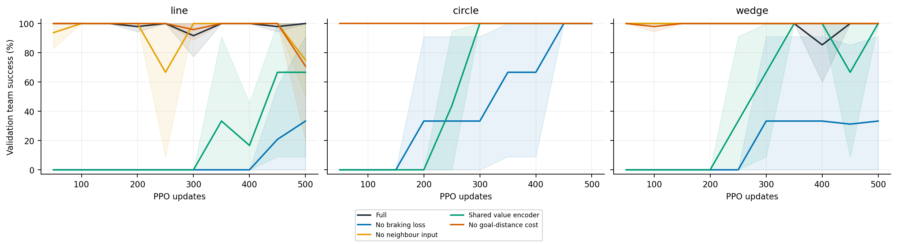
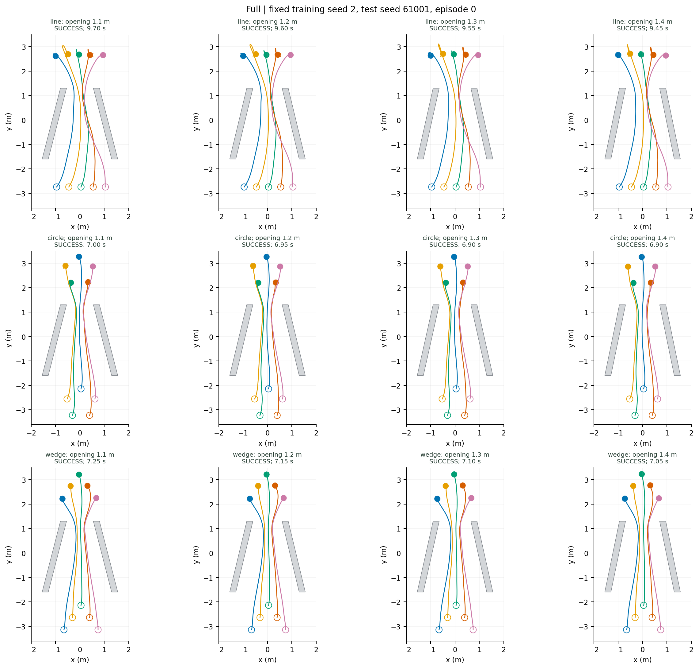

# 完整方案

完整方案对照。

| 队形 | 1.20 m 成功率 | 四档成功数 | 碰撞 | 超时 | 成功耗时（s，1.20 m） | 成功回合过程队形误差（m） |
|---|---:|---:|---:|---:|---:|---:|
| line | 100.0 ± 0.0% | 1144/1152 | 8 | 0 | 8.91 ± 0.65 | 0.308 ± 0.047 |
| circle | 100.0 ± 0.0% | 1152/1152 | 0 | 0 | 6.84 ± 0.05 | 0.151 ± 0.003 |
| wedge | 100.0 ± 0.0% | 1152/1152 | 0 | 0 | 6.95 ± 0.15 | 0.149 ± 0.014 |

[逐种子、逐开口数据](per_seed_width.csv) · [总体总结](../README.md)
