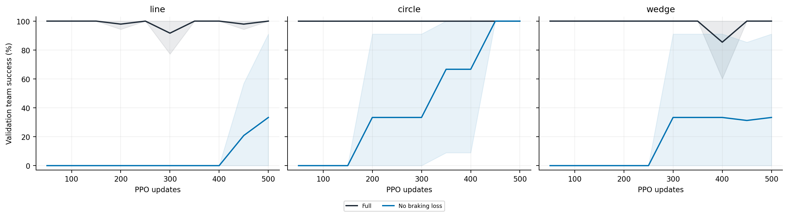
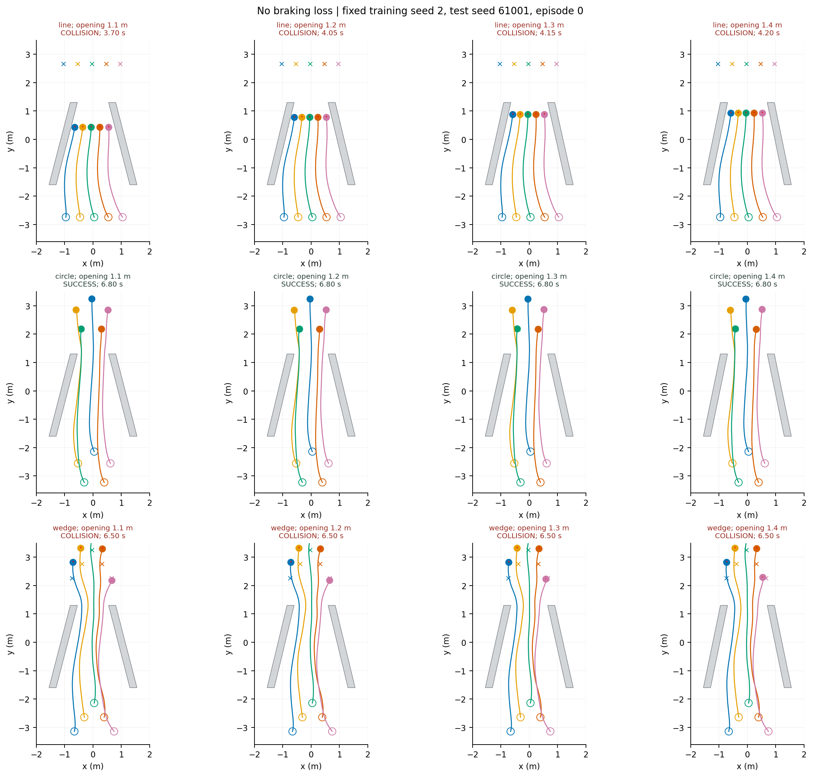

# 去制动损失

制动辅助损失权重置零。

| 队形 | 1.20 m 成功率 | 四档成功数 | 碰撞 | 超时 | 成功耗时（s，1.20 m） | 成功回合过程队形误差（m） |
|---|---:|---:|---:|---:|---:|---:|
| line | 33.3 ± 57.7% | 384/1152 | 768 | 0 | 10.02 (n=1) | 0.175 (n=1) |
| circle | 100.0 ± 0.0% | 1079/1152 | 71 | 2 | 7.13 ± 0.70 | 0.072 ± 0.018 |
| wedge | 33.3 ± 57.7% | 370/1152 | 774 | 8 | 8.55 (n=1) | 0.105 (n=1) |

[逐种子、逐开口数据](per_seed_width.csv) · [总体总结](../README.md)
