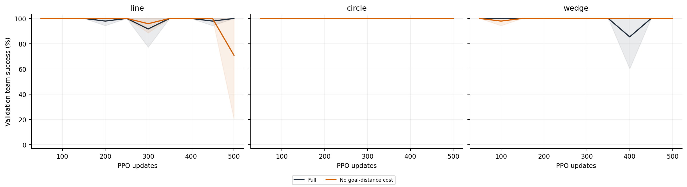
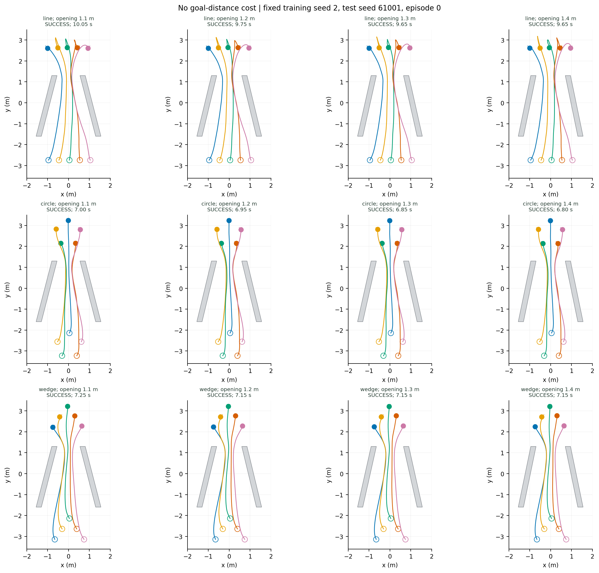

# 去目标距离代价

每步目标距离代价置零；保留目标进展和近目标速度项。

| 队形 | 1.20 m 成功率 | 四档成功数 | 碰撞 | 超时 | 成功耗时（s，1.20 m） | 成功回合过程队形误差（m） |
|---|---:|---:|---:|---:|---:|---:|
| line | 69.8 ± 52.3% | 822/1152 | 39 | 291 | 10.45 ± 1.05 | 0.320 ± 0.033 |
| circle | 100.0 ± 0.0% | 1152/1152 | 0 | 0 | 6.87 ± 0.07 | 0.154 ± 0.005 |
| wedge | 100.0 ± 0.0% | 1152/1152 | 0 | 0 | 7.06 ± 0.15 | 0.145 ± 0.010 |

[逐种子、逐开口数据](per_seed_width.csv) · [总体总结](../README.md)
