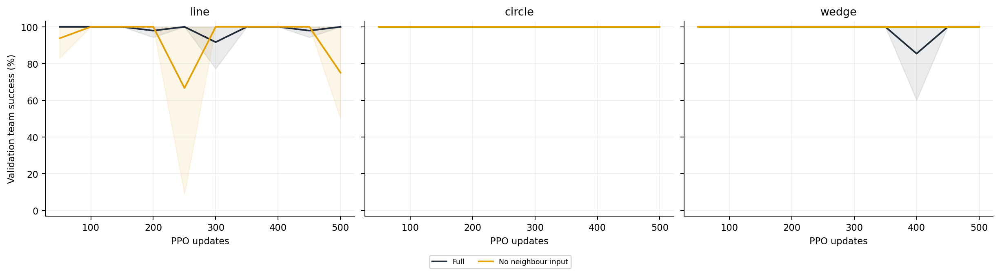
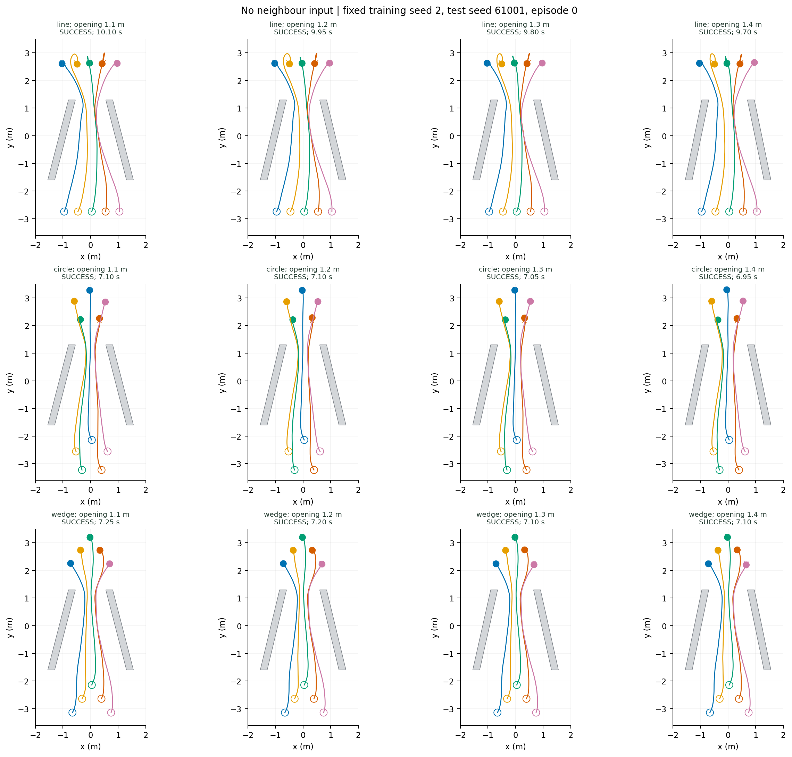

# 去邻居输入

屏蔽部署用 actor 的邻居特征和数量；训练 critic 与局部制动教师仍使用相同原始量测。激光仍能感知其他机器人。

| 队形 | 1.20 m 成功率 | 四档成功数 | 碰撞 | 超时 | 成功耗时（s，1.20 m） | 成功回合过程队形误差（m） |
|---|---:|---:|---:|---:|---:|---:|
| line | 73.6 ± 37.1% | 912/1152 | 240 | 0 | 10.65 ± 0.75 | 0.360 ± 0.038 |
| circle | 100.0 ± 0.0% | 1152/1152 | 0 | 0 | 6.86 ± 0.11 | 0.157 ± 0.008 |
| wedge | 100.0 ± 0.0% | 1152/1152 | 0 | 0 | 7.16 ± 0.23 | 0.146 ± 0.006 |

[逐种子、逐开口数据](per_seed_width.csv) · [总体总结](../README.md)
