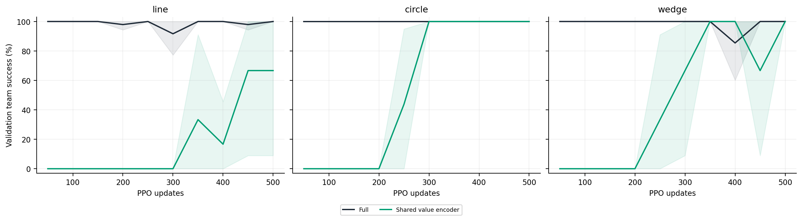
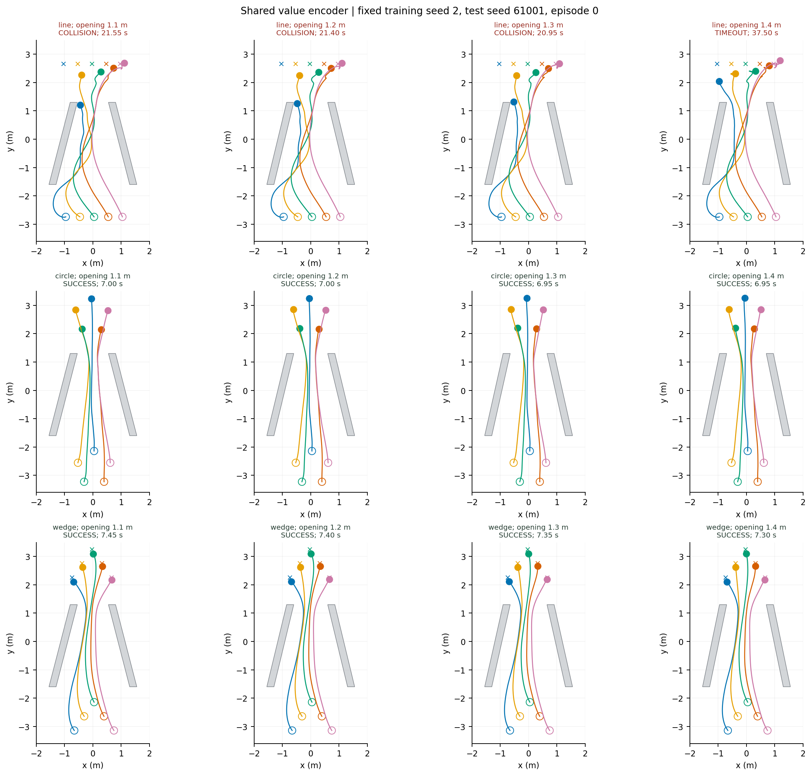

# 共享价值编码器

价值头使用 actor 特征，移除独立 critic 编码器；actor 容量不变。

| 队形 | 1.20 m 成功率 | 四档成功数 | 碰撞 | 超时 | 成功耗时（s，1.20 m） | 成功回合过程队形误差（m） |
|---|---:|---:|---:|---:|---:|---:|
| line | 66.7 ± 57.7% | 768/1152 | 257 | 127 | 9.81 ± 1.46 | 0.357 ± 0.094 |
| circle | 100.0 ± 0.0% | 1152/1152 | 0 | 0 | 6.90 ± 0.12 | 0.167 ± 0.016 |
| wedge | 100.0 ± 0.0% | 1152/1152 | 0 | 0 | 7.40 ± 0.47 | 0.144 ± 0.013 |

[逐种子、逐开口数据](per_seed_width.csv) · [总体总结](../README.md)
