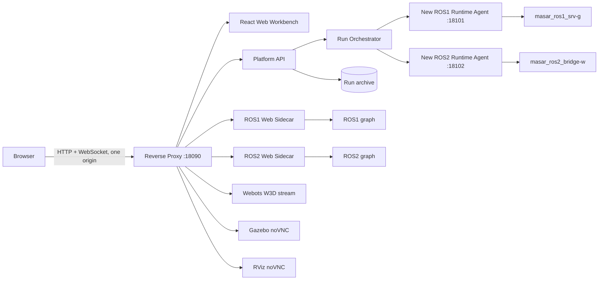

# MASAR 统一仿真验证与可视化平台设计

状态：第二版设计已确认，传感器修订已纳入  
版本：0.3-draft  
最后更新：2026-07-31  
实施范围：`ROS2swarm_w` 与 `masar_ws`，本期不接入 `multi-agent-neat`

## 1. 文档目的

本文定义一个独立于现有 ROS 工程的统一入口，用于启动、控制和同步观察 MASAR 的群行为验证、探索组搜救以及探索组与响应组协同搜救实验。平台不重写算法，不改变原脚本的默认运行语义，只负责：

1. 将现有合法启动组合整理成场景目录。
2. 对两个现有容器执行受限编排和健康检查。
3. 在一个浏览器工作台中同时显示仿真、RViz、地图、传感器、任务状态和日志。
4. 保存每次运行的配置、事件、日志、结果摘要和 rosbag。
5. 为后续历史回放和多实验对比保留稳定的数据契约。

本文是架构与产品设计说明。可执行接口和验收契约见 [SPEC.md](./SPEC.md)。

## 2. 已确认决策

| 项目 | 决策 |
|---|---|
| 使用者与并发 | 单用户；全平台同一时间最多一个活动实验 |
| 现有工程 | 尽量不改；必要改动只能增加默认关闭的平台参数 |
| 原 Qt GUI | 保留，原单容器运行方式继续可用；平台另提供 Web 控制界面 |
| 主界面 | 仿真、RViz、地图、传感器等面板同时可见，不做互斥页签 |
| 一级模块 | 群行为与控制验证、探索组独立运行、完整搜救系统 |
| 群行为模块 | 不要求 RViz；不得展示未由项目定义的通用行为指标 |
| 观测语义 | 只显示运行时真实存在且类型匹配的数据；缺失显示“未提供” |
| 可视化技术 | Robot Web Tools 为 ROS Web 数据主链路；Webots 原生 W3D streaming；Gazebo/RViz 使用 noVNC |
| 历史能力 | MVP 归档运行资料和 rosbag；回放与多实验对比后续实现 |
| 对外入口 | 仅绑定服务器 `127.0.0.1`，通过 SSH 隧道访问 |

### 2.1 废弃项目隔离

`/home/zjc/workspace/masar-unified-platform` 是已完全废弃的历史项目，不是本平台的前身，也不是迁移输入：

- 不复制其代码、协议、Agent 或目录结构。
- 不连接其 `agent.py`。
- 不使用其 `18088` 端口。
- 不依赖或主动清理其残留进程；残留进程的处置是独立运维事项。

新平台目录固定为 `/home/zjc/workspace/masar-simulation-platform`。

## 3. 已验证现状

验证日期为 2026-07-31。

### 3.1 容器与基础环境

| 容器 | 镜像与环境 | 网络 | 工作区挂载 | 状态 |
|---|---|---|---|---|
| `masar_ros1_srv-g` | `zjc2024/masar_ros1_srv-g:v1`，Ubuntu 20.04.6，ROS1 Noetic | host | `/home/zjc/workspace:/root/workspace` | 运行中 |
| `masar_ros2_bridge-w` | `zjc2024/masar_ros2_bridge-w:v1`，Ubuntu 22.04.5，ROS2 Humble，Webots R2025a | host | `/home/zjc/workspace:/root/workspace` | 运行中 |

已使用隔离 ROS master 验证两个容器之间的 ROS1/ROS2 `dynamic_bridge` 通信。当前没有启动业务仿真、RViz 或业务 ROS 节点。

两个业务容器中当前均未发现 `rosbridge_server`、`web_video_server` 和 `tf2_web_republisher`。这些包不得临时安装进现有容器镜像，而由平台新增的 ROS1/ROS2 sidecar 提供。

### 3.2 现有运行入口

`masar_ws/README.md:19-137` 已说明以下稳定入口：

| 入口 | 当前用途 | 平台模块 |
|---|---|---|
| `ROS2swarm_w/start_simulation.sh` | Webots 中运行 ROS2swarm 行为 | 群行为与控制验证 |
| `masar_ws/run_response_deform_demo.sh` | 4 台 Burger 的 DEFORM 编队导航 | 群行为与控制验证 |
| `masar_ws/run_response_controller_demo.sh` | roundflocking / transport 控制器验证 | 群行为与控制验证 |
| `masar_ws/launch_robosar_g.sh` | Gazebo/Tepper 探索组搜救闭环 | 探索组独立运行 |
| `ROS2swarm_w/start_robosar_webots.sh` + `masar_ws/launch_robosar_w.sh` | Webots 双容器探索组搜救闭环 | 探索组独立运行 |
| `masar_ws/run_tepper_response_demo.sh` | Gazebo/Tepper 探索组与响应组完整系统 | 完整搜救系统 |

现有资料明确说明 Webots 双容器的权威边界：ROS2 侧负责 Webots、`robot_N` 和 bridge；ROS1 侧负责 `/sim_map`、SLAM、任务生成、任务分配、导航、控制和 GUI，见 `masar_ws/README.md:50-74`。

### 3.3 当前可观测数据

已在代码中确认的主要数据包括：

| 数据域 | 现有来源 | 用途 |
|---|---|---|
| 地图 | `/sim_map`、地图更新与 TF | 原生二维/三维地图面板、RViz |
| 探索进度 | `/percent_completed` | 只用于探索/完整搜救模块 |
| 任务分配 | `/task_allocation_image`、`/task_allocation` | 分配图与任务状态 |
| 前沿 | `/frontier_filter/filtered_frontiers` | 地图叠加 |
| 应急对象 | `/robosar_sim/emergency_objects`、`/robosar_sim/emergency_events` | 发现对象与任务生成 |
| 应急任务 | `/emergency/tasks`、`/emergency/active_task` | 任务队列与状态时间线 |
| 响应组 | `/response_group/status`、`/response_group/behavior_mode`、`/response_group/task_result` | 完整搜救状态 |
| 响应组几何 | `/response_group/center_path`、`/response_group/formation_slots` | 路径与编队叠加 |
| 机器人遥测 | `/robot_N/scan`、`/robot_N/odom`、`/robot_N/cmd_vel` 或 ROS1 对应映射 | 激光、里程计、控制命令 |
| 场景状态 | `/global_info` | 运行时存在时显示机器人/物体位置 |

`EmergencyTask.msg` 已定义 `NEW -> DISPATCHED -> EN_ROUTE -> ACTING -> DONE/FAILED`。`ResponseGroupStatus.msg` 已定义状态、规划状态、编队中心、目标位姿、缩放量、slot error、最小净空和运动门等字段。这些是项目已有业务数据，可以按场景显示。

## 4. 产品信息架构

### 4.1 一级模块一：群行为与控制验证

目标是快速观察机器人行为与控制链路，不把它伪装成带统一评分体系的算法评测平台。

包含：

- ROS2swarm 的聚合、分散、吸引、导航、roundflocking、transport 与网络策略等现有行为。
- `run_response_deform_demo.sh`。
- `run_response_controller_demo.sh` 的 roundflocking、transport、checkpoint 和 heuristic 合法模式。

默认同时显示：

1. Webots 或 Gazebo 仿真画面。
2. 运行时可用的机器人位置/轨迹面板。
3. 固定传感器面板。
4. 机器人与话题连接状态。
5. 话题事件和进程日志。

此模块不启动 RViz，也不显示“聚合度、平均间距、速度一致性”等项目没有定义的指标。

#### 传感器展示规则

- Burger 和 e-puck 的具体话题由运行时发现结果与场景清单的允许列表共同决定。
- `LaserScan` 显示扫描形状、有效量程和当前消息频率。
- `Odometry` 显示位置、朝向和线/角速度。
- `cmd_vel` 显示当前命令及消息新鲜度。
- 安全状态、电池和相机仅在当前机器人确实发布对应话题时出现。
- `/global_info`、Path、Marker 等为可选数据，存在且类型正确时才显示。
- 不存在的数据源显示“未提供”，不得生成示例数值冒充实时值。

这里的 topic frequency、last message age、ONLINE/STALE 是传输健康度，只回答“数据链路是否工作”，不评价算法行为好坏。

### 4.2 一级模块二：探索组独立运行

包含两个合法仿真器组合：

- Gazebo：`launch_robosar_g.sh`。
- Webots：ROS2 侧 `start_robosar_webots.sh`，就绪后启动 ROS1 侧 `launch_robosar_w.sh`。

默认同时显示：

1. Gazebo 或 Webots 仿真。
2. RViz。
3. 原生任务地图，包括机器人位姿、轨迹、前沿和分配叠加。
4. 相机与传感器。
5. 探索完成度、机器人在线状态和任务分配状态。
6. 事件与节点日志。

### 4.3 一级模块三：完整搜救系统

MVP 的合法入口为 `run_tepper_response_demo.sh`，即 Gazebo/Tepper 中探索组与 4 台 Burger 响应组共同运行。没有独立入口支撑的“完整系统 + Webots”不出现在场景选择器中。

默认同时显示探索组模块的全部面板，并增加：

- 应急对象发现流。
- 应急任务队列与任务状态时间线。
- 当前响应行为模式。
- 响应组导航/任务状态。
- 响应组路径、目标和 formation slots 地图叠加。
- 项目已有的 `rms_slot_error`、`max_slot_error`、`minimum_clearance` 等响应组字段。

这些响应组字段不得回填到普通 ROS2swarm 聚合/分散场景中。

## 5. 工作台布局

### 5.1 桌面默认结构

```text
+--------------------------------------------------------------------------------+
| 顶栏：模块 / 场景 / 运行状态 / 计时 / 启动 / 停止 / HOME / 归档             |
+----------------+-----------------------------------------+---------------------+
| 实验配置       | 仿真                                    | 场景/任务状态       |
| 场景参数       | Webots W3D 或 Gazebo noVNC              | 机器人与话题健康度  |
| 记录选项       +----------------------+------------------+ 当前任务/响应组     |
| 预检结果       | RViz noVNC           | 原生地图         |                     |
|                +----------------------+------------------+                     |
|                | 相机与传感器                            |                     |
+----------------+-----------------------------------------+---------------------+
| 任务时间线/话题事件                    | 进程日志                               |
+--------------------------------------------------------------------------------+
```

群行为模块隐藏 RViz 和任务时间线后，仿真、轨迹与传感器自动占用释放出的空间。

### 5.2 面板交互

- 面板可以拖拽调宽、最大化、恢复和弹出到独立浏览器窗口。
- 所有核心面板在默认桌面同时存在，不通过互斥标签切换。
- 多相机、多激光等高带宽同类话题只在对应面板内部选择。
- 弹出窗口与主窗口共享同一个 `run_id` 和数据连接，不创建第二次 ROS 订阅编排。
- 布局保存在浏览器本地；MVP 不做多用户布局同步。
- 小屏幕按“仿真、地图/RViz、传感器、状态、日志”的顺序纵向排列，不相互覆盖。

已确认的静态视觉稿位于 `.superpowers/visual-review/layout-v3.html`。

## 6. 总体架构



### 6.1 控制平面

控制平面是新项目中的独立服务，包含：

- 场景目录与参数校验。
- 单运行互斥锁。
- 运行状态机。
- 两容器编排。
- 预检、就绪探针、超时、停止与归档。
- 对浏览器发布状态、事件和日志。

浏览器不能提交任意 shell 命令，不能指定任意 launch 文件，也不能通过控制 API 发布任意 ROS 消息。所有操作必须匹配版本化场景清单。

### 6.2 新运行代理

每个现有容器运行一个来自新平台目录的轻量代理。代理通过一次性 `docker exec` 启动，但代码仍位于新项目中，不写入现有 ROS 工程。

代理职责：

- 执行控制平面给出的已签名、已允许步骤 ID。
- 为每个 `run_id` 建立独立进程组。
- 按 stdout/stderr 原样流式回传日志。
- 执行 ROS 话题、节点和端口就绪探针。
- 只终止当前 `run_id` 创建的进程组。

禁止使用模糊 `pkill`、按进程名全局清理、复用旧 `agent.py` 或清理非本次运行创建的进程。

平台启动的现有 ROS1 脚本统一接收 `MASAR_PLATFORM_MODE=1`。该模式禁用脚本内部的二次 `setsid`、原 Qt GUI 和原生全局清理，使完整子树保持在 Runtime Agent 持有的 PGID 中；直接在容器内运行脚本时默认行为不变。所有 host/Compose/Agent 进程同时设置 `NO_PROXY/no_proxy=127.0.0.1,localhost,::1`。

### 6.3 ROS Web sidecar

ROS1 和 ROS2 分别使用与发行版匹配、按 digest 锁定基础镜像的 sidecar。sidecar 使用 host network 加入相应 ROS 图，但不修改两个业务容器镜像；ROS2 sidecar 还使用 host IPC，与现有 ROS2 业务容器的 Fast DDS 共享传输边界。`ROS_DOMAIN_ID` 与 `ROS_LOCALHOST_ONLY` 由场景运行配置显式传入。

每个 sidecar 可按场景启用：

- `rosbridge_server`：浏览器 ROS WebSocket 协议。
- `tf2_web_republisher`：按需下采样 TF。
- `web_video_server`：相机图像到浏览器友好格式。

sidecar 只绑定 loopback，最终由 Caddy 在 `127.0.0.1:18090` 提供同源路径。Noetic 版本没有区分发布与订阅 glob 的参数，因此镜像构建时移除 advertise、publish 和 service-call capability，只保留订阅/分片能力；Humble 使用空 `topics_pub_glob` 和按场景限制的 `topics_sub_glob`。Caddy 与两个 sidecar 均有健康检查，且所有 Compose 服务固定设置 `NO_PROXY/no_proxy=127.0.0.1,localhost,::1`。

### 6.4 图形界面

- Webots：使用 `WebotsLauncher(stream=..., port=...)` 的原生 W3D streaming。当前安装签名已验证包含 `stream=False` 和 `port='1234'`。[R2025a 源码](https://github.com/cyberbotics/webots/blob/R2025a/src/webots/gui/WbTcpServer.cpp)固定使用 `QTcpServer::listen(QHostAddress::Any, port)`，没有 bind-host 参数；平台因此不修改 Webots socket 行为，而由 `webots-guard` 在 host network 安装 IPv4/IPv6 INPUT 规则，只允许 loopback 访问 `18141`。
- Gazebo：平台模式以现有脚本的 `--no-rviz` 启动主系统，并把 Gazebo GUI 放在独立虚拟显示中；noVNC 显示该桌面。
- RViz：平台在另一虚拟显示中单独启动现有 RViz 配置，通过第二个 noVNC 面板显示。
- 原 Qt GUI：原命令保持默认启动。平台场景可以使用默认关闭的参数跳过 Qt，以避免两个控制面同时误操作；不选择平台模式时行为不变。

显示 sidecar 固定分配 Gazebo `:101` 与 RViz `:102`，每套 Xvfb/openbox/x11vnc/websockify 都有独立的 PID/PGID 和即时持久化的 `/proc` 启动标识。x11vnc 同时显式绑定 `127.0.0.1` 与 `::1`，websockify 只绑定 IPv4 loopback；Caddy 是浏览器唯一入口。依赖锁定为 noVNC `v1.7.0` 和 websockify `v0.13.0` 的 commit tarball + SHA-256。RViz 是探索/救援运行的可选观测进程：面板故障产生 `DISPLAY_ERROR`，不会终止仍健康的 ROS 任务；群行为与控制策略验证不启动 RViz。

Webots path-prefix 反向代理和鼠标交互已通过真实 Chromium 验证：`/webots/` 可完成 WebSocket upgrade，W3D 画布非空，拖拽与滚轮分别改变相机姿态和位置。验收页使用 Cyberbotics R2025a viewer；生产前端将在 React 任务中锁定并本地化对应资产，断线重连也在该任务形成组件级测试。

## 7. Robot Web Tools 采用分析

调研入口：[Robot Web Tools](https://robotwebtools.github.io/)。仓库默认分支和版本信息在 2026-07-31 重新核对；前端依赖必须锁版本并存入 lockfile，禁止运行时从 CDN 拉取。

### 7.1 直接采用

| 工具 | 平台用途 | 采用原因 | 边界 |
|---|---|---|---|
| [rosbridge_suite](https://github.com/RobotWebTools/rosbridge_suite) | ROS1/ROS2 到浏览器的 WebSocket 网关 | 默认分支为 `ros2`；协议成熟，ROS1/ROS2 前端接口统一 | 不是安全边界；只能 loopback + 反向代理，限制消息大小和允许话题 |
| [roslibjs](https://github.com/RobotWebTools/roslibjs) | topic/service/param 客户端和连接管理 | npm `roslib` 当前核对为 2.1.0，BSD-2-Clause | 封装成平台 connection/topic adapter，不允许组件各自建连接 |
| [tf2_web_republisher](https://github.com/RobotWebTools/tf2_web_republisher) | 按固定帧和目标帧提供精简 TF | 避免浏览器订阅完整 `/tf` 与 `/tf_static` | ROS1/ROS2 sidecar 分别部署；缓存和频率由场景配置 |
| [web_video_server](https://github.com/RobotWebTools/web_video_server) | 相机图像浏览器显示 | 避免在前端手写 ROS Image 编解码 | 同时最多激活一个主视频源；断流显示原因和最后帧时间 |
| [noVNC](https://github.com/novnc/noVNC) | Gazebo、RViz、必要时 Qt 的远程桌面 | 支持鼠标键盘和缩放，适合保留原生 GUI | 每个面板使用独立虚拟显示；浏览器默认只查看，控制按场景授权 |

### 7.2 条件采用并隔离

| 工具 | 用途 | 风险 | 处理 |
|---|---|---|---|
| [ros3djs](https://github.com/RobotWebTools/ros3djs) | OccupancyGrid、TF、Path、Marker、LaserScan、PointCloud2、URDF | npm `ros3d` 为 1.1.0，依赖较旧 Three.js API；旧示例 CDN 不可靠 | 锁定版本，放入独立 `Ros3DPanel` 适配层；业务组件不直接调用；PointCloud2 默认关闭 |
| [ros2djs](https://github.com/RobotWebTools/ros2djs) | 轻量二维 OccupancyGrid | npm `ros2d` 为 0.10.0，依赖旧 EaselJS | 仅用于稳定二维地图路径；若兼容性验证失败，由同一 `MapPanel` 接口切换到 ros3djs 平面视图 |

“条件采用”不是重新实现渲染器。它表示先做固定版本的兼容性验证，再通过平台适配层使用，避免老依赖扩散到整个前端。

### 7.3 暂不作为主体

| 工具 | 结论 |
|---|---|
| `webrtc_ros` | 构建和媒体链路复杂，MVP 的单用户 SSH 场景不需要；先用 `web_video_server` |
| `rclnodejs` | Web SDK allow-list 思路可借鉴，但只覆盖 ROS2，不能统一 ROS1/ROS2 主链路 |
| Foxglove | 不作为任务控制主界面；避免与定制工作台产生两个入口 |
| `rosboard` | 可保留为开发诊断入口，不承载平台状态机或业务控制 |

### 7.4 后续采用

[Lichtblick](https://github.com/Lichtblick-Suite/lichtblick) 适合第二阶段的 rosbag/MCAP 回放、高级图表和跨运行分析。它应作为“诊断/回放工作区”嵌入或跳转，不替代本平台的场景编排和搜救任务界面。

### 7.5 RoboticsAcademy 借鉴边界

[JdeRobot/RoboticsAcademy](https://github.com/JdeRobot/RoboticsAcademy) 的默认分支为 `humble-devel`。本平台借鉴其场景目录、Manager 编排、命令完成确认、VNC 仿真窗口和 React 工作台思路。

RoboticsAcademy 为 GPL-3.0 项目。本平台不复制其源代码；只借鉴公开架构思想。其标记为 obsolete 的旧架构文档不作为实现依据。

## 8. 数据与显示契约

### 8.1 数据发现

每个场景提供允许话题模式、期望类型和展示能力。例如：

```yaml
data_sources:
  - graph: ros2
    pattern: /robot_*/scan
    type: sensor_msgs/msg/LaserScan
    capability: laser
    required: false
  - graph: ros2
    pattern: /robot_*/odom
    type: nav_msgs/msg/Odometry
    capability: odometry
    required: true
  - graph: ros1
    topic: /percent_completed
    type: std_msgs/Float32
    capability: exploration_progress
    required: false
```

运行时只在“清单允许 + ROS 图存在 + 类型匹配”三个条件同时满足时订阅。

### 8.2 缺失、过期与错误

| 状态 | UI 表现 |
|---|---|
| 场景不提供 | “未提供” |
| 允许但尚未发现 | “等待数据” |
| 已连接且在新鲜度阈值内 | `ONLINE` / 正常显示 |
| 超过阈值未更新 | `STALE`，保留最后值和时间 |
| 消息类型不匹配 | `TYPE_MISMATCH`，不解析载荷 |
| 网关断开 | `DISCONNECTED`，面板停止更新并尝试有界重连 |

不得把“未提供”渲染为 0，也不得把旧值持续显示为实时值。

### 8.3 浏览器带宽控制

- 激光与里程计使用最后值队列，默认 UI 更新上限 10 Hz。
- TF republisher 只请求当前面板所需帧。
- 相机面板一次只选择一个高带宽视频源。
- PointCloud2 默认关闭，启用时设置点数和刷新率上限。
- 日志按游标分页，浏览器不保留无限增长的 DOM。

## 9. 控制与安全

### 9.1 控制路径

任务命令由 Platform API 校验后发布：

- START：`/system_mission_command`，值 `1`。
- STOP：`/system_mission_command`，值 `2`。
- HOME：`/system_mission_command`，值 `3`。
- 响应组返航：`/response_group/return_home`。

消息常量可在 `masar_ws/src/robosar/robosar_messages/msg/mission_command.msg` 验证。网页不直接获得 rosbridge 发布任意话题的权限。

### 9.2 访问边界

- 平台默认监听 `127.0.0.1:18090`。
- 代理默认监听 `127.0.0.1:18101` 和 `127.0.0.1:18102`。
- ROS Web 与 noVNC 内部端口不绑定公网接口。Webots R2025a 原生进程固定 wildcard listen，平台用健康检查覆盖的 IPv4/IPv6 INPUT 守卫拒绝所有非 loopback 的 `18141` 连接；只有 Caddy 能从 loopback 反代该流。
- 浏览器只访问 `18090` 的同源 HTTP/WebSocket 路径。
- API 校验 `Origin`、`run_id` 和一次性命令 token。
- 不把 Docker socket、shell 或 rosbridge 原始发布能力暴露给浏览器。

单用户不等于无安全边界。SSH 隧道负责用户认证，平台仍需防止浏览器误发任意命令。

## 10. 归档与后续回放

MVP 每次运行生成：

```text
runs/<run_id>/
├── manifest.json
├── resolved-scenario.yaml
├── events.jsonl
├── process-logs/
├── ros/
│   ├── topics-snapshot.json
│   └── nodes-snapshot.json
├── bags/
├── summary.json
└── checksums.sha256
```

MVP 支持列表、查看摘要和下载 rosbag，不实现时间同步回放或多次实验图表对比。

后续阶段：

1. 将 ROS1 bag 和 ROS2 bag 统一导入 MCAP 或保留转换索引。
2. 用同一平台事件时钟对齐视频、地图、任务和日志。
3. 使用 Lichtblick 提供高级回放。
4. 按相同场景和参数字段进行多运行并排对比。

群行为对比仍只比较已归档的真实信号和用户选择的项目定义结果，不自动添加没有定义的算法评分。

## 11. 兼容改动策略

允许对现有工程做的改动必须同时满足：

1. 只增加平台专用参数、环境变量或 launch argument。
2. 默认值关闭平台行为。
3. 原命令、默认输出、节点拓扑和任务逻辑不变。
4. 新参数只影响显示、日志、stream 或 Qt/RViz 是否由平台另行托管。
5. 每个改动都有原命令 dry-run 和现有测试回归。

首批可能的兼容点：

- `start_webots.launch.py` 暴露 `webots_stream` 与 `webots_port`，默认 `false` 和现有端口。
- 相关顶层 Webots 启动入口透传上述参数，默认关闭。
- 平台场景通过现有 `--no-rviz` 禁用脚本内 RViz，再在独立虚拟显示启动 RViz。
- 如果现有脚本尚无“跳过 Qt”开关，只增加默认 `false` 的 `platform_skip_gui`；原命令仍启动 Qt。

任何算法、导航、安全间隙、任务切换和速度控制修改都超出平台接入范围。

## 12. SSH 与浏览器访问

推荐只转发统一入口：

```sshconfig
Host masar-platform
  HostName <服务器可达地址或现有 SSH 别名>
  User zjc
  LocalForward 18090 127.0.0.1:18090
  ServerAliveInterval 30
  ServerAliveCountMax 3
```

连接后浏览器访问 `http://localhost:18090`。也可以继续使用 Cursor/VS Code 的 Ports 面板转发 `18090`。

本执行环境可以操作服务器文件、命令、Docker 容器以及可达网页，并可使用服务器侧的自动化 Chromium 做页面检查。它不能在没有远程调试或配对的情况下直接控制用户 Windows 上已经打开的 Chrome，也不能绕过服务器网络、校园 VPN 或 SSH 可达性限制。

## 13. 风险与处理

| 风险 | 影响 | 处理 |
|---|---|---|
| host network 中端口冲突 | 场景无法启动或连错服务 | 预检端口；内部端口集中登记；拒绝自动抢占未知进程 |
| ROS1/ROS2 同名话题类型冲突 | dynamic bridge 不创建桥或数据误读 | 场景定义权威 graph 和类型；启动时做类型探针 |
| Webots stream 反代路径不兼容 | 仿真面板空白 | 第一阶段真实浏览器 spike；保留独立 loopback 端口回退 |
| Gazebo/RViz 共享 DISPLAY | 无法形成两个独立面板 | 平台以 `--no-rviz` 启动主脚本，在第二虚拟显示单独启动 RViz |
| rosbridge 高带宽数据压垮浏览器 | 卡顿或内存增长 | throttle、queue length 1、按面板订阅、PointCloud 默认关闭 |
| 停止实验误杀其他节点 | 原系统受影响 | run_id 进程组所有权；禁止模糊 pkill；停止前后记录 PID 树 |
| 用户同时使用 Qt 与 Web 控制 | 命令竞争 | 平台运行默认只保留一个控制面；原生运行仍保留 Qt |
| 历史包格式不一致 | 后续回放困难 | MVP 即写版本化 manifest、事件时钟和 checksum |

## 14. 设计完成定义

设计进入实施阶段前必须满足：

- 三个一级模块和全部合法场景均写入场景清单。
- 群行为模块没有未定义的通用行为指标。
- V3 默认布局可在桌面同时看见所需面板。
- ROS Web Tools 的用途、版本固定策略和失败回退已明确。
- 对现有工程的每一项修改都有默认关闭和回归验证。
- 旧项目、旧 Agent 和 `18088` 不在依赖图中。
- 单活动运行、停止所有权、归档结构和后续回放边界已明确。
