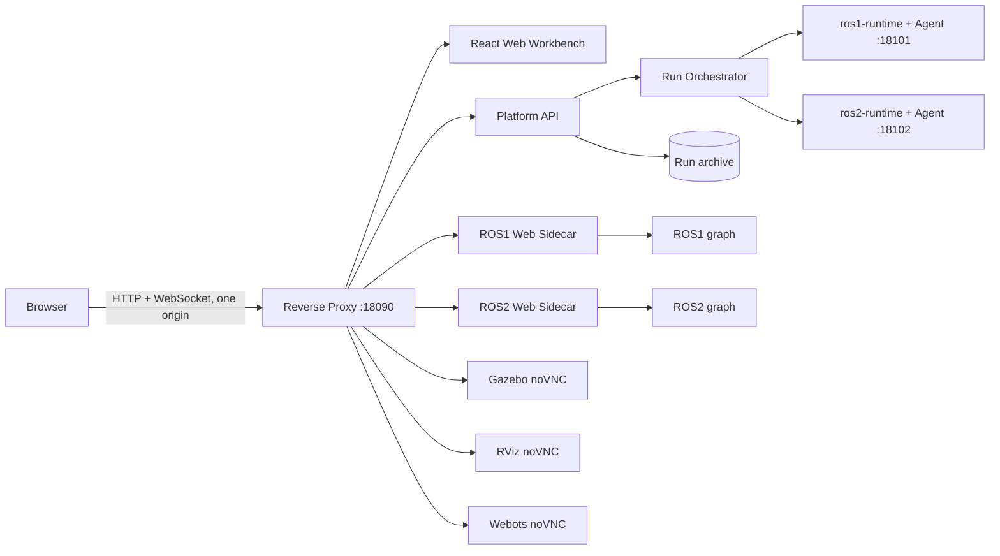

# MASAR 统一仿真验证与可视化平台设计

状态：运行闭环与 Compose 托管 E1-E4 全部验收通过
文档/部署契约版本：0.5-compose-managed（Python 包版本见 `pyproject.toml`，当前为 0.1.0）
最后更新：2026-08-04
实施范围：`ROS2swarm_w` 与 `masar_ws`，本期不接入 `multi-agent-neat`

## 1. 文档目的

本文定义一个独立于现有 ROS 工程的统一入口，用于启动、控制和同步观察 MASAR 的群行为验证、探索组搜救以及探索组与响应组协同搜救实验。平台不重写算法，不改变原脚本的默认运行语义，只负责：

1. 将现有合法启动组合整理成场景目录。
2. 通过单一 Compose 项目托管两个业务 runtime，并执行受限编排和健康检查。
3. 在一个浏览器工作台中同时显示仿真、RViz、任务分配与建图、传感器、任务状态和日志。
4. 保存每次运行的配置、事件、日志、结果摘要和 rosbag。
5. 为后续历史回放和多实验对比保留稳定的数据契约。

本文是架构与产品设计说明。可执行接口和验收契约见 [SPEC.md](./SPEC.md)。

## 2. 已确认决策

| 项目 | 决策 |
|---|---|
| 使用者与并发 | 单用户；全平台同一时间最多一个活动实验 |
| 现有工程 | 尽量不改；必要改动只能增加默认关闭的平台参数 |
| 原 Qt GUI | 保留，原单容器运行方式继续可用；平台另提供 Web 控制界面 |
| 主界面 | 仿真、RViz、任务分配与建图、传感器等面板同时可见，不做互斥页签 |
| 一级模块 | 群行为与控制验证、探索组独立运行、完整搜救系统 |
| 群行为模块 | 不要求 RViz；不得展示未由项目定义的通用行为指标 |
| 观测语义 | 只显示运行时真实存在且类型匹配的数据；缺失显示“未提供” |
| 可视化技术 | Robot Web Tools 为 ROS 数据主链路；Webots/Gazebo/RViz 统一使用 noVNC；Webots 通过 VirtualGL 使用宿主 NVIDIA X server |
| 历史能力 | MVP 归档运行资料和 rosbag；回放与多实验对比后续实现 |
| 对外入口 | 绑定 `127.0.0.1:18090`；本机直接访问，远程服务器通过 SSH 隧道访问 |
| 部署入口 | `make docker-start`；8 个常驻服务由一个 Compose 项目管理 |
| 开发模式 | 不区分生产/开发 Compose；依赖在镜像，平台源码/配置大多只读挂载，整个 ROS workspace 读写挂载以复用构建结果 |

### 2.1 Workspace 与文档边界

宿主机采用三个项目同级的 `<workspace>` 布局，绝对路径由部署脚本根据当前 checkout
自动推导，也可以通过 `MASAR_WORKSPACE_ROOT` 覆盖。Compose 将其挂载到容器内稳定
路径 `/root/workspace`，因此现有 ROS 脚本不依赖某个宿主机用户目录。

废弃平台不属于当前仓库、Compose 项目或迁移输入。当前实现不复制其代码或协议，
不连接旧 Agent，不使用旧入口端口，也不主动清理其宿主机进程。

根目录 `README.md` 是项目汇总和快速开始；完整使用、设计、规范、计划和验收文档
统一放在 `docs/`。

## 3. 已验证现状

原始环境验证日期为 2026-07-31；下表已按 2026-08-04 当前 Compose 契约更新。

### 3.1 容器与基础环境

| 容器 | 镜像与环境 | 网络 | 工作区挂载 | 状态 |
|---|---|---|---|---|
| `masar_ros1_srv-g` / `ros1-runtime` | `talent18/masar_ros1_srv-g:v2@sha256:3639f637...`，ROS1 Noetic | host | `${MASAR_WORKSPACE_ROOT}:/root/workspace` | Compose 托管 |
| `masar_ros2_bridge-w` / `ros2-runtime` | `talent18/masar_ros2_bridge-w:v2@sha256:5550e15e...`，ROS2 Humble，Webots R2025a | host | `${MASAR_WORKSPACE_ROOT}:/root/workspace` | Compose 托管 |

两个容器之间的 ROS1/ROS2 `dynamic_bridge`、真实业务仿真、RViz 和六个场景均已完成分阶段验收。常驻 Compose 服务空闲时不启动业务 ROS 节点；创建 Run 后才由 Runtime Agent 启动该场景的进程组。

两个业务 runtime 不承担浏览器数据面。`rosbridge_server`、`web_video_server` 和
`tf2_web_republisher` 由独立 ROS1/ROS2 sidecar 提供，不在业务容器中临时安装。

### 3.2 现有运行入口

`masar_ws/README.md` 已说明以下稳定入口：

| 入口 | 当前用途 | 平台模块 |
|---|---|---|
| `ROS2swarm_w/start_simulation.sh` | Webots 中运行 ROS2swarm 行为 | 群行为与控制验证 |
| `masar_ws/run_response_deform_demo.sh` | 4 台 Burger 的 DEFORM 编队导航 | 群行为与控制验证 |
| `masar_ws/run_response_controller_demo.sh` | roundflocking / transport 控制器验证 | 群行为与控制验证 |
| `masar_ws/launch_robosar_g.sh` | Gazebo/Tepper 探索组搜救闭环 | 探索组独立运行 |
| `ROS2swarm_w/start_robosar_webots.sh` + `masar_ws/launch_robosar_w.sh` | Webots 双容器探索组搜救闭环 | 探索组独立运行 |
| `masar_ws/run_tepper_response_demo.sh` | Gazebo/Tepper 探索组与响应组完整系统 | 完整搜救系统 |

现有资料明确说明 Webots 双容器的权威边界：ROS2 侧负责 Webots、`robot_N` 和 bridge；ROS1 侧负责 `/sim_map`、SLAM、任务生成、任务分配、导航、控制和原生 GUI。平台运行时禁用该 Run 内的原生 Qt GUI，由 Web 工作台控制。

### 3.3 当前可观测数据

已在代码中确认的主要数据包括：

| 数据域 | 现有来源 | 用途 |
|---|---|---|
| 地图 | `/sim_map`、地图更新与 TF | RViz 交互观测、readiness 与录包；当前 React `MapPanel` 不重复渲染 OccupancyGrid |
| 探索进度 | `/percent_completed` | `0..1` 地图覆盖比例，只用于探索/完整搜救的建图面板 |
| 任务分配 | `/task_allocation_image`、`/task_allocation` | Qt 分配图与最近一次新分配批次（“本轮分配”） |
| 前沿 | `/frontier_filter/filtered_frontiers` | 任务分配与建图面板的候选前沿计数及场景 readiness |
| 应急对象 | `/robosar_sim/emergency_objects`、`/robosar_sim/emergency_events` | 发现对象与任务生成 |
| 应急任务 | `/emergency/tasks`、`/response_group/active_task` | 任务队列与当前响应任务 |
| 响应组 | `/response_group/status`、`/response_group/behavior_mode`、`/response_group/task_result` | 完整搜救状态 |
| 机器人遥测 | `/robot_N/scan`、`/robot_N/odom`、`/robot_N/cmd_vel` 或 ROS1 对应映射 | 激光、单机器人局部里程计、控制命令 |
| 仿真世界位姿 | Webots `/global_info`；Gazebo `/gazebo/model_states` | 在同一世界坐标系中绘制多机器人当前位置与历史轨迹 |

`EmergencyTask.msg` 已定义 `NEW -> DISPATCHED -> EN_ROUTE -> ACTING -> DONE/FAILED`。`ResponseGroupStatus.msg` 已定义状态、规划状态、编队中心、目标位姿、缩放量、slot error、最小净空和运动门等字段。这些是项目已有业务数据，可以按场景显示。

## 4. 产品信息架构

### 4.1 一级模块一：群行为与控制验证

目标是快速观察机器人行为与控制链路，不把它伪装成带统一评分体系的算法评测平台。

包含：

- ROS2swarm 的聚合、分散、吸引、导航、roundflocking、transport 与网络策略等现有行为。
- `run_response_deform_demo.sh`。
- `run_response_controller_demo.sh` 的 roundflocking、transport、checkpoint 和 heuristic 合法模式。

默认同时显示：

1. Webots 或 Gazebo 仿真画面。
2. 运行时可用的机器人位置/轨迹面板。
3. 按机器人选择的传感器面板。
4. 机器人与话题连接状态。
5. 话题事件和进程日志。

此模块不启动 RViz，也不显示“聚合度、平均间距、速度一致性”等项目没有定义的指标。

#### 传感器展示规则

- Burger 和 e-puck 的具体话题由运行时发现结果与场景清单的允许列表共同决定。
- 活动 Run 的机器人选择器先使用 `/robots` 的 Run 期望清单保持完整行数，再用真实 ROS 首帧决定每台机器人的在线状态；期望清单本身不作为健康证据。未创建 Run 或 Run 已进入 `COMPLETED`/`FAILED` 时，不向实时面板传递这份计划清单。
- `LaserScan` 显示扫描形状、有效量程和当前消息频率。
- `Odometry` 显示位置、朝向和线/角速度。
- `cmd_vel` 显示当前命令及消息新鲜度。
- 相机、IMU、红外、安全状态和电池等可选字段仅在明确型号支持或当前机器人确实
  发布对应话题时出现。Gazebo 探索 Khepera 不显示红外/IMU；响应 Burger 不显示
  红外，但使用真实 `/tb_i/scan` 与 `/tb_i/imu`；八路红外只属于 Webots e-puck。
- 多机器人总体轨迹只接受仿真器统一世界位姿：Webots 使用 `/global_info`，Gazebo 使用 `/gazebo/model_states`。各机器人的局部 `odom` 只在传感器面板显示，不作为总体轨迹的回退来源。
- 不存在的数据源显示“未提供”，不得生成示例数值冒充实时值。

这里的 topic frequency、last message age、ONLINE/STALE 是传输健康度，只回答“数据链路是否工作”，不评价算法行为好坏。

### 4.2 一级模块二：探索组独立运行

包含两个合法仿真器组合：

- Gazebo：`launch_robosar_g.sh`。
- Webots：ROS2 侧 `start_robosar_webots.sh`，就绪后启动 ROS1 侧 `launch_robosar_w.sh`。

默认同时显示：

1. Gazebo 或 Webots 仿真。
2. RViz。
3. 任务分配与建图：Qt 任务分配图、地图覆盖率、候选前沿和本轮分配。
4. 按机器人选择实际存在的相机、LaserScan、IMU 和 Odometry；Gazebo Khepera
   没有红外/IMU 时不渲染对应字段。
5. 探索任务态势：在线探索机器人，以及火源、受害者、待推送障碍的快照计数、位置和探测机器人。
6. 机器人/话题健康、事件与节点日志。

任务分配与建图、探索任务态势各自只保留上述职责，不重复展示进度或分配。默认 HIGH 分配器虽然创建 `/tasks_completed` publisher，但实测不发消息，因此默认探索和完整搜救 profile 不公开“已完成任务”。

### 4.3 一级模块三：完整搜救系统

MVP 的合法入口为 `run_tepper_response_demo.sh`，即 Gazebo/Tepper 中探索组与 4 台 Burger 响应组共同运行。没有独立入口支撑的“完整系统 + Webots”不出现在场景选择器中。

默认同时显示探索组模块的全部面板，并增加：

- 应急对象发现流。
- 合并后的响应/规划状态与运动使能。
- 当前应急任务与任务队列。
- `rms_slot_error`、`max_slot_error` 和 `minimum_clearance`。

响应摘要固定为上述六项操作期核心信息。行为模式、编队纵横尺度、响应机器人数量和最近结果仍可由底层 profile 解码或归档，但不在默认右栏单独占行，避免与状态、任务和编队质量重复。右侧状态栏使用纵向流布局：任务态势、响应摘要和普通状态面板分别以 `180px`、`220px` 和 `145px` 为最小基准高度；高视口按权重增长填满右栏，低视口保持最小高度并整体滚动。任务对象列表在面板内独立滚动，后续健康、事件和日志面板不得覆盖前一面板。

这些响应组字段不得回填到普通 ROS2swarm 聚合/分散场景中。

## 5. 工作台布局

### 5.1 桌面默认结构

```text
+--------------------------------------------------------------------------------+
| 顶栏：模块 / 场景 / 运行状态 / 计时 / 启动 / 停止 / HOME / 归档             |
+----------------+-----------------------------------------+---------------------+
| 实验配置       | 仿真                                    | 场景/任务状态       |
| 场景参数       | Webots 或 Gazebo noVNC                  | 机器人与话题健康度  |
| 记录选项       +----------------------+------------------+ 当前任务/响应组     |
| 预检结果       | RViz noVNC           | 任务分配与建图   |                     |
|                +----------------------+------------------+                     |
|                | 相机与传感器                            |                     |
+----------------+-----------------------------------------+---------------------+
| 任务时间线/话题事件                    | 进程日志                               |
+--------------------------------------------------------------------------------+
```

群行为模块隐藏 RViz 和任务时间线后采用上下布局：仿真在上方横跨中央工作区，机器人运行轨迹、传感器观测在下方等宽并排。小屏幕再按仿真、轨迹、传感器顺序转为单列。

### 5.2 面板交互

- 面板可以拖拽调宽、最大化、恢复和弹出到独立浏览器窗口。
- 所有核心面板在默认桌面同时存在，不通过互斥标签切换。
- 多相机、多激光等高带宽同类话题只在对应面板内部选择。
- 弹出窗口与主窗口共享同一个 `run_id` 和数据连接，不创建第二次 ROS 订阅编排。
- 布局保存在浏览器本地；MVP 不做多用户布局同步。
- 小屏幕按“仿真、任务分配与建图/RViz、传感器、状态、日志”的顺序纵向排列，不相互覆盖。
- 桌面右侧状态栏在高视口中自动填满纵向空间；高度不足时显示纵向滚动，任务态势中的搜救对象列表可单独滚动，不以裁剪文本换取固定高度。

`.superpowers/visual-review/layout-v3.html` 只保留为群行为模块的早期视觉稿，不代表探索组或完整搜救布局。生产 React 工作台已按三个一级模块分别实现：三段任务轨道承担模块选择与运行阶段语义；探索/救援默认同屏显示仿真、RViz、任务分配与建图和传感器；群行为的仿真在上方横跨两列，轨迹与传感器在下方并排。空任务分配图、相机和响应字段不绘制示例值，所有等待/缺失/陈旧状态直接来自 API 数据。

构建后的工作台由 Caddy 根路径提供，且排在 `/api`、ROS、Webots、视频和 noVNC 路由之后。桌面布局在 1440x900 保证核心面板同时可见；390px 小屏转为单列，不隐藏核心面板。面板调整尺寸、最大化、恢复和弹出都复用同一 `run_id`，不触发新的运行创建。

## 6. 总体架构



### 6.1 控制平面

控制平面是新项目中的独立服务，包含：

- 场景目录与参数校验。
- 单运行互斥锁。
- 运行状态机。
- 两容器编排。
- 预检、就绪探针、超时、停止与归档。
- 对浏览器发布状态、事件和日志。

浏览器不能提交任意 shell 命令，不能指定任意 launch 文件，也不能通过控制 API 发布任意 ROS 消息。所有操作必须匹配版本化场景清单。

### 6.2 Compose 托管的运行代理

`ros1-runtime` 和 `ros2-runtime` 的容器主进程分别执行平台目录中的轻量 Runtime
Agent。Agent 随 Compose 启动和容器重启自动恢复，不存在运行后注入或手工修复
步骤。整个 workspace 以 bind mount 提供代码，业务镜像只提供 ROS、Webots 和
系统依赖。

代理职责：

- 执行控制平面给出的已签名、已允许步骤 ID。
- 为每个 `run_id` 建立独立进程组。
- 按 stdout/stderr 原样流式回传日志。
- 执行 ROS 话题、节点和端口就绪探针。
- 只终止当前 `run_id` 创建的进程组。

禁止使用模糊 `pkill`、按进程名全局清理、复用旧 `agent.py` 或清理非本次运行创建的进程。

平台启动的现有 ROS1 脚本统一接收 `MASAR_PLATFORM_MODE=1`。该模式禁用脚本内部的二次 `setsid`、原 Qt GUI 和原生全局清理，使完整子树保持在 Runtime Agent 持有的 PGID 中；直接在容器内运行脚本时默认行为不变。所有 host/Compose/Agent 进程同时设置 `NO_PROXY/no_proxy=127.0.0.1,localhost,::1`。

### 6.3 ROS Web sidecar

ROS1 和 ROS2 分别使用与发行版匹配、按 digest 锁定基础镜像的 sidecar。sidecar 使用 host network 加入相应 ROS 图；ROS2 sidecar 还使用 host IPC，与 Compose 托管的 ROS2 runtime 共享 Fast DDS 传输边界。平台场景、ROS2 sidecar 与原生 ROS2swarm 统一使用 ROS2 domain `42`；`ROS_DOMAIN_ID` 与 `ROS_LOCALHOST_ONLY` 仍由场景运行配置显式传入。

每个 sidecar 可按场景启用：

- `rosbridge_server`：浏览器 ROS WebSocket 协议。
- `tf2_web_republisher`：保留为显式帧兼容服务；当前生产 React 面板不请求 TF，地图/TF 由 RViz 观测。
- `web_video_server`：相机图像到浏览器友好格式。

sidecar 只绑定 loopback，最终由 Caddy 在 `127.0.0.1:18090` 提供同源路径。Noetic 版本没有区分发布与订阅 glob 的参数，因此镜像构建时移除 advertise、publish 和服务端能力，只保留订阅、分片以及精确限制到 `rosapi/topics`（兼容带/不带前导斜杠）的 `CallService` 数据发现能力；Humble 使用空 `topics_pub_glob`、按场景限制的 `topics_sub_glob` 和同样的精确发现服务列表。ROS1 使用官方 rosbridge launch 以同时提供 rosapi；已有 ROS master 时复用它，没有 master 时该 sidecar 会创建仅供平台数据面的本机 master。Caddy 与两个 sidecar 均有健康检查，且所有 Compose 服务固定设置 `NO_PROXY/no_proxy=127.0.0.1,localhost,::1`。

### 6.4 图形界面

- Webots：平台默认启动 Webots GUI 到独立虚拟桌面 `:103`，通过 VirtualGL 的 `vglrun -d :0` 在宿主 NVIDIA X server 完成 3D 渲染，再由独立 noVNC 通道显示。浏览器不再加载运行时 CDN 的 Webots viewer，也不依赖 W3D WebSocket 的异常关闭语义。已实现的 `stream`/`port` 参数保留为默认关闭的兼容能力，不再是平台生产显示路径。
- Gazebo：平台模式以现有脚本的 `--no-rviz` 启动主系统，并把 Gazebo GUI 放在独立虚拟显示中；noVNC 显示该桌面。
- RViz：平台在另一虚拟显示中单独启动现有 RViz 配置，通过第二个 noVNC 面板显示。
- 原 Qt GUI：原命令保持默认启动。平台场景可以使用默认关闭的参数跳过 Qt，以避免两个控制面同时误操作；不选择平台模式时行为不变。

显示 sidecar 固定分配 Gazebo `:101`、RViz `:102` 与 Webots `:103`，每套 Xvfb/openbox/x11vnc/websockify 都有独立的 PID/PGID 和即时持久化的 `/proc` 启动标识。x11vnc 同时显式绑定 `127.0.0.1` 与 `::1`，websockify 只绑定 IPv4 loopback；Caddy 是浏览器唯一入口。依赖锁定为 noVNC `v1.7.0` 和 websockify `v0.13.0` 的 commit tarball + SHA-256。RViz 是探索/救援运行的可选观测进程：面板故障产生 `DISPLAY_ERROR`，不会终止仍健康的 ROS 任务；群行为与控制策略验证不启动 RViz。Webots 显示是 Webots 场景的 required 前置条件，启动前必须同时证明 noVNC 可用且 `DISPLAY=:103 vglrun -d :0 glxinfo -B` 的 renderer 为 NVIDIA，禁止静默回退到 `llvmpipe`。

Webots W3D path-prefix 和鼠标交互的早期验收作为技术评估记录保留。2026-08-02 的真实运行显示，业务容器默认 `DISPLAY=:1` 使用 `llvmpipe`，而 `vglrun -d :0` 能使用 RTX 6000 Ada；同时 W3D 运行在一次正常停止后的下一次启动发生 Webots `SIGSEGV`。因此生产路径改为 Webots noVNC，验收必须覆盖连续两次启动/停止、非空画面、鼠标拖动/缩放、仿真时钟实时率、GPU renderer 和零残留进程。

## 7. Robot Web Tools 采用分析

调研入口：[Robot Web Tools](https://robotwebtools.github.io/)。仓库默认分支和版本信息在 2026-07-31 重新核对；前端依赖必须锁版本并存入 lockfile，禁止运行时从 CDN 拉取。

### 7.1 直接采用

| 工具 | 平台用途 | 采用原因 | 边界 |
|---|---|---|---|
| [rosbridge_suite](https://github.com/RobotWebTools/rosbridge_suite) | ROS1/ROS2 到浏览器的 WebSocket 网关 | 默认分支为 `ros2`；协议成熟，ROS1/ROS2 前端接口统一 | 不是安全边界；只能 loopback + 反向代理，限制消息大小和允许话题 |
| [roslibjs](https://github.com/RobotWebTools/roslibjs) | topic/service/param 客户端和连接管理 | npm `roslib` 当前核对为 2.1.0，BSD-2-Clause | 封装成平台 connection/topic adapter，不允许组件各自建连接 |
| [tf2_web_republisher](https://github.com/RobotWebTools/tf2_web_republisher) | 为后续显式帧面板保留精简 TF 能力 | 避免浏览器订阅完整 `/tf` 与 `/tf_static` | ROS1/ROS2 sidecar 已部署；当前生产面板未接入 `TfClient` |
| [web_video_server](https://github.com/RobotWebTools/web_video_server) | 相机图像浏览器显示 | 避免在前端手写 ROS Image 编解码 | 同时最多激活一个主视频源；原生 MJPEG `` 只报告可信的 load/error 连接状态，不伪造浏览器无法观测的逐帧时间 |
| [noVNC](https://github.com/novnc/noVNC) | Gazebo、RViz、必要时 Qt 的远程桌面 | 支持鼠标键盘和缩放，适合保留原生 GUI | 每个面板使用独立虚拟显示；浏览器默认只查看，控制按场景授权 |

### 7.2 条件采用并隔离

| 工具 | 用途 | 风险 | 处理 |
|---|---|---|---|
| ros3djs / ROS2D | OccupancyGrid、TF、Path、Marker、LaserScan、PointCloud2、URDF | 旧 Three.js/EaselJS 依赖链不适合当前安全和维护边界 | 已移除；当前 MapPanel 使用任务图快照，轨迹使用原生 SVG，后续接入需重新评审依赖 |
| Robot Web Tools / roslib | ROS 图发现、话题订阅、视频与 RViz/noVNC 数据链路 | 使用现有 rosbridge、web-video-server 和原生浏览器 SVG 绘制 | 已通过真实 ROS1/ROS2 Chromium 验证；轨迹、任务图和传感器面板只保留当前实际使用的适配器 |

“条件采用”不是重新实现渲染器。它表示先做固定版本的兼容性与漏洞验证，再通过平台适配层使用；验证失败的依赖不因已有示例丰富而绕过安全门禁。

### 7.3 暂不作为主体

| 工具 | 结论 |
|---|---|
| `webrtc_ros` | 构建和媒体链路复杂，MVP 的单用户 SSH 场景不需要；先用 `web_video_server` |
| `rclnodejs` | Web SDK allow-list 思路可借鉴，但只覆盖 ROS2，不能统一 ROS1/ROS2 主链路 |
| Foxglove | 不作为任务控制主界面；避免与定制工作台产生两个入口 |
| `rosboard` | 可保留为开发诊断入口，不承载平台状态机或业务控制 |

### 7.4 后续采用

[Lichtblick](https://github.com/Lichtblick-Suite/lichtblick) 适合第二阶段的 rosbag/MCAP 回放、高级图表和跨运行分析。它应作为“诊断/回放工作区”嵌入或跳转，不替代本平台的场景编排和搜救任务界面。

### 7.5 RoboticsAcademy 借鉴边界

[JdeRobot/RoboticsAcademy](https://github.com/JdeRobot/RoboticsAcademy) 的默认分支为 `humble-devel`。本平台借鉴其场景目录、Manager 编排、命令完成确认、VNC 仿真窗口和 React 工作台思路。

RoboticsAcademy 为 GPL-3.0 项目。本平台不复制其源代码；只借鉴公开架构思想。其标记为 obsolete 的旧架构文档不作为实现依据。

## 8. 数据与显示契约

### 8.1 数据发现

每个场景提供允许话题模式、期望类型和展示能力。例如：

```yaml
data_sources:
  - graph: ros2
    topic_pattern: /<robot>/scan
    message_types: [sensor_msgs/msg/LaserScan]
    capability: laser
    required: true
  - graph: ros2
    topic_pattern: /<robot>/odom
    message_types: [nav_msgs/msg/Odometry]
    capability: odometry
    required: true
  - graph: ros1
    topic_pattern: /percent_completed
    message_types: [std_msgs/Float32]
    capability: exploration_progress
    required: false
```

运行时只在“清单允许 + ROS 图存在 + 类型匹配”三个条件同时满足时订阅。

控制面的 `/data-sources` 只给出允许模式、图、候选类型、能力与 required 标记。浏览器 `RosDataRuntime` 通过 rosapi 周期发现，将 `<robot>`/`<agent>` 模式展开为精确话题，完成类型校验、订阅、首帧、Hz 与 STALE 判定。`/robots` 只返回由 Run 已解析参数得到的期望机器人清单，不能替代上述实时发现。同一机器人、同一 capability 的重复候选按 `ONLINE > STALE > 已发现/等待首帧 > DISCONNECTED > TYPE_MISMATCH > UNAVAILABLE` 选择；在线机器人数量优先使用实时 Odometry，再回退到 agent-status 快照。

ROS2 rosbridge 必须以 `call_services_in_new_thread:=true` 运行。否则大 ROS 图上的 `/rosapi/topics` 调用可能阻塞 WebSocket 接收循环，使前端同时表现为话题未发现和持续重连。

ROS Web sidecar 必须加载对应业务消息 overlay，而不只连接 ROS graph。ROS1 sidecar 只读挂载 `/root/workspace/masar_ws` 并 source `devel/setup.bash`，ROS2 sidecar 只读挂载 `ROS2swarm_w` 并 source `install/setup.bash`。缺少 overlay 时 rosapi 仍能发现自定义话题，但 rosbridge 无法创建 `robosar_messages`/`communication_interfaces` subscriber，这种状态不得被误判为业务未发布。

### 8.2 缺失、过期与错误

| 状态 | UI 表现 |
|---|---|
| 场景不提供 | “未提供” |
| 允许但尚未发现 | “等待数据” |
| 已连接且在新鲜度阈值内 | `ONLINE` / 正常显示 |
| 超过阈值未更新 | `STALE`，保留最后值和时间 |
| 消息类型不匹配 | `TYPE_MISMATCH`，不解析载荷 |
| 网关断开 | `DISCONNECTED`，面板停止更新并尝试有界重连 |

不得把“未提供”或“已发现 publisher 但尚未收到消息”渲染为 0，也不得把旧值持续显示为实时值。应急对象计数在首个真实快照前为 `—`，收到真实空快照后才为 `0`。低频、latched 的任务分配图使用 `web_video_server /snapshot`：Run 活动时首帧前每 1.5 秒重试，成功后每 3 秒刷新。刷新使用候选 `Image` 预解码，只有成功帧能够提交给可见元素；STOP/HOME 后 publisher 消失或临时刷新失败时保留最后成功帧。普通机器人相机与 Gazebo Burger D435 均使用当前选择机器人的单路 MJPEG stream，并在默认选中源尚无首帧且 `naturalWidth === 0` 时每 1.5 秒有界重连。四台 Burger 均保留彩色传感器与可选话题，但前端切换时释放旧流，不进行四路 snapshot 预热。D435 深度和双红外传感器默认不激活且不进入 data profile；Gazebo 内部相机视锥可视化关闭，避免在 noVNC 主视图重复渲染。完整搜救按 `agent_N`/`tb_N` 分组选择传感器，响应组 profile 明确允许 `/tb_i/scan` 与 `/tb_i/imu`；不存在的红外源不产生字段。传感器型号表只负责无话题时的缺失说明，实际发现的话题优先。

### 8.3 浏览器带宽控制

- 激光与里程计使用最后值队列，默认 UI 更新上限 10 Hz。
- 当前生产面板不请求 TF；未来接入时只能通过现有显式帧适配器请求所需帧。
- 相机面板一次只选择一个 MJPEG 高带宽视频源；普通相机与 D435 使用同一生命周期，不维护后台多路缓存。
- PointCloud2 当前不在 data profile 中，前端不订阅或渲染。
- 日志按游标分页，浏览器不保留无限增长的 DOM。

## 9. 控制与安全

### 9.1 控制路径

任务命令由 Platform API 校验后发布：

- START：`/system_mission_command`，值 `1`。
- STOP：`/system_mission_command`，值 `2`。
- HOME：`/system_mission_command`，值 `3`。
- 响应组返航：`/response_group/return_home`。

消息常量可在 `masar_ws/src/robosar/robosar_messages/msg/mission_command.msg` 验证。网页不直接获得 rosbridge 发布任意话题的权限。

### 9.2 访问边界

- 平台默认监听 `127.0.0.1:18090`。
- 代理默认监听 `127.0.0.1:18101` 和 `127.0.0.1:18102`。
- ROS Web 与 noVNC 内部端口不绑定公网接口。Webots R2025a 原生进程固定 wildcard listen，平台用健康检查覆盖的 IPv4/IPv6 INPUT 守卫拒绝所有非 loopback 的 `18141` 连接；只有 Caddy 能从 loopback 反代该流。
- 浏览器只访问 `18090` 的同源 HTTP/WebSocket 路径。
- API 校验 `Origin`、`run_id` 和一次性命令 token。
- 不把 Docker socket、shell 或 rosbridge 原始发布能力暴露给浏览器。

单用户不等于无安全边界。SSH 隧道负责用户认证，平台仍需防止浏览器误发任意命令。

## 10. 归档与后续回放

MVP 每次运行生成：

```text
runs/<run_id>/
├── request.json
├── resolved-scenario.json
├── manifest.json
├── resolved-scenario.yaml
├── events.jsonl
├── process-logs/*.stdout.log|*.stderr.log
├── ros/
│   ├── ros1-graph.json / ros2-graph.json（按场景实际 Agent）
│   ├── topics-snapshot.json
│   └── nodes-snapshot.json
├── bags/
│   ├── ros1/*.bag
│   └── ros2/metadata.yaml + *.db3
├── summary.json
└── checksums.sha256
```

所有固定文件使用 `.partial`、`fsync` 和原子替换；`checksums.sha256` 精确覆盖除自身外的已索引文件。录制器必须先于 RViz 和业务进程停止，只有 Agent 所有权记录证明录制器已终止才索引 bag。下载从防符号链接的已打开文件描述符流式读取并支持单 Range。MVP 支持列表、查看摘要和下载归档/rosbag，不实现时间同步回放或多次实验图表对比。

后续阶段：

1. 将 ROS1 bag 和 ROS2 bag 统一导入 MCAP 或保留转换索引。
2. 用同一平台事件时钟对齐视频、地图、任务和日志。
3. 使用 Lichtblick 提供高级回放。
4. 按相同场景和参数字段进行多运行并排对比。

群行为对比仍只比较已归档的真实信号和用户选择的项目定义结果，不自动添加没有定义的算法评分。

## 11. 兼容改动策略

允许对现有工程做的改动必须同时满足：

1. 只增加平台专用参数、环境变量或 launch argument。
2. 默认值关闭平台行为。
3. 原命令、默认输出、节点拓扑和任务逻辑不变。
4. 新参数只影响显示、日志、stream 或 Qt/RViz 是否由平台另行托管。
5. 每个改动都有原命令 dry-run 和现有测试回归。

首批可能的兼容点：

- `start_webots.launch.py` 暴露 `webots_stream` 与 `webots_port`，默认 `false` 和现有端口。
- 相关顶层 Webots 启动入口透传上述参数，默认关闭。
- 平台场景通过现有 `--no-rviz` 禁用脚本内 RViz，再在独立虚拟显示启动 RViz。
- 如果现有脚本尚无“跳过 Qt”开关，只增加默认 `false` 的 `platform_skip_gui`；原命令仍启动 Qt。

任何算法、导航、安全间隙、任务切换和速度控制修改都超出平台接入范围。

## 12. 本地与远程浏览器访问

平台部署在浏览器所在设备时直接访问 `http://127.0.0.1:18090`。部署在远程服务器
时，只转发统一入口：

```sshconfig
Host masar-platform
  HostName <服务器可达地址或现有 SSH 别名>
  User <用户名>
  LocalForward 18090 127.0.0.1:18090
  ServerAliveInterval 30
  ServerAliveCountMax 3
```

连接后本地浏览器访问 `http://127.0.0.1:18090`。也可以使用 Cursor/VS Code 的
Ports 面板只转发 `18090`。

本执行环境可以操作服务器文件、命令、Docker 容器以及可达网页，并可使用服务器侧的自动化 Chromium 做页面检查。它不能在没有远程调试或配对的情况下直接控制用户 Windows 上已经打开的 Chrome，也不能绕过服务器网络、校园 VPN 或 SSH 可达性限制。

## 13. 风险与处理

| 风险 | 影响 | 处理 |
|---|---|---|
| host network 中端口冲突 | 场景无法启动或连错服务 | 预检端口；内部端口集中登记；拒绝自动抢占未知进程 |
| ROS1/ROS2 同名话题类型冲突 | dynamic bridge 不创建桥或数据误读 | 场景定义权威 graph 和类型；启动时做类型探针 |
| Webots 软件渲染或 W3D 生命周期异常 | 仿真卡顿、停止后无法重启 | noVNC + VirtualGL 固定 GPU 路径；连续两轮启停和 renderer/实时率验收；W3D 仅保留默认关闭的兼容入口 |
| Gazebo 长时间运行中的原生进程崩溃 | 任务在长时间探索后意外结束 | 平台按 Run 所有权检测、归档并清理；短验收基线记录 RTF 和 CPU，原生 `free(): invalid pointer` 作为 `masar_ws` 上游稳定性问题单独定位，不用宽泛重启掩盖 |
| Gazebo/RViz 共享 DISPLAY | 无法形成两个独立面板 | 平台以 `--no-rviz` 启动主脚本，在第二虚拟显示单独启动 RViz |
| rosbridge 高带宽数据压垮浏览器 | 卡顿或内存增长 | throttle、queue length 1、按面板订阅、当前 profile 不接入 PointCloud2 |
| ROS2 一次性群控命令只发现部分订阅者 | 部分机器人仍停在未启动状态 | Agent 先读取当前 `/swarm_command` 订阅数，再以 volatile/reliable QoS 等待全部当前订阅后发布；无法证明投递条件时命令失败 |
| 停止实验误杀其他节点 | 原系统受影响 | run_id 进程组所有权；禁止模糊 pkill；停止前后记录 PID 树 |
| 用户同时使用 Qt 与 Web 控制 | 命令竞争 | 平台运行默认只保留一个控制面；原生运行仍保留 Qt |
| 历史包格式不一致 | 后续回放困难 | MVP 即写版本化 manifest、事件时钟和 checksum |

## 14. 设计完成定义

设计进入实施阶段前必须满足：

- 三个一级模块和全部合法场景均写入场景清单。
- 群行为模块没有未定义的通用行为指标。
- V3 默认布局可在桌面同时看见所需面板。
- ROS Web Tools 的用途、版本固定策略和失败回退已明确。
- 对现有工程的每一项修改都有默认关闭和回归验证。
- 旧项目、旧 Agent 和 `18088` 不在依赖图中。
- 单活动运行、停止所有权、归档结构和后续回放边界已明确。

## 15. 当前实施门禁

Stage A 已于 2026-08-02 通过，Stage B 于 2026-08-03 完成五台 e-puck 部署后复验。Stage A 的 Webots/Gazebo 性能、GPU noVNC 和生命周期证据保留在 `ACCEPTANCE.md`。Stage B 已完成真实多机器人 SVG 世界轨迹、按机器人切换的传感器、全部机器人/话题健康、真实进程日志和 discussed-dispersion 讨论状态；群行为桌面布局为上方仿真、下方轨迹与传感器。轨迹统一使用 Webots `/global_info` 或 Gazebo `/gazebo/model_states`，不再叠加每台机器人的局部 `odom`。群行为 Webots 世界固定为 `command_world.wbt` 且不显示世界选择控件，机器人类型通过 `e_puck`/`burger` 下拉框选择。ROS2 群控命令等待全部当前订阅者后才发布，readiness 用单个 rclpy 会话批量观察全部机器人，ROS2 rosbridge 的 rosapi 服务调用在独立线程执行。

Stage C 探索组模块已于 2026-08-03 通过。真实 Qt 分配图、地图覆盖/候选前沿/本轮分配、按机器人选择的传感器、在线机器人和应急对象均在 Gazebo、Webots 各两轮 Run 中通过浏览器验收；四轮都完成逆序停止、零 Run 残留和 checksum 校验，且业务容器未重启。

Stage D 的实机门禁已于 2026-08-03 通过。最终完整搜救 Run `run-8adea267bc8f43f4b89d396b5096f1f6` 显示真实探索与响应数据、非空 Gazebo/RViz 和紧凑六项响应摘要；响应面板与健康面板无重叠。后续布局复验确认高视口右栏底部间隙为 0，低视口可滚动到最后一个面板，搜救对象列表滚动后不越过面板边界。停止后 Run 为 `COMPLETED/USER_STOP`，三个 Agent 记录均 `STOPPED`，16 个归档 checksum 全部通过，且两个业务容器未重启。项目汇总以根目录 `README.md` 为入口，完整启动与操作以 `docs/OPERATIONS.md` 为唯一手册。
