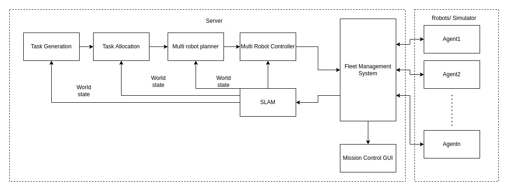

# RoboSAR ROS1 packages

本目录保存 RoboSAR 搜救系统的 ROS1 Noetic 包。系统由多机器人接入、Gazebo/Webots
场景上下文、SLAM、任务生成与分配、导航、交通控制、Mission Control GUI 和应急响应组
组成。原项目资料可参考 [RoboSAR 项目网站](https://mrsdprojects.ri.cmu.edu/2022teamf/)。

本文是包级架构索引，不是当前平台启动手册，也不建议操作者逐个手工启动节点。当前入口
以 [`masar_ws/README.md`](../../README.md) 为准；统一 Web 平台的部署、操作和停止流程见
[`masar-simulation-platform/docs/OPERATIONS.md`](../../../masar-simulation-platform/docs/OPERATIONS.md)。

## 当前运行入口

从 `masar_ws` 根目录使用以下聚合脚本：

| 入口 | 当前用途 |
|---|---|
| `launch_robosar_g.sh` | ROS1 + Gazebo/Tepper 探索组搜救闭环 |
| `launch_robosar_w.sh` | ROS1 侧 Webots RoboSAR 链；必须在 ROS2 `start_robosar_webots.sh` 就绪后启动 |
| `run_response_deform_demo.sh` | 4 台 Burger 响应组 DEFORM 编队导航验证 |
| `run_response_controller_demo.sh` | roundflocking/transport 控制器独立验证 |
| `run_tepper_response_demo.sh` | Gazebo/Tepper 探索组与响应组完整系统 |

统一平台会调用同一批脚本，并在一次 Run 中管理其全部业务、仿真、RViz 和录制进程。
平台模式禁用该 Run 内的 Qt GUI；直接运行上述原生入口时 Qt GUI 继续保留。不要在平台
存在活动 Run 时再手工启动第二套 ROS 图或仿真器。

## 主任务链

```text
机器人与仿真接入
-> 多机器人 SLAM 与 /sim_map
-> frontier/coverage 任务生成
-> HIGH 任务分配
-> mission executive 与路径规划
-> 多机器人交通控制
-> Qt GUI 或统一 Web 平台控制与观测
```

完整搜救会在此基础上加入应急对象、任务队列和 4 台 Burger 响应组。响应组当前只有一条
生产运行链：共享编队中心规划、连续形变槽位、导航/任务控制切换和唯一最终
`/tb_i/cmd_vel` 输出。实现与限制见
[`ROBOSAR_DEFORM_INTEGRATION_DESIGN.md`](../../docs/ROBOSAR_DEFORM_INTEGRATION_DESIGN.md)。

## 包职责

| 包 | 职责 |
|---|---|
| `robosar_agent_bringup` | 机器人/仿真 agent 接入，以及 scan、odom、cmd_vel 话题 |
| `robosar_sim_bringup` | Gazebo/Webots 场景上下文、静态地图和仿真对象 |
| `robosar_SLAM_toolbox` | 项目内定制的多机器人 SLAM launch/config |
| `robosar_task_generator` | frontier、coverage 和应急对象相关任务生成 |
| `robosar_task_allocator` | HIGH 分配器、mission commander 和任务状态快照 |
| `robosar_navigation` | mission executive、MultiAStar 和路径执行 |
| `robosar_controller` | 多机器人交通控制、避碰和任务运动门 |
| `robosar_gui` | 原生 Mission Control Qt GUI |
| `robosar_emergency_response` | 应急任务、响应组编队导航、控制切换和返航 |
| `robosar_messages` | 搜救、应急对象和响应组自定义消息 |



## 文档边界

- 本文件只解释 `src/robosar` 的当前组成和权威入口。
- `src/robosar/*/README.md` 可能是包级说明、第三方项目原文或上游历史资料，不替代
  `masar_ws/README.md` 与平台运维手册。
- `robosar_SLAM_toolbox/README.md` 保留上游 Slam Toolbox 说明；它不是 MASAR 的启动指南。
- `docs/superpowers/` 保存已确认的设计/实施历史快照，不作为当前操作步骤。
